# Additivity experiment (issue #260)

An opt-in, offline experiment. It asks whether cached single-cut output deltas
can rank pruning bundles more economically than Ockham's current selection.

It is disabled in ordinary runs, changes no default and adds no `OckhamConfig`
field or flag. It never accepts or publishes a creature: predictions only order
candidates for evaluation, and the full-corpus scorer is the only acceptance
authority. Nothing is written to a population, a journal or the learnings store.

## Purpose

Ockham scores each cut and each bundle with the full-corpus scorer, which is
expensive. If a cheap prediction could order the bundles so that the
full-scorer budget lands on better candidates, the same budget would find
better pruning. This experiment measures whether that holds for Ockham's
forward-only creatures, under a predeclared protocol, without adopting anything.

## Source and caveat

The hypothesis comes from arXiv 2611.07487v2, "When Does Blockwise Additivity
Break?" (revised 11 November 2026). That paper studies block replacement with
additive logit predictors.

- Transfer to forward-only creatures and to compensated pruning is a
  **hypothesis**, not a result.
- The paper's most aggressive case (DeiT-B) favours random ranking over the
  additive predictor. The experiment therefore includes a random arm as a
  control rather than assuming the prediction helps.
- No validated benefit is claimed. A run on fixtures proves only that the
  mechanics work.

## The pipeline

```mermaid
flowchart TD
    M[Manifest: parents, corpora, scorer, budgets, seeds, decision rule] --> L[Load and validate, MSE only]
    L --> P[For each parent: baseline via establish_baseline]
    P --> S[Activation stats, default sample, computed fresh each run]
    S --> C[Deterministic audit core: ceil core_fraction x records]
    C --> K[Cache key: parent, dataset digest, ranges, cut semantics, stats digest, scorer, cost, versions]
    K --> E[Singles: prune_hidden_group per hidden neuron, refusals recorded]
    E --> O[Cache entries: targets, y0, one per proposable single, chunk by chunk]
    O --> R[For each budget and seed: audit pool of distinct bundles]
    R --> Q[Materialise audit pool, dedupe by creature digest]
    Q --> A[Audit estimates: additiveLoss diagnostic, cachedOutput prediction]
    A --> F[Audit: one full-scorer call over every unique audit bundle]
    F --> T[Audit rankings of the four arms scored against audit truth, audit creatures dropped]
    T --> SP[Search pool: own seed, same size, materialised and estimated, never fully scored]
    SP --> G[Arms: current, additiveLoss, cachedOutput, random rank the search pool]
    G --> H[Search: each arm full-scores its top picks, batched or one per pick under searchWallClockMs]
    H --> V[Selected = best full score among within-budget picks; predictions never choose]
    V --> X[Optional held-out score of selections]
    X --> REP[Report JSON: rows, cache stats, aggregates, beating cases]
```



## Manifest

The manifest is application-agnostic. Every field is shown; optional fields
are marked. Relative paths resolve against the manifest's directory, and
unknown fields are refused.

```json
{
  "formatVersion": 1,
  "parents": ["parents/elite-001.json", "parents/elite-002.json"],
  "trainingData": "corpus/train",
  "validationData": "corpus/held-out",
  "scorer": { "binary": "rust_scorer", "args": ["--cost", "MSE"] },
  "cost": "MSE",
  "seeds": [1, 2, 3],
  "coreFraction": 0.02,
  "budgets": [0.1, 0.2, 0.3, 0.4],
  "auditPool": 16,
  "fullEvaluations": 4,
  "searchWallClockMs": 600000,
  "topK": 3,
  "minImprovement": 0.0,
  "decisionRule": "Adopt a predictor only if its selected full score beats current on at least 80 per cent of (parent, seed) pairs at the 0.2 budget, with no regression in the held-out score.",
  "limits": { "maxCacheBytes": 2147483648, "chunkRecords": 4096 },
  "cacheDir": "bench-cache"
}
```

| Field | Required | Meaning |
| --- | --- | --- |
| `formatVersion` | yes | Must be `1`. |
| `parents` | yes | 1 to 64 distinct immutable creature files. Never written. |
| `trainingData` | yes | Training corpus directory of `.bin` files. |
| `validationData` | no | Held-out corpus. Scored only for reporting; never used to rank or select. |
| `scorer.binary` | yes | Scorer executable. A path with a separator resolves against the manifest directory. |
| `scorer.args` | no | Extra scorer arguments; part of the cache key. |
| `cost` | yes | Must be `"MSE"` (case-sensitive). See "Cost" below. |
| `seeds` | yes | 1 to 32 distinct seeds. |
| `coreFraction` | no | Fraction of the corpus used as the audit core. Default `0.02`. |
| `budgets` | no | 1 to 8 strictly ascending fractions in (0, 1]. Default `[0.1, 0.2, 0.3, 0.4]`. A budget `b` removes `ceil(b × hidden neurons)`. |
| `auditPool` | yes | Requested size of the audit pool and of the search pool, per (parent, budget, seed). 2 to 64. |
| `fullEvaluations` | yes | Per-arm full-scorer budget `E`, between 1 and `auditPool`: each arm full-scores at most `E` search-pool picks. |
| `searchWallClockMs` | no | Per-arm wall-clock budget in milliseconds, 1 to 604800000 (7 days). Absent means no budget: each arm's picks go in one batched scorer call. With a budget, each arm scores one pick per call, in ranking order, and starts a new call only while its charged time plus scorer time is below the budget. The last call may end past the budget: its pick is recorded as not within budget and cannot be selected. Charged time is the arm's own proposals, cache build and reads, search-pool materialisation and ranking. |
| `topK` | no | Audit recall depth: the top-ranked bundles per arm counted by top-k recall. It does not bound full scoring; `fullEvaluations` does. Default `3`. |
| `minImprovement` | yes | Non-negative promotion threshold used by the audit. |
| `decisionRule` | yes | Predeclared adoption rule, echoed verbatim. At most 2000 characters. |
| `limits.maxCacheBytes` | yes | Byte cap on each output-cache key directory (one per parent and key). Invalidated directories are not deleted, so the cache root as a whole is not capped. |
| `limits.chunkRecords` | yes | Records per streamed chunk, between 1 and 1,000,000. |
| `cacheDir` | yes | Root of the output cache (`outputs/`) and the scoring workspace (`workspace/`). No stats cache or learnings file is written. |

The decision rule is written before the run and echoed into the report. Change
it only by writing a new manifest.

## Running

```sh
neat_ai_ockham bench-additivity manifest.json --out report.json
```

The command prints one line, `{"report", "rows", "representative"}`, and writes
the full report to `--out`. On error it prints the message to stderr and exits 1. A `--out` that names the manifest, a parent or the scorer, or lies inside a corpus, is refused before any scorer call. A non-MSE cost is refused while the manifest is validated, before any parent or corpus file is read.

Use `cargo test -p neat_ai_ockham --test additivity_bench` to exercise the
pipeline against an in-test faithful scorer.

## The four arms

Each arm ranks two pools of unique materialised bundles, both of requested size
`auditPool`. The audit pool is fully scored, and each arm's ranking of it is
measured against that truth. The search pool is only estimated. Every arm ranks
the same search pool, so the selections are paired. Both pools start with
Ockham's ranked prefix at pool position 0, then seeded distinct draws, so they
can share bundles.

- **current**: Ockham's ranked prefix first, then the remaining pool bundles in
  emission order. The ranked prefix is the top `k` singles of the all-winners
  plan that `promote::bundle_plans` emits: every proposable single with delta
  `L0 − Li`, sorted descending, ties by UUID, unestimated singles last. The
  remaining pool bundles are the seeded draws, in the order they were emitted.
  In an ordinary run, Ockham's member deltas come from scorer screening. The
  bench gives every arm the same core-sample deltas, so the comparison isolates
  ordering.
- **additiveLoss** (diagnostic only): ranks by `−Σ(Li − L0)`. It is reported
  to compare against the cached prediction and never selects anything on its
  own.
- **cachedOutput**: ranks by `L0 − loss(y0 + Σ(yi − y0))`, the predicted
  improvement from cached single-cut outputs, streamed chunk by chunk.
- **random**: a seeded permutation of each pool, drawn separately for the audit
  ranking and the search ranking. It is the control: a predictor that does not
  beat random has not earned its cost.

Each arm full-scores its top `fullEvaluations` picks from the search pool. With
no `searchWallClockMs`, those picks go in one batched scorer call. With one, the
arm makes one call per pick, in ranking order. It starts a call only while its
charged time plus scorer time is below the budget, so the last call may end past
it. That pick still counts in `costMs` but is marked `withinBudget: false` and
cannot be selected. The selected bundle is the best full score among the
within-budget picks, ties to the lower search-pool index. If no pick is within
budget, nothing is selected. The prediction orders the picks; it never chooses
the winner.

Predicted improvements are core loss reductions `L0 − loss`, in MSE units. The
promotion audit compares each prediction with the bundle's full-corpus error
reduction, `parent full error − bundle full error`, in the same units. So
`minImprovement` tests error, not score: the score also subtracts the structural
penalty, which the promotion audit does not use. The ranking metrics (Spearman,
top-k recall, regret) use the full-corpus score truth of the audit pool.

## Cache

Entries hold network outputs as raw little-endian `f32`, record-major. They
cover one deterministic audit core: `ceil(coreFraction × records)` records
planned with `SampleSpec::with_max_records`, identical for every arm and seed.

Entries are `targets`, `y0` (the parent's outputs) and one `cut-<digest>` per
proposable single (the single child's outputs, with the single's activation
mean folded in). The activation means are measured fresh on every run, with the
default sample, and never read from a stats cache.

### Key

The cache directory is named by the SHA-256 of the canonical key. A key
changes whenever any of these change:

- format version of the entry layout;
- parent checksum;
- dataset digest, a SHA-256 over every selected record's inputs and targets;
- corpus identity;
- record-range digest and record count;
- input and output widths;
- cut semantics: `prune_hidden_group` single member, mean fold from the stats
  sample tag;
- stats digest: a SHA-256 over the ordered `(uuid, mean)` list handed to the
  pruning step for every hidden neuron, with a missing mean kept distinct from
  any present one;
- the pinned `neat-core` line;
- the Ockham crate version;
- scorer identity and arguments;
- cost function name.

A changed record inside the audit core therefore opens a new directory and
rebuilds. A changed activation mean, however it came about, changes the stats
digest and so opens a new directory too. An existing key file must match
exactly, or the cache refuses to open it. A `key.json` over 64 KiB is refused
before it is read.

### Invalidation and rejections

A rejected entry means **no estimate**, never a loss. Rejection kinds are
counted per parent:

- `nonFinite`: a NaN or infinite value;
- `mismatched`: the wrong byte count;
- `overLimit`: the write would exceed `maxCacheBytes`;
- `missing`, `io`: absent or unreadable entry.

If `targets` or `y0` cannot be cached, every estimate for that parent is
`None` and the report says why (`estimateBlocked`). The run continues.

## Resource bounds

- RAM is one cache entry accumulator, fixed chunk buffers, at most `auditPool`
  materialised bundle creatures, and the parent. It is never neurons × records ×
  outputs. Each single's creature is dropped as soon as its cache entry is built.
  The audit pool's creatures are dropped before the search pool is materialised,
  so the two pools never coexist. The reported `ramBoundBytes` covers the
  accumulator and chunk buffers only,
  as `chunkRecords × 4 × (inputs + outputs + 4 × outputs) + coreRecords × outputs
  × 4` bytes: the corpus stream's input and target chunks, four bench-owned
  chunk buffers, and one predicted-output accumulator the size of a cache entry.
- `measuredPeakRssBytes` is the bench process's own peak resident set (`VmHWM`
  from `/proc/self/status`). The top-level value is read at the end of the run.
  Each `rows[]` entry carries the same measure read at the end of that row. Each
  reading is the process's `VmHWM` as the kernel reports it at that point, which
  is approximate, so successive readings are not guaranteed to be monotone from
  one row to the next. Both are `null` where the file is unavailable, or its
  `VmHWM` line is missing or malformed. They exclude the external scorer child
  processes.
- At most three cache files are open at once. A cached-output estimate holds
  two at most: one bundle member and a fresh `y0` reader, both closed before the
  next member. The targets reader is opened last, alone. Each reader holds one
  chunk at a time.
- The accumulator is allocated once per parent and reused for every bundle.
- Each output-cache key directory is capped at `maxCacheBytes`. A write that
  would take that directory over the cap is refused before any byte is written.
  Directories of invalidated keys are not deleted, so the cache root as a whole
  is not capped.

## Cost

Only `"MSE"` is accepted. The cost is `neat_core::loss::mse_record`, the
canonical per-record cost shared with the family. Other costs need a per-record
cost API in NEAT-AI-core, which does not yet export one. The manifest refuses
any other cost rather than approximating it.

## Report

The report is JSON in camelCase.

- `formatVersion` (now `2`), `manifest` (the predeclared protocol echoed),
  `representative`, `evidence`, `authority`, `measuredPeakRssBytes`.
- `parents[]`: baseline score, error and penalty; hidden neuron count; core
  records; proposable and estimated singles; `failedProposals` (uuid and core's
  reason); `estimateBlocked`; `singlesMs`; and `cache` (hits, builds,
  rejections by kind, bytes used, peak bytes, `maxCacheBytes`,
  `ramBoundBytes`, build and read milliseconds).
- `rows[]`, one per (parent, budget, seed): `requestedRemovals`, `feasible`,
  `reason`, `eligible`, `poolRequested`, `poolSize` (materialised audit-pool
  bundles, duplicates included; refusals are counted only in `refused`),
  `duplicates` (each with the `duplicateOf` index and the shared
  `creatureDigest`), `refused`, `bundles[]`, `audit` (full calls, record
  evaluations, milliseconds), `poolMaterialisationMs` and `estimateMs` (both for
  the audit pool), `validationParentScore`, `search` and `arms[]`.
- `search` is the search pool: `requested`, `size`, `duplicates`, `refused`,
  `bundles[]`, `materialisationMs` and `estimateMs`. It is `null` for infeasible
  rows. Its `bundles[]` entries record `index`, `members`, `overlaps`,
  `missing`, `cascadeNeurons`, `splicedNeurons` (the same structural-removal
  diagnostics as the audit bundles, so a search bundle the audit pool never
  drew still names every neuron its cut removed), `hiddenRemoved`,
  `synapsesRemoved`, `growthUnitsRemoved`, `meetsBudget`, `creatureDigest`,
  `additiveLoss` and `cachedOutput`. Search bundles have no full score, since
  they are never scored as a whole.
- Each audit `bundles[]` entry records members, `overlaps` (members an earlier
  member's cascade, constant fold or splice already took), `missing`,
  `cascadeNeurons` (every neuron the cut stranded beyond the request: the
  cleanup cascade plus neurons folded into constant support),
  `splicedNeurons` (hidden pass-throughs the cleanup spliced out, their
  sources wired straight into their targets), hidden, synapse and
  growth-unit reductions, `meetsBudget`, `creatureDigest`, full `score`,
  `error`, `complexityPenalty` (kept separate from the score), `truthDelta`,
  `additiveLoss` and `cachedOutput`.
- Each `arms[]` entry records `ranking` (over the audit pool) and the audit
  metrics (spearman, top-k recall, regret, false promotions and rejections,
  unestimated count); `searchRanking` (over `search.bundles`); `picks`, each
  with its `bundle` index into `search.bundles`, its search score and its
  `withinBudget` flag (always true without `searchWallClockMs`); `stoppedBy`
  (`fullEvaluations`, `poolExhausted` or `wallClock`); `selectedBundle`, an index
  into `search.bundles`, with its score, error, penalty, delta, `selectedRegret`,
  `selectedHiddenRemoved` and `selectedSynapsesRemoved`; `validationScore`;
  `fullScorerCalls`; `recordEvaluations`; `costMs`; and `inferenceLatencyMs`.
  Each row also records `measuredPeakRssBytes`, the peak-resident-set reading
  described under Memory above, taken at the end of that row.
- `selectedRegret` is paired: the best `selectedScore` among the row's arms
  minus this arm's. The audit's own regret stays in `audit.regret`.
- `fullScorerCalls` is 1 for a batched call, one per pick under
  `searchWallClockMs`, and 0 when the budget was spent before the first pick.
- `selectedBundle` is `null` when no pick is within budget, including when no
  pick was scored.
- For the two predictor arms, `inferenceLatencyMs` is the measured prediction
  time (the additive sum for additiveLoss, the streamed prediction for
  cachedOutput) divided by the search-pool bundles that had an estimate. It is
  `null` for the other arms, and when no search-pool bundle had an estimate.
- `aggregate[]`, one per budget: distributions over feasible rows of spearman,
  top-k recall, paired regret (`selectedRegret`), selected delta and total
  milliseconds per arm, plus paired comparisons of cachedOutput against current
  and against random over (parent, seed). Under `searchWallClockMs` an arm can
  finish a feasible row with no selection. Each arm therefore carries
  `rowsWithoutSelection`, the feasible rows in which it selected nothing; its
  `regret` and `selectedDelta` distributions cover only its other rows. Each
  paired comparison needs a selection from cachedOutput and from the arm it is
  compared with, and is independent of the other arm, so
  `pairedRowsExcludedVsCurrent` and `pairedRowsExcludedVsRandom` count the
  feasible rows each one leaves out.
- `casesBeatingCachedOutput[]`: every case where current or random selected a
  strictly better full score than cachedOutput, and every case where current or
  random selected while cachedOutput selected nothing (a loss for cachedOutput,
  listed with a null `cachedOutputScore`). These are listed in full, not
  summarised, so negative findings are visible.

Scores are never summed across bundles. The audit's full-scorer call is
reported apart from the economics.

## Cost attribution

`costMs` per arm is the sum of six parts.

- `singleProposals` and `cacheBuild`: parent-level one-off costs, charged to
  arms that rank by singles (current, additiveLoss, cachedOutput).
- `cacheReadInference`: reading single losses for those arms, plus the search
  pool's estimate time: the additive sum for additiveLoss, and the streamed
  cached-output prediction for cachedOutput. The additive sum is charged to
  additiveLoss only.
- `poolMaterialisation`: the search pool's materialisation, shared by every arm.
  The audit pool's materialisation is charged to no arm. It is reported at row
  level as `poolMaterialisationMs`.
- `ranking`: ordering the search pool.
- `scorer`: the arm's own search scorer calls, one batched call or one per pick
  under `searchWallClockMs`.

With `searchWallClockMs`, the first five parts are fixed before the first pick.
Each pick then adds its scorer time. A new call starts only while charged plus
scorer time is below the budget, so the last call may end past it. Its time
still counts in `scorer`, and its pick is marked `withinBudget: false`.
`costMs.total` is the sum of all six parts.

Random is charged pool materialisation, its own ranking and its own scorer
calls. It is not charged single proposals, cache builds or cache reads. Its pool
still needs the proposability screen, but that screen is shared and is reported
at parent level, so random's cost is understated by exactly that screen. The
record evaluations for singles count core records times the entries built, and
they are charged to the arms that rank by singles.

## Status

- **No representative run has been done.** The protocol requires 20 elite
  parents. A run over fewer parents is fixture-only and is not evidence.
- **No conclusion is drawn.** Fixture runs check that the mechanics work
  (cache reuse and invalidation, rejection fallback, selection from picks,
  scoring-directory cleanup). They say nothing about whether prediction helps.
- **Negative findings must be recorded, and the code removed if they do not
  earn the maintenance cost.** If a representative run shows that random or
  current matches or beats cachedOutput, the experiment's conclusion is
  negative. The code should then be removed rather than kept as an option.
- **Private datasets and results stay outside the repository.** Manifests may
  point at them, but neither the corpora nor the reports are committed.
