# Additivity experiment (issue #260)

An opt-in, offline experiment. It asks whether cached single-cut output deltas
can rank pruning bundles more economically than Ockham's current selection.

It is disabled in ordinary runs, changes no default and adds no `OckhamConfig`
field or flag. It never accepts or publishes a creature: predictions only order
candidates for evaluation, and the full-corpus scorer is the only acceptance
authority. Nothing is written to a population, a journal or the learnings store.

## Purpose

Ockham scores each cut and each bundle with the full-corpus scorer, which is
expensive. If a cheap prediction could order the bundles so that the
full-scorer budget lands on better candidates, the same budget would find
better pruning. This experiment measures whether that holds for Ockham's
forward-only creatures, under a predeclared protocol, without adopting anything.

## Source and caveat

The hypothesis comes from arXiv 2611.07487v2, "When Does Blockwise Additivity
Break?" (revised 11 November 2026). That paper studies block replacement with
additive logit predictors.

- Transfer to forward-only creatures and to compensated pruning is a
  **hypothesis**, not a result.
- The paper's most aggressive case (DeiT-B) favours random ranking over the
  additive predictor. The experiment therefore includes a random arm as a
  control rather than assuming the prediction helps.
- No validated benefit is claimed. A run on fixtures proves only that the
  mechanics work.

## The pipeline

```mermaid
flowchart TD
    M[Manifest: parents, corpora, scorer, budgets, seeds, decision rule] --> L[Load and validate, MSE only]
    L --> P[For each parent: baseline via establish_baseline]
    P --> S[Activation stats, default sample, cached under cache_dir/stats]
    S --> C[Deterministic audit core: ceil core_fraction x records]
    C --> K[Cache key: parent, dataset digest, ranges, cut semantics, scorer, cost, versions]
    K --> E[Singles: prune_hidden_group per hidden neuron, refusals recorded]
    E --> O[Cache entries: targets, y0, one per proposable single, chunk by chunk]
    O --> R[For each budget and seed: pool of distinct bundles]
    R --> Q[Materialise bundles, dedupe by creature digest]
    Q --> A[Estimates: additiveLoss diagnostic, cachedOutput prediction]
    A --> F[Audit: one full-scorer call over every unique bundle]
    F --> G[Arms: current, additiveLoss, cachedOutput, random rank the pool]
    G --> H[Search: each arm full-scores its own top-E picks in a separate call]
    H --> V[Selected = best full score among picks; predictions never choose]
    V --> X[Optional held-out score of selections]
    X --> REP[Report JSON: rows, cache stats, aggregates, beating cases]
```



## Manifest

The manifest is application-agnostic. Every field is shown; optional fields
are marked. Relative paths resolve against the manifest's directory, and
unknown fields are refused.

```json
{
  "formatVersion": 1,
  "parents": ["parents/elite-001.json", "parents/elite-002.json"],
  "trainingData": "corpus/train",
  "validationData": "corpus/held-out",
  "scorer": { "binary": "rust_scorer", "args": ["--cost", "MSE"] },
  "cost": "MSE",
  "seeds": [1, 2, 3],
  "coreFraction": 0.02,
  "budgets": [0.1, 0.2, 0.3, 0.4],
  "auditPool": 16,
  "fullEvaluations": 4,
  "topK": 3,
  "minImprovement": 0.0,
  "decisionRule": "Adopt a predictor only if its selected full score beats current on at least 80 per cent of (parent, seed) pairs at the 0.2 budget, with no regression in the held-out score.",
  "limits": { "maxCacheBytes": 2147483648, "chunkRecords": 4096 },
  "cacheDir": "bench-cache"
}
```

| Field | Required | Meaning |
| --- | --- | --- |
| `formatVersion` | yes | Must be `1`. |
| `parents` | yes | 1 to 64 distinct immutable creature files. Never written. |
| `trainingData` | yes | Training corpus directory of `.bin` files. |
| `validationData` | no | Held-out corpus. Scored only for reporting; never used to rank or select. |
| `scorer.binary` | yes | Scorer executable. A path with a separator resolves against the manifest directory. |
| `scorer.args` | no | Extra scorer arguments; part of the cache key. |
| `cost` | yes | Must be `"MSE"` (case-sensitive). See "Cost" below. |
| `seeds` | yes | 1 to 32 distinct seeds. |
| `coreFraction` | no | Fraction of the corpus used as the audit core. Default `0.02`. |
| `budgets` | no | 1 to 8 strictly ascending fractions in (0, 1]. Default `[0.1, 0.2, 0.3, 0.4]`. A budget `b` removes `ceil(b × hidden neurons)`. |
| `auditPool` | yes | 2 to 64 bundles per (parent, budget, seed). |
| `fullEvaluations` | yes | Per-arm full-scorer budget `E`, between 1 and `auditPool`. |
| `topK` | no | Top-ranked bundles counted by top-k recall. Default `3`. |
| `minImprovement` | yes | Non-negative promotion threshold used by the audit. |
| `decisionRule` | yes | Predeclared adoption rule, echoed verbatim. At most 2000 characters. |
| `limits.maxCacheBytes` | yes | Hard byte cap on the output cache. |
| `limits.chunkRecords` | yes | Records per streamed chunk, between 1 and 1,000,000. |
| `cacheDir` | yes | Root of the cache, the stats cache and the scoring workspace. |

The decision rule is written before the run and echoed into the report. Change
it only by writing a new manifest.

## Running

```bash
neat_ai_ockham bench-additivity manifest.json --out report.json
```

The command prints one line, `{"report", "rows", "representative"}`, and writes
the full report to `--out`. On error it prints the message to stderr and exits 1. A non-MSE cost is refused while the manifest is validated, before any parent or corpus file is read.

Use `cargo test -p neat_ai_ockham --test additivity_bench` to exercise the
pipeline against an in-test faithful scorer.

## The four arms

Every arm ranks the same pool of unique materialised bundles. Ockham's ranked
prefix is always pool position 0.

- **current**: Ockham's own order. The pool's first `k` bundles are the top
  `k` eligible singles, ranked by single improvement `L0 − Li` descending, ties
  by UUID, unestimated singles last. Later pool entries are seeded draws in
  rank order. The arm keeps the emission order unchanged.
- **additiveLoss** (diagnostic only): ranks by `−Σ(Li − L0)`. It is reported
  to compare against the cached prediction and never selects anything on its
  own.
- **cachedOutput**: ranks by `L0 − loss(y0 + Σ(yi − y0))`, the predicted
  improvement from cached single-cut outputs, streamed chunk by chunk.
- **random**: a seeded permutation of the pool. It is the control: a predictor
  that does not beat random has not earned its cost.

Each arm sends its top `E` picks to a separate full-scorer call. The selected
bundle is the best full score among those picks, ties to the lower pool index.
The prediction orders the picks; it never chooses the winner.

Predicted improvements are loss units, while the audit compares truth in score
units (`1 − error − penalty`). The two agree only approximately, because the
score also subtracts the structural penalty. The audit's `minImprovement` test
applies to whichever units the arm predicts in.

## Cache

Entries hold network outputs as raw little-endian `f32`, record-major. They
cover one deterministic audit core: `ceil(coreFraction × records)` records
planned with `SampleSpec::with_max_records`, identical for every arm and seed.

Entries are `targets`, `y0` (the parent's outputs) and one `cut-<digest>` per
proposable single (the single child's outputs, with the single's activation
mean folded in).

### Key

The cache directory is named by the SHA-256 of the canonical key. A key
changes whenever any of these change:

- format version of the entry layout;
- parent checksum;
- dataset digest, a SHA-256 over every selected record's inputs and targets;
- corpus identity;
- record-range digest and record count;
- input and output widths;
- cut semantics: `prune_hidden_group` single member, mean fold from the stats
  sample tag;
- the pinned `neat-core` line;
- the Ockham crate version;
- scorer identity and arguments;
- cost function name.

A changed record inside the audit core therefore opens a new directory and
rebuilds. An existing key file must match exactly, or the cache refuses to
open it.

### Invalidation and rejections

A rejected entry means **no estimate**, never a loss. Rejection kinds are
counted per parent:

- `nonFinite`: a NaN or infinite value;
- `mismatched`: the wrong byte count;
- `overLimit`: the write would exceed `maxCacheBytes`;
- `missing`, `io`: absent or unreadable entry.

If `targets` or `y0` cannot be cached, every estimate for that parent is
`None` and the report says why (`estimateBlocked`). The run continues.

## Resource bounds

- RAM is bounded by one cache entry plus fixed chunk buffers, never by
  neurons × records × outputs. The reported `ramBoundBytes` is
  `chunkRecords × 4 × (inputs + outputs + 4 × outputs) + coreRecords × outputs
  × 4` bytes: the corpus stream's input and target chunks, four bench-owned
  chunk buffers, and one predicted-output accumulator the size of a cache entry.
- At most three cache files are open at once. A cached-output estimate holds
  two at most: one bundle member and a fresh `y0` reader, both closed before the
  next member. The targets reader is opened last, alone. Each reader holds one
  chunk at a time.
- The accumulator is allocated once per parent and reused for every bundle.
- Disk use is capped by `maxCacheBytes`. A write that would exceed it is
  refused before any byte is written.

## Cost

Only `"MSE"` is accepted. The cost is `neat_core::loss::mse_record`, the
canonical per-record cost shared with the family. Other costs need a per-record
cost API in NEAT-AI-core, which does not yet export one. The manifest refuses
any other cost rather than approximating it.

## Report

The report is JSON in camelCase.

- `formatVersion`, `manifest` (the predeclared protocol echoed),
  `representative`, `evidence`, `authority`.
- `parents[]`: baseline score, error and penalty; hidden neuron count; core
  records; proposable and estimated singles; `failedProposals` (uuid and core's
  reason); `estimateBlocked`; `singlesMs`; and `cache` (hits, builds,
  rejections by kind, bytes used, peak bytes, `maxCacheBytes`,
  `ramBoundBytes`, build and read milliseconds).
- `rows[]`, one per (parent, budget, seed): `requestedRemovals`, `feasible`,
  `reason`, `eligible`, `poolRequested`, `poolSize`, `duplicates`, `refused`,
  `bundles[]`, `audit` (full calls, record evaluations, milliseconds),
  `poolMaterialisationMs`, `estimateMs`, `validationParentScore` and `arms[]`.
- Each `bundles[]` entry records members, `overlaps` (members an earlier
  cascade already took), `missing`, `cascadeNeurons`, hidden, synapse and
  growth-unit reductions, `meetsBudget`, `creatureDigest`, full `score`,
  `error`, `complexityPenalty` (kept separate from the score), `truthDelta`,
  `additiveLoss` and `cachedOutput`.
- Each `arms[]` entry records `ranking`, the audit metrics (spearman, top-k
  recall, regret, false promotions and rejections, unestimated count), `picks`
  with their search scores, the selected bundle and its score, error, penalty,
  delta, regret and reductions, `validationScore`, `fullScorerCalls`,
  `recordEvaluations` and `costMs`.
- `aggregate[]`, one per budget: distributions over feasible rows of spearman,
  top-k recall, regret, selected delta and total milliseconds per arm, plus
  paired comparisons of cachedOutput against current and against random over
  (parent, seed).
- `casesBeatingCachedOutput[]`: every case where current or random selected a
  strictly better full score than cachedOutput. These are listed in full, not
  summarised, so negative findings are visible.

Scores are never summed across bundles. The audit's full-scorer call is
reported apart from the economics.

## Cost attribution

`costMs` per arm is the sum of six parts.

- `singleProposals` and `cacheBuild`: parent-level one-off costs, charged to
  arms that rank by singles (current, additiveLoss, cachedOutput).
- `cacheReadInference`: reading single losses for those arms, plus streamed
  cached-output prediction for cachedOutput.
- `poolMaterialisation`: shared by every arm.
- `ranking`: ordering the pool.
- `scorer`: the arm's own search call.

Random is charged pool materialisation only. Its pool still needs the
proposability screen, but that screen is shared and is reported at parent
level, so random's cost is understated by exactly that screen. The record
evaluations for singles count core records times the entries built, and they
are charged the same way.

## Status

- **No representative run has been done.** The protocol requires 20 elite
  parents. A run over fewer parents is fixture-only and is not evidence.
- **No conclusion is drawn.** Fixture runs check that the mechanics work
  (cache reuse and invalidation, rejection fallback, selection from picks,
  scoring-directory cleanup). They say nothing about whether prediction helps.
- **Negative findings must be recorded, and the code removed if they do not
  earn the maintenance cost.** If a representative run shows that random or
  current matches or beats cachedOutput, the experiment's conclusion is
  negative. The code should then be removed rather than kept as an option.
- **Private datasets and results stay outside the repository.** Manifests may
  point at them, but neither the corpora nor the reports are committed.
