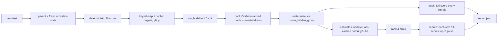

# PR summary — Issue #260: rank pruning bundles using cached output deltas

## Summary

Adds an opt-in, offline benchmark, `neat_ai_ockham bench-additivity <manifest.json> --out <report.json>`.
It tests whether cached single-cut output deltas can rank pruning bundles
more cheaply than current Ockham selection.

The harness works like this:

- It reads a predeclared manifest of parents, corpora, scorer, seeds, budgets,
  audit pool, per-arm full-evaluation budget, decision rule and resource limits.
- It picks one deterministic 2 % record core per parent and caches the parent
  outputs `y0` and every single-cut child output `yi` under a strong key.
- It predicts each bundle's loss as `y0 + Σ(yi − y0)` through
  `neat_core::loss::mse_record`.
- It compares four arms (current, additive loss, cached output, random) on
  identical materialised pools. A ranking audit fully scores every pool bundle.
  A separate search phase gives each arm the same full-evaluation budget.
- The output is a machine-readable report.

Ordinary runs, their defaults and acceptance are unchanged. Predictions only
order candidates; the full-corpus scorer stays the only judge, and the bench
writes no creature to any population, journal or learnings store.

No representative 20-elite run has been done, because the elite manifest and
the private corpora are not in this execution environment. The experiment's
outcome is therefore still open. Part of #260.

## Spec

### Intent and Rationale

- The issue asks for an experiment harness, not a change to acceptance. The
  code lives in its own module (`ockham/src/additivity/`) and its own
  subcommand, so nothing in the ordinary run path calls it.
- Bundle loss is computed only through `neat_core::loss::mse_record`, the
  per-record cost NEAT-AI-core already exports. This keeps the scorer's cost
  and penalty logic in one place. Fitness scores are never summed, and each
  materialised bundle's actual `complexityPenalty` is recorded from the scorer.
- Every bundle is built through the existing core rewrite path,
  `prune_hidden_group`, with mean fold and cleanup, so cascades and overlaps
  are real rather than modelled.

### Essential Design Decisions

- **MSE only.** Any other manifest `cost` is refused. NEAT-AI-core exports a
  per-record API only for MSE (`mse_record`), and the issue forbids
  duplicating scorer cost logic. A scorer result whose `costName` differs from
  the manifest also fails the run.
- **The "current" arm is defined, not copied.** It is Ockham's ranked prefix
  (from `promote::bundle_plans`, the all-winners plan) first, then the rest of
  the pool in emission order. Every arm uses the same core-sample single
  deltas, so the comparison isolates ordering. The rest of the pool is seeded
  random k-member draws; no exhaustive enumeration is attempted.
- **A missing estimate is never a loss.** A cache rejection (non-finite,
  mismatched, over the byte limit, or IO) leaves the bundle unestimated.
  `rank_by_estimate` keeps it in its current-order slot, and the audit counts
  it as `unestimated`.
- **The cache key covers everything the outputs depend on.** It includes:
  - the parent checksum and a SHA-256 over the exact core records' bytes, so
    it does not rely on the corpus head/tail fingerprint alone;
  - the ordered-ranges digest, the widths and the cut semantics;
  - a digest of the folded activation means (stats are computed fresh on each
    run, never served from a head/tail-keyed cache);
  - the neat-core pin, the Ockham version, the scorer identity and arguments,
    and the cost.

  The key shape is versioned (`CACHE_FORMAT_VERSION = 2`). RAM is bounded by
  one cache-entry accumulator, fixed chunk buffers and at most `auditPool`
  materialised creatures. At most three cache files are open at once.
- False-promotion and false-rejection counts compare predicted loss
  improvement with the actual full-corpus *error* reduction (same units).
  Ranking metrics use full scores.

### Undiscoverable Facts

- NEAT-AI-core's cleanup splices a single-input IDENTITY hidden neuron into a
  direct edge. A fixture built from those makes a "bundle" that never removes
  its second member. This was observed while writing the linear-delta test,
  so the fixtures use HARD_TANH neurons kept inside their linear band.
- The paper (arXiv 2611.07487v2) favours random ranking in its most aggressive
  DeiT-B case. No benefit is claimed for Ockham, and the docs say so.

## Evidence

The change is CLI and backend only; no UI file is touched. The pipeline is
documented in `docs/additivity-experiment.md`, together with the manifest,
the arms, the cache key, the resource bounds, the report fields, cost
attribution and the status.

- Tests run against an in-test `DirectoryScorer`, `FaithfulScorer` in
  `ockham/tests/additivity_bench.rs`. It stands in for the production
  `ExternalScorer` (`ockham/src/scorer.rs`) and follows that file's documented
  contract: `score = 1 − error − complexityPenalty`, one result per creature
  file, `costName` and `recordCount`. It computes the error from the real
  corpus through `mse_record`. The bench relies on two properties: per-file
  results, and the cost name being reported. The real `rust_scorer` was not
  run here.

## Acceptance Criteria

<!-- vibe-spec-review inputs="diff+issue-body" -->

- **met** — Deterministic tests cover exact independent linear deltas,
  nonlinear interaction failures, overlapping/cascading removals, cache
  invalidation and non-finite outputs — evidence:
  `ockham/src/additivity/predict.rs::exact_linear_deltas_predict_the_bundle_exactly`,
  `ockham/src/additivity/predict.rs::a_nonlinear_output_breaks_the_additive_prediction`,
  `ockham/src/additivity/predict.rs::a_cascade_shared_by_the_bundle_is_double_counted`,
  `ockham/src/additivity/cache.rs::changing_one_key_field_gives_a_fresh_directory_without_the_entry`,
  `ockham/tests/additivity_bench.rs::cache_is_reused_on_a_second_run_and_invalidated_by_a_changed_record`,
  `ockham/src/additivity/cache.rs::non_finite_values_are_refused_and_leave_no_file`,
  `ockham/src/additivity/predict.rs::non_finite_values_are_refused_with_their_index`
  — reviewer: met
- **met** — Tests prove approximate predictions cannot accept a creature or
  alter ordinary defaults — evidence:
  `ockham/tests/additivity_bench.rs::predictions_only_order_and_the_best_full_score_among_picks_selects`
  and
  `ockham/tests/additivity_bench.rs::end_to_end_reports_every_arm_and_leaves_the_parent_alone`
  — reviewer: partial — reason: after the review, the end-to-end test also
  asserts that a bench run leaves no `experiments.jsonl`, no learnings and no
  stats cache, so nothing an ordinary run reads. The parent bytes are
  unchanged. Ordinary defaults stay pinned by the existing unchanged
  `ockham/src/config.rs::defaults_match_the_charter`, and the diff adds no
  `OckhamConfig` field or flag.
- **met** — Existing quality gates pass; no unrelated mutation/fuzz discovery
  requirement — evidence: `./quality.sh` run on the final code, which printed
  "All quality checks passed!"; no mutation or fuzz work added — reviewer:
  missing — reason: the reviewer saw only the diff and could not run the gate.
  It was run here and passed.
- **met** — Reproducible command/manifest and machine-readable report are
  provided — evidence: `ockham/src/main.rs` (`bench-additivity`),
  `ockham/src/additivity/manifest.rs`,
  `ockham/src/additivity/bench_report.rs`, `docs/additivity-experiment.md` —
  reviewer: met
- **missing** — Representative 20-elite results are required before
  declaring this experiment successful; fixture-only tests are not
  experimental evidence — reviewer: partial — reason: no run over 20 elite
  parents has been done, because the elite manifest and the
  training/validation corpora are not in this execution environment. The
  report labels runs over fewer than 20 parents `fixture-only`, and nothing
  here declares success.
- **missing** — A negative outcome is documented and optional code is
  removed if it does not earn its maintenance cost — reviewer: partial —
  reason: there is no outcome until the representative run exists. The
  policy is in `docs/additivity-experiment.md` § Status, and the report keeps
  every case where random or current beats cached output.
- **unrequested** — manifest bounds (1–64 parents, ≤ 32 seeds, ≤ 8 budgets,
  `auditPool` 2–64, `decisionRule` ≤ 2000 characters, 1 MiB manifest cap) —
  reviewer: unrequested — reason: trust-boundary input validation that keeps
  the harness's disk, RAM and scorer cost bounded, as the issue's
  resource-limit section requires.
- **unrequested** — `SplitMix64` widened to `pub(crate)` in
  `ockham/src/ordering.rs` — reviewer: unrequested — reason: the random arm
  and the pool draws reuse the existing seeded generator instead of copying
  it.

Spec-reviewer partials that remain open in this diff: there is no wall-clock
budget per arm (only an equal full-evaluation budget); audit and search share
one seeded pool per seed rather than separate seed streams; and peak RAM is
reported as a computed bound, not a measured figure.

## Standards Review

<!-- vibe-standards-review inputs="diff+CODING-STANDARDS.md" -->

This repository has no `CODING-STANDARDS.md`. The reviewer used
`CONTRIBUTING.md`, `README.md` and the fleet standards.

- **violation** — Fail loud: `core_pin()` fell back silently — evidence:
  `ockham/src/additivity/cache.rs:83` — reason: fixed in this diff
  (`Result`, error names `ockham/Cargo.toml`; the test asserts `tag = "v`)
- **violation** — Fail loud: scorer cost and record count were not checked —
  evidence: `ockham/src/additivity/bench.rs:893` — reason: fixed in this diff
  (`check_report`; test
  `a_scorer_reporting_another_cost_fails_the_run_naming_it`)
- **violation** — The cache key omitted the folded activation means —
  evidence: `ockham/src/additivity/bench.rs:334` — reason: fixed in this diff
  (stats computed fresh; `stats_digest` key field; format version 2)
- **violation** — Docs said `maxCacheBytes` capped the whole cache — evidence:
  `docs/additivity-experiment.md:99` — reason: fixed in this diff (the cap is
  per key directory)
- **violation** — The RAM-bound docs ignored the creatures kept per single —
  evidence: `ockham/src/additivity/bench.rs:223` — reason: fixed in this diff
  (creatures dropped after each entry is built; the docs state the true
  bound)
- **violation** — The current arm copied the `bundle_plans` comparator —
  evidence: `ockham/src/additivity/bench.rs:817` — reason: fixed in this diff
  (calls `promote::bundle_plans`)
- **violation** — Unbounded `key.json` read — evidence:
  `ockham/src/additivity/cache.rs:247` — reason: fixed in this diff (64 KiB
  cap checked before reading)
- **violation** — Test-only production members — evidence:
  `ockham/src/additivity/predict.rs:174` — reason: fixed in this diff
  (`predict_bundle_loss`, `OutputCache::dir` and `OutputCache::key` removed;
  `Arm::predicts` used by the bench)
- **violation** — Displaced doc comment on `train_ordering` — evidence:
  `ockham/src/main.rs:409` — reason: fixed in this diff
- **violation** — Wrong `topK` docs — evidence:
  `ockham/src/additivity/manifest.rs:83` — reason: fixed in this diff
- **violation** — `poolSize` counted refusals — evidence:
  `ockham/src/additivity/bench_report.rs:303` — reason: fixed in this diff
- **violation** — Measured inference latency was missing — evidence:
  `ockham/src/additivity/bench_report.rs:230` — reason: fixed in this diff
  (`inferenceLatencyMs` per predictor arm)
- **violation** — No test for unaltered defaults — evidence:
  `ockham/tests/additivity_bench.rs:286` — reason: fixed in this diff (the
  end-to-end test asserts no journal, learnings or stats are left behind)
- **clean** — Australian English; no wall-clock thresholds in tests; no
  source-grep or dummy tests; manifest size checked before read and unknown
  fields refused; a missing estimate is never treated as a loss; selection
  happens only from full scores; versioned persisted formats; atomic cache
  writes; bounded open files; no existing test expectation changed. The
  review-enforced rules checked were insert position, copy-versus-call and
  test-only members.

## Test Plan

New tests (all run on the final code):

- `ockham/tests/additivity_bench.rs` (8 tests):
  - end-to-end, every arm reported, parent untouched, nothing an ordinary run
    reads is left behind
  - the selected bundle is the best full score among each arm's picks
  - cache reuse, and invalidation by a changed middle record
  - an over-limit cache falls back to unestimated bundles
  - an infeasible budget is reported as `feasible: false`
  - a scorer reporting another cost fails the run
  - CLI refusal of a non-MSE cost, and `--help` lists the command
  - every many-member bundle gets an estimate
- `ockham/src/additivity/predict.rs` (6): linear-exact, nonlinear failure,
  cascade double-count, non-finite, mismatched lengths, empty loss.
- `ockham/src/additivity/cache.rs` (12): round trip, one-field invalidation
  (including `statsDigest`, `corePin` and `datasetDigest`), mismatched key,
  oversize `key.json`, non-finite, short write, truncated entry, over limit,
  unsafe names, a dataset digest that sees a middle record `corpus_info`
  misses.
- `ockham/src/additivity/rank.rs` (13): estimate ranking with fallback slots,
  seeded random, audit metrics with literal expectations, gain-versus-truth
  promotion units, distributions, paired comparisons.
- `ockham/src/additivity/manifest.rs` (6): load and resolve, per-field
  refusals, oversize, representative threshold.

No existing test was edited or removed. The only change to existing code is
the visibility of `SplitMix64` in `ockham/src/ordering.rs`, and the existing
`--lib ordering` tests pass.

Results on the final code:

- `cargo test -p neat_ai_ockham --test additivity_bench`: 8 passed.
- `cargo test -p neat_ai_ockham --lib additivity`: 37 passed.
- `--test cli`: 21 passed. `--test readme_contract`: 10 passed.
- `./quality.sh < /dev/null`: exit 0, "All quality checks passed!". This
  covers shellcheck, codespell, markdownlint, clippy `-D warnings`, the full
  test suites and rustdoc `-D warnings`.

Not done or not checked: no run against the real `rust_scorer` binary; no
representative 20-elite run; the `validationData` path is implemented but has
no test; a per-arm wall-clock budget is not implemented. The one remaining
risk is that the fixture results say nothing about whether cached-output
ranking helps.
