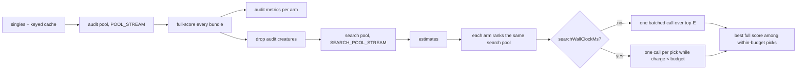

# PR summary — Issue #260: rank pruning bundles using cached output deltas

## Summary

The `bench-additivity` harness landed in #266. This PR closes three gaps that
#266 left open in step 6 and the Report section of the issue:

- **Separate search pool.** Each (parent, budget, seed) row now draws a
  search pool on its own seed stream, apart from the audit pool. Every arm
  ranks the same search pool (paired), and the random arm uses its own
  permutation stream for each pool. The audit pool is still fully scored, and
  its costs stay on the row, charged to no arm.
- **Equal per-arm wall-clock budget.** There is a new optional manifest field,
  `searchWallClockMs`. Each arm is charged its own single proposals, cache
  build, cache read or inference, search-pool materialisation and ranking,
  then its scorer time. Under a budget the arm makes one scorer call per pick.
  A pick whose call ends past the budget is still charged, but it cannot be
  selected.
- **Measured peak RAM.** The process's `VmHWM` is reported per row and once
  at the end of the run (`measuredPeakRssBytes`). It is beside the computed
  `ramBoundBytes`, not a replacement for it.

Ordinary runs, their defaults and acceptance are unchanged. This host has no
elite manifest, private corpora or `rust_scorer`, so the representative
20-elite run is still outstanding. Part of #260.

## Spec

### Intent and Rationale

- The #266 Spec review left three partials: no wall-clock budget per arm,
  audit and search sharing one pool, and peak RAM given only as a computed
  bound. Each is closed here inside `ockham/src/additivity/`, without touching
  the ordinary run path.
- The search pool reuses the same `build_pool` and `prune_hidden_group`
  materialisation as the audit pool, through one shared helper. The two pools
  differ only in their seed stream. Ranking for both pools goes through one
  `rank_arm` helper.

### Essential Design Decisions

- **`selectedRegret` is now paired.** It is the best `selectedScore` among the
  row's arms minus this arm's. The search pool is never fully scored, so its
  true optimum is unknown. Regret against the best candidate stays in each
  arm's `audit.regret` on the audit pool. The aggregate regret distribution
  reads the paired value. (The Spec reviewer flagged this as a possible
  misreading of "selected-candidate regret"; the audit regret is the
  survivor-bias-free form.)
- **Wall-clock selection is "anytime".** A call starts only while the charge
  is under budget. A pick whose call ends past the budget is charged but not
  selectable. If no pick finishes within budget, the arm selects nothing.
  Without `searchWallClockMs` there is one batched call, exactly as before.
- **Report format version 2.** The report shape changed (`rows[].search`,
  `searchRanking`, `stoppedBy`, `withinBudget`, `measuredPeakRssBytes`).
  The manifest format stays version 1, because the new field is optional and
  existing manifests load unchanged. The cache key and `CACHE_FORMAT_VERSION`
  are unchanged, because cached outputs do not depend on any of this.
- **RSS is the process's own, and approximate.** `VmHWM` leaves out the
  external scorer child processes, and it is `null` off Linux or when the
  line is malformed. Successive readings are not guaranteed to be monotone:
  the gate observed one row at 5246976 bytes after one at 5332992.

### Undiscoverable Facts

- No elite manifest, training/validation corpora or `rust_scorer` binary
  exists on this host, so no representative run was possible.
- The configured reviewer model hit an HTTP 429 rate limit, so both reviewers
  were re-dispatched with a model override. Their verdicts below come from
  that second dispatch.

## Evidence

The change is CLI and backend only; no UI file is touched.

- Tests run against the existing in-test `FaithfulScorer` in
  `ockham/tests/additivity_bench.rs`, which stands in for `ExternalScorer`
  (`ockham/src/scorer.rs`). The wall-clock tests wrap it in `ClockedScorer`,
  which only advances an injected `ManualClock` by 10 ms per scoring call, so
  every cost and stop is a literal, with no real timing.

## Acceptance Criteria

<!-- vibe-spec-review inputs="diff+issue-body" -->

- **met** — Deterministic tests cover exact independent linear deltas,
  nonlinear interaction failures, overlapping/cascading removals, cache
  invalidation and non-finite outputs — evidence:
  `ockham/src/additivity/predict.rs::exact_linear_deltas_predict_the_bundle_exactly`,
  `ockham/src/additivity/predict.rs::a_nonlinear_output_breaks_the_additive_prediction`,
  `ockham/tests/additivity_bench.rs::the_bench_records_cascades_overlaps_and_duplicate_creatures`,
  `ockham/tests/additivity_bench.rs::cache_is_reused_on_a_second_run_and_invalidated_by_a_changed_record`,
  `ockham/src/additivity/cache.rs::non_finite_values_are_refused_and_leave_no_file`
  (delivered in #266, still passing at this head) — reviewer: met
- **met** — Tests prove approximate predictions cannot accept a creature or
  alter ordinary defaults — evidence:
  `ockham/tests/additivity_bench.rs::end_to_end_reports_every_arm_and_leaves_the_parent_alone`,
  `ockham/tests/additivity_bench.rs::predictions_only_order_and_the_best_full_score_among_picks_selects`
  — reviewer: met
- **met** — Existing quality gates pass; no unrelated mutation/fuzz discovery
  requirement — evidence: `./quality.sh < /dev/null` run at `dffb2c1` exited 0
  with "All quality checks passed!"; no mutation or fuzz work added —
  reviewer: partial — reason: the reviewer saw only the diff and could not run
  the gate ("partial (unverified)"). It was run here and passed.
- **met** — Reproducible command/manifest and machine-readable report are
  provided — evidence: `ockham/src/additivity/manifest.rs`
  (`searchWallClockMs`), `ockham/src/additivity/bench_report.rs`
  (`REPORT_FORMAT_VERSION = 2`), `docs/additivity-experiment.md` — reviewer:
  met
- **missing** — Representative 20-elite results are required before declaring
  this experiment successful; fixture-only tests are not experimental evidence
  — reviewer: missing — reason: no 20-parent run has been done. This host has
  no elite manifest, no corpora and no `rust_scorer`. Outstanding: run
  `bench-additivity` over a 20-parent manifest with the private elites and
  keep the report outside the repository.
- **missing** — A negative outcome is documented and optional code is removed
  if it does not earn its maintenance cost — reviewer: partial — reason: there
  is no outcome until the representative run exists. The policy is in
  `docs/additivity-experiment.md` § Status. Removing the harness now would
  decide the experiment without evidence. I departed from the reviewer's
  `partial` because nothing for this criterion is delivered yet.
- **unrequested** — the 1 ms to 7-day bound on `searchWallClockMs` and its
  tests — reviewer: unrequested — reason: trust-boundary validation of a new
  manifest input, matching the manifest's existing bounds on every other
  field.

Step 6 and Report items the Spec reviewer also judged:

- Equal wall-clock/full-evaluation budgets: reviewer `partial`, naming two
  defects. Both are fixed after the review. First, additiveLoss's
  search-pool inference is now charged (`bench.rs`, `cache_read_inference`).
  Second, a call ending past the budget no longer yields a selectable pick
  (`Pick.within_budget`). Tests:
  `a_search_wall_clock_budget_stops_each_arm_after_three_scored_picks` and
  `a_search_wall_clock_budget_shorter_than_one_call_makes_one_pick_and_selects_nothing`.
- Separate repeated paired seeds, audit costs visible and separate: reviewer
  `met`.
- Peak storage/RAM: reviewer `partial` (one value per process, read once).
  After the review it is also reported per row (`rows[].measuredPeakRssBytes`).
  It still excludes the scorer child processes, which the doc states.

## Standards Review

<!-- vibe-standards-review inputs="diff+CODING-STANDARDS.md" -->

This repository has no `CODING-STANDARDS.md`. The reviewer used
`CONTRIBUTING.md`, `README.md` and the review-enforced rules in its brief; it
could not fetch the fleet standards.

- **violation** — doc comment made false: `BundleMeta.members` said
  "Positions in the ranked singles" but holds indices into `singles` —
  evidence: `ockham/src/additivity/bench.rs:259` — reason: fixed in this diff
- **violation** — copy instead of call: the search-pool ranking and
  `predicted` selection copied the audit-pool ones, and the growth-units
  expression was inlined twice — evidence:
  `ockham/src/additivity/bench.rs:905` — reason: fixed in this diff
  (`rank_arm`, `predicted_for` and `BundleMeta::growth_units_removed`)
- **clean** — no doc comment separated from its item; no duplicated `use`
  imports; no test-only production members; fail-loud (`take_result` errors
  on a missing result, an out-of-range `searchWallClockMs` is refused, an
  empty search pool gives an infeasible row with a reason); tests assert
  literal outcomes with an injected `ManualClock` and no wall-clock
  thresholds; the changed doc comments match the code. Optional notes acted
  on: the `audit_pool` docs now say they also size the search pool, and
  `parse_vm_hwm_bytes` is private. The conditional score comparison in the
  predictions test now asserts it ran at least once, and once with differing
  pool indices.

## Test Plan

New tests:

- `ockham/src/additivity/bench.rs`:
  `vm_hwm_is_read_in_kilobytes_from_a_realistic_status_text`,
  `a_status_text_without_vm_hwm_gives_none`,
  `a_malformed_vm_hwm_value_gives_none`.
- `ockham/src/additivity/manifest.rs`:
  `search_wall_clock_is_bounded_from_one_millisecond_to_seven_days` (0 and
  604800001 refused naming `searchWallClockMs`; 1 and 604800000 accepted),
  `search_wall_clock_loads_from_json_and_absent_is_none`.
- `ockham/tests/additivity_bench.rs`:
  - `a_search_wall_clock_budget_stops_each_arm_after_three_scored_picks`:
    25 ms budget, 10 ms per call. Per arm: three picks, three calls,
    `stoppedBy` `wallClock`, scorer 30 ms. Only the first two picks are
    `withinBudget`, and the selection is the best of those two.
  - `a_search_wall_clock_budget_shorter_than_one_call_makes_one_pick_and_selects_nothing`:
    5 ms budget. One late pick and no selection; `selectedRegret` is `None`.
  - `without_a_search_budget_each_arm_makes_one_batched_call_over_its_picks`:
    the control. One call, `fullEvaluations`, and every pick within budget.
  - `arms_rank_a_separate_search_pool_and_regret_is_paired_within_it`:
    `searchRanking` is a permutation, picks index `search.bundles`, and the
    paired regret holds.
  - `the_search_pool_draws_member_sets_the_audit_pool_does_not_hold`.

Edited existing tests (no assertion removed):

- `predictions_only_order_and_the_best_full_score_among_picks_selects`:
  - `arm_row.ranking[..expected_picks.len()]` became
    `arm_row.search_ranking[..expected_picks.len()]`, because picks now come
    from the search ranking.
  - The search-versus-audit score check now looks up the audit bundle by
    `creatureDigest`, because the two pools' indices differ. It asserts that
    at least one comparison ran, and one with differing indices.
- `end_to_end_reports_every_arm_and_leaves_the_parent_alone`: on Linux it
  adds assertions that the run-level and every row's `measuredPeakRssBytes`
  are positive.
- The manifest fixtures gained `search_wall_clock_ms: None`.

Results at `dffb2c1`:

- `cargo test -p neat_ai_ockham --test additivity_bench`: 17 passed.
- `cargo test -p neat_ai_ockham --lib additivity`: 42 passed.
- `--test readme_contract`: 10 passed.
- `./quality.sh < /dev/null`: exit 0, "All quality checks passed!".

The first gate run failed on a per-row monotone-RSS assertion added in this
PR. The kernel's reading is approximate, so the assertion and the matching
doc claim were removed, and the gate passed afterwards.

Not done or not checked: no representative 20-elite run; no run against
the real `rust_scorer`; peak RAM of the scorer child processes is not
measured; and CI and PR review are not yet observed.
