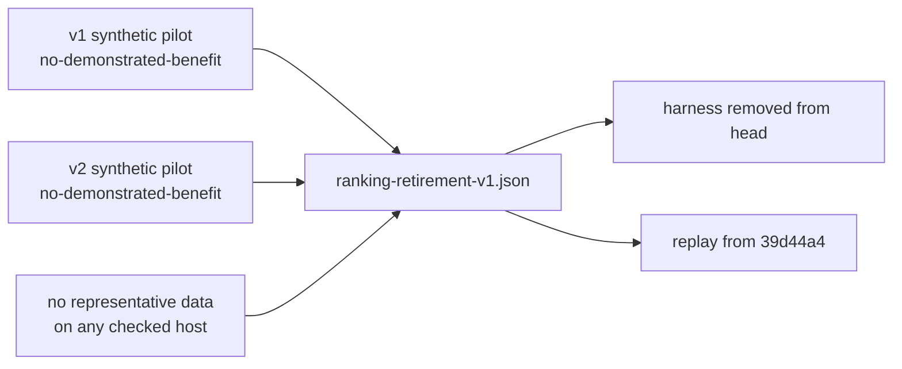

## Summary

Retires the opt-in ranking research harness as the maintenance decision #261
asks for ("remove optional code that does not earn its maintenance cost"). Both
synthetic pilots (protocols v1 and v2, archived under `docs/research/`) returned
`no-demonstrated-benefit`, with transfer-pairwise minus partial at −0.611
[−0.75, −0.333]. No representative corpora, creatures or search histories have
been available on any checked host. The harness source is kept for replay at
commit `39d44a43e92ed9bcb9ffa7d6d5124240292e3274` (Develop after #290). The new
`docs/experiments/ranking-retirement-v1.json` records the decision, the negative
findings and the evidence digests. No success is claimed. Closes #261.

Removed: `ockham/examples/priority_ordering_bench/` (the `--experiment` mode),
`ockham/examples/ranking_pilot.rs`, `ockham/src/model/pairwise.rs`,
`ExternalScorer::score_directory_bounded` and `ockham/tests/bounded_scorer.rs`.
After the examples go, nothing else calls the pairwise module or the bounded
scorer.

## Spec

### Intent and Rationale

- The earlier rule tied removal to a representative v2 run. That run needs
  private data, which has never been on any fleet host, so the issue kept being
  re-queued with nothing it could do. The repository's precedent for this case
  is `docs/experiments/soft-gate-retirement-v1.json` (#262): remove the
  optional runtime, keep the evidence, and replay from a pinned commit.
- Replaying from a pinned commit keeps the representative comparison runnable,
  without maintaining about 6,500 lines that only that comparison uses.

### Essential Design Decisions

- This departs from the removal rule predeclared in
  `docs/experiments/ranking-v1.md`. The departure is stated in the retirement
  record, in `ranking-v1.md` and in both archive READMEs. They all call it a
  maintenance decision, not evidence that the method fails on representative
  data.
- Kept: the simulated `priority_ordering_bench` (Issue #107), the pointwise
  model, `telemetry::load_from_reader` (`telemetry::load` calls it), the private
  `score_command` helper, both archives and their digest tests.
- The cost-measurement code (`ranking_pilot search` and `time`) belonged to the
  harness, so it is removed with it.
- `docs/experiments/ranking-v1-availability.json` is a dated record and is not
  edited. Its digest is pinned as evidence.

### Undiscoverable Facts

- On 20 November 2026, a host-wide search for `candidates*.jsonl`,
  `experiments.jsonl` and creature files found none. That is the same result as
  the 13 November availability record.
- The pinned commit refuses protocol-v1 files, so the v1 archive replays at
  `a4f0d274ccb84e37f5fa2b97ce3396daf0286aaa`, as its README already said. The v2
  archive replays at the pinned commit.

## Evidence

Backend and docs change only, so no screenshot is needed.

- `ockham/tests/ranking_pilot_archive.rs::ranking_retirement_record_matches_the_archived_evidence`
  checks:
  - the decision `remove-optional-research-harness`, zero representative tasks
    and the pinned source commit;
  - that each pilot verdict in the record equals the verdict in that archive's
    `results.json`, and both are `no-demonstrated-benefit`;
  - the sha256 of each evidence file: both archives' `results.json` and
    `manifest.json`, and the availability record.
- The two existing archive tests in the same file still pass. They read only
  committed JSON, not the removed code.

## Test Plan

- Added `ranking_retirement_record_matches_the_archived_evidence`. It failed
  before the record existed (`No such file or directory` at
  `ockham/tests/ranking_pilot_archive.rs:367`) and passes after it was written.
- Removed tests, together with the functionality they covered (no callers are
  left at head):
  - `ockham/tests/bounded_scorer.rs`;
  - the bounded-versus-ordinary block at the end of
    `ockham/tests/real_scorer.rs::real_scorer_scores_the_incumbent_baseline`.
    Its ordinary-scoring assertions are unchanged;
  - the unit tests inside the deleted examples.
- `cargo test --locked --test real_scorer --test ranking_pilot_archive`:
  4 passed. `real_scorer` skips here because there is no `rust_scorer`.
- `cargo test --locked --lib` (829 passed) and
  `cargo test --locked --examples` (25 passed).
- `cargo clippy --locked --all-targets -- -D warnings` and `cargo fmt --check`:
  no findings. `markdownlint-cli2` and `scripts/spell-check.sh`: no findings.
- Docs swept: I grepped `README.md` and `docs/` (excluding `docs/archive/`) for
  `--experiment`, `ranking_pilot`, `model::pairwise`, `score_directory_bounded`
  and `research-only`. Updated: the README section "Controlled proxy/history
  comparison", plus the status, maintenance and "Current finding" text of
  `ranking-v1.md`. In both archive READMEs I updated the maintenance decision
  and Reproduce. The protocol command blocks in `ranking-v1.md` stay as the
  historical record, under the status note that they run from the pinned
  commit. The `priority_ordering_bench` doc comments in `ockham/src/priority.rs`
  name the retained simulated bench and are still true.
- `./quality.sh < /dev/null` on the final tree: exit 0 ("All quality checks passed!").
- Not checked: CI, macOS, and a replay from the pinned commit in a fresh
  worktree.
