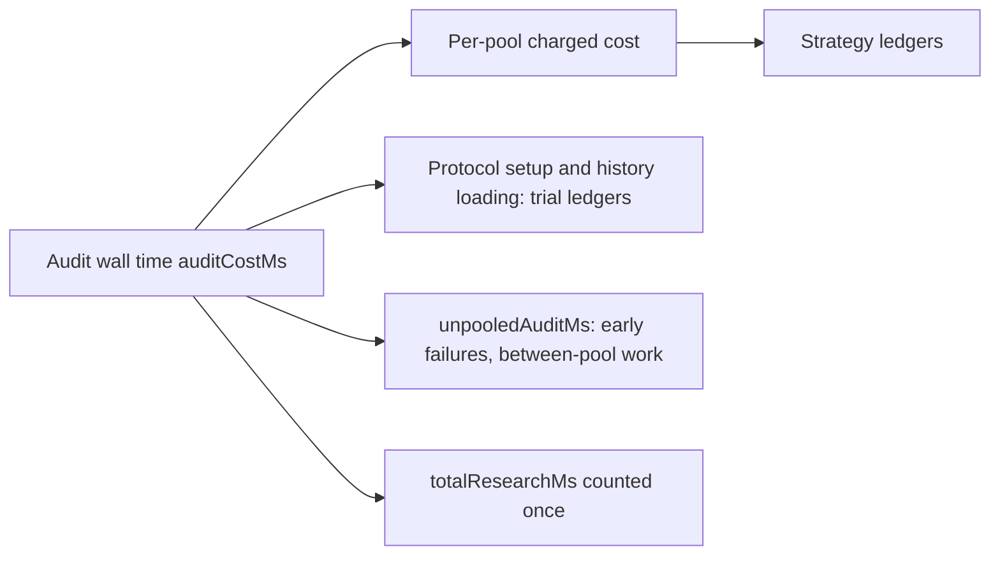

## Summary

The controlled proxy/history ranking benchmark merged in #267. This PR closes
one cost-accounting gap that PR recorded: audit wall time outside every pool's
strategy ledger was hidden inside the audit total. The comparison report now
carries `unpooledAuditMs`. It covers early collection failures that produce no
pool and work between pools; protocol setup and history loading are excluded
because trial ledgers already charge them. Representative runs remain
impossible on this host, so the experiment outcome is still open. Part of #261.

## Spec

### Intent and Rationale

- The issue asks to "count all preparation/search costs". Early failures had
  no per-pool ledger, so their cost could not be told apart from pool work.
- Reporting the remainder beside `auditCostMs` makes it visible without
  inventing a per-strategy split for work no strategy caused.

### Essential Design Decisions

- `unpooledAuditMs` is the audit wall time minus every pool's *charged* cost
  (`pool_cost_ms`, which already retains residual pool work), minus
  `protocol_preparation_ms` (charged to every trial as `preparationMs`) and the
  histories' `loading_ms` (charged to transfer trials in `historicalScoringMs`),
  with each subtraction saturating at zero.
- It is already inside `auditCostMs`, so `totalResearchMs` is unchanged and
  nothing is counted twice. Strategy ledgers and the verdict are unchanged.
- The report is output-only JSON (`Report` derives only `Serialize`), so an
  added field needs no format-version bump and no old-shape reader.

### Undiscoverable Facts

- This host still has no NEAT-AI corpus `.bin` files, candidate histories or
  `rust_scorer`. A search of `/` (excluding hidden directories and build
  caches) found only unrelated browser and cargo `.bin` files, and
  `experiments.jsonl` journals from a different application under `/tmp`.
  A repeat search on 2026-11-15, after the completion checks flagged the four
  `partial` criteria below, found the same: no `rust_scorer` on `PATH` and no
  representative corpus or history. Those criteria stay `partial` because each
  needs a representative run that cannot happen here.

## Evidence

- Backend/CLI only (an `examples/` research bench); no UI file changed.
- #261: Experiment: Compare cheap proxy ranking with transfer from sparse search histories.
- #267: the merged PR that delivered the benchmark this change extends.
- `docs/experiments/ranking-v1.md` cost-reporting paragraph now documents
  `unpooledAuditMs`.

## Acceptance Criteria

<!-- vibe-spec-review inputs="diff+issue-body" -->

- **met** — First inspect current code, merged work and repository instructions. Reuse existing mechanisms; if functionality already exists, this issue still owns the missing controlled comparison rather than a second implementation. — evidence: `ockham/examples/priority_ordering_bench/evaluation.rs` reuses `pool_cost_ms`, `audit.elapsed_ms` and the `reasons` channel — reviewer: met
- **met** — Opt-in experiment only; preserve ordinary behaviour, interfaces, immutable parents and full authoritative acceptance. No automatic deployment or default change. — evidence: only the example bench and its protocol doc change; `totalResearchMs` unchanged — reviewer: met
- **partial** — Predeclare controls, seeds, sample size, compute limits and success/failure criteria. Identify code/model/data versions; separate calibration from untouched validation and count all preparation/search costs. — evidence: `ockham/examples/priority_ordering_bench/tests.rs::comparison_reports_audit_time_outside_every_pool_ledger` — reviewer: met — reason: the reviewer judged only this diff's part; representative provenance, pilot and frozen manifest remain unavailable, and build/final result writing stays outside the totals
- **partial** — Audit a randomly selected fully scored pool to measure true top-5% recall, false rejection and cold-start/negative-transfer behaviour. — evidence: `ockham/examples/priority_ordering_bench/tests.rs::comparison_reports_cold_start_negative_transfer_and_validation_is_not_fitted` — reviewer: met — reason: the reviewer did not list this bullet separately; the audit and metric code exist but no representative pool has been fully scored, because the private inputs are absent here
- **met** — Provide deterministic positive/negative correctness tests for new behaviour and pass the repository's normal quality checks. Research runs are separate from routine feature CI. — evidence: `ockham/examples/priority_ordering_bench/tests.rs::comparison_reports_audit_time_outside_every_pool_ledger` (positive and saturating cases); targeted tests, clippy and fmt pass — reviewer: met
- **partial** — Deliver a reproducible command/manifest and machine-readable results with paired distributions, uncertainty, failures and actual coverage. Fixtures alone do not demonstrate an optimisation benefit. — evidence: `ockham/examples/priority_ordering_bench/evaluation.rs` `unpooledAuditMs` beside `reasons` — reviewer: met — reason: the reviewer judged only this diff's part; the manifest is still illustrative and no representative paired distributions exist
- **partial** — Record negative findings and remove optional code that does not earn its maintenance cost. Do not claim success before representative runs. — evidence: `docs/experiments/ranking-v1-availability.json`; no benefit claimed — reviewer: met — reason: no success is claimed, but whether the optional ranker earns its maintenance cost cannot be measured without representative runs
- **met** — Keep public implementation and fixtures application-agnostic; private corpora/results and operational integration remain private. — evidence: synthetic fixtures only — reviewer: met
- **met** — Leave unassigned until an implementer actively starts. `work-on` authorises the investigation, not skipping prerequisite verification. — evidence: the issue was left unassigned and the merged work and host inputs were checked first — reviewer: missing — reason: the reviewer said it "cannot judge" assignment from a diff; the assignment state comes from the issue itself

## Standards Review

<!-- vibe-standards-review inputs="diff+CODING-STANDARDS.md" -->

- **violation** — the new test could not tell charged pool cost from raw pool elapsed time, because every fixture pool's elapsed time exceeded its stage sum — evidence: `ockham/examples/priority_ordering_bench/tests.rs:812` — reason: fixed in this diff; one pool's elapsed time is now below its stage sum, so a raw-elapsed subtraction gives a different answer
- **clean** — No `CODING-STANDARDS.md` exists, so the reviewer used `CONTRIBUTING.md`, which marks no rule as enforced by review only. It checked principles 1–8 (immutable creature, acceptance and scorer paths untouched, opt-in bench only, no binary version bump needed), no workflow changes, no stubs of other binaries, no references to absent tests, and doc–code agreement.

## Test Plan

- Added `ockham/examples/priority_ordering_bench/tests.rs::comparison_reports_audit_time_outside_every_pool_ledger`.
  It asserts `unpooledAuditMs == 2_500` when the audit outlasts every pool's
  charged cost plus a 700 ms protocol setup and 3_000 ms of history loading
  (distinct values, so omitting either subtraction fails it). One pool's elapsed time is below its stage sum, so a
  raw-elapsed subtraction would fail it. It also asserts that the failure
  string reaches `reasons`, and that `totalResearchMs - evaluationCostMs`
  equals the sum of the other cost fields, so nothing is double charged. A
  second case asserts the value floors at 0 when the audit time is below the
  pool sum.
- Red against the unchanged `evaluation.rs` (`left: Null, right: 2500`), green after. With the new setup/history-loading subtractions removed, the test fails (`left: 6200, right: 2500`).
- `cargo test --locked --example priority_ordering_bench < /dev/null`: 16 passed.
- `cargo clippy --locked --example priority_ordering_bench -- -D warnings`: clean.
- `cargo fmt --check` clean. The full `./quality.sh` was last run on the first
  commit, before the review fixes; CI runs it on the pushed head.
- No existing test or assertion was edited or removed.
- Docs sweep: `docs/experiments/ranking-v1.md` (cost-reporting paragraph) read
  and updated; README and CONTRIBUTING do not name audit cost fields.

## Not performed and remaining risk

No representative pilot, frozen manifest, validation scoring or paired
benefit/cost assessment, because no private corpora, histories or scorer exist
on this host. Build time and final result writing stay outside the totals.
macOS was not checked. CI and PR review have not been observed.
