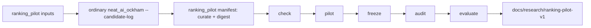

## Summary

Ran the merged ranking-v1 benchmark (#267, #274) end to end for the first time:
check, pilot, freeze, audit and evaluate, with the real NEAT-AI-scorer on
synthetic tasks. The source histories are real, sparse histories from ordinary
Ockham searches.

The new generator `ockham/examples/ranking_pilot.rs` writes the inputs and the
digest-bound manifest. The run is archived under `docs/research/ranking-pilot-v1/`,
and an integration test pins its digests. The verdict is
`no-demonstrated-benefit`: partial-score ordering alone dominates. Cheap-proxy
fusion, target-only pairwise and sparse-history transfer all trail it, and
transfer shows negative transfer at about four times the per-trial cost.

A second commit fixes cost counting. The bench rounded elapsed time down, so
feature, fit, adaptation and ranking work under 1 ms was charged as 0 in every
archived trial. It now rounds up, and `ranking_pilot manifest` charges curation
time. A recount at `e02ef9f` (`docs/research/ranking-pilot-v1/cost-recount/`)
used the same scorer and inputs. It reproduced identical recall, intervals,
coverage and verdict, and each overhead is now charged at no more than about
1 ms per trial.

This is a negative synthetic finding, not a representative result. The
representative run and the decision to keep or remove the code are still open.
Part of #261.

## Spec

### Intent and Rationale

- The bench existed, but it had never run against a real scorer. Until it did,
  there were no machine-readable paired results, no frozen manifest, no
  fully scored random pools, and no measured costs.
- The private representative corpora are not on this host. A synthetic,
  real-scorer pilot was the furthest the protocol could go here. It mirrors
  #263's `strata-pilot-v1`.
- The source histories come from ordinary `neat_ai_ockham --candidate-log`
  searches rather than hand-made rows. They are therefore genuinely sparse
  (3 of 12 candidates per source are fully scored), as the issue asks.

### Essential Design Decisions

- **Search-only histories.** The source searches use `--min-improvement 1000000`
  and `--no-exact-cleanup`, so no cut can be accepted and every row names the
  immutable parent. The bench's history loader refuses rows from any other
  incumbent.
- **Curation rule.** Curation keeps one row per `(uuid, kind, merged_with)`.
  It prefers the first row that has both a full and a sampled delta. The
  ordinary sweep screens the same candidate many times, so keeping the first
  row would discard its labelled observation.
- **Acquisition cost must be recorded.** A source without an `acquisition-ms`
  file is refused, so an unmeasured historical cost cannot silently count as 0.
- **Costs round up.** `audit::ms` charges any non-zero work at least 1 ms,
  so feature and training overhead is counted before rejection could be
  permitted. The archive is kept as run, and the recount sits beside it.
- **No code removed.** The pairwise and transfer arms stay research-only in the
  example bench. The issue says "Do not claim success before representative
  runs". Removing the arms on synthetic evidence would decide the
  maintenance question before that run exists.

### Undiscoverable Facts

- The issue's arXiv sources were already verified by #267 (see
  `docs/experiments/ranking-v1.md`). They were not re-fetched in this run.
- The scorer was built from NEAT-AI-scorer `742c5df30fc98ece3afe784be1aca18f925b47b3`.
  Its SHA-256 is `d057a334…`, the same binary identity as #263's pilot.
- 186 of the 237 validation candidates are synapse cuts, which have no neuron
  feature vector. The composite and pairwise arms tie them at zero, and this
  explains much of why those arms trail partial ordering.

## Evidence

Backend/research only; no UI file changed. The protocol section
`docs/experiments/ranking-v1.md` → "Synthetic pilot" and "Current finding" were
read and updated, and the full record is `docs/research/ranking-pilot-v1/README.md`.

Primary cell: full history, calibration 8, evaluation 5, 3 validation groups,
seeds 7 and 19. Each row is the paired top-5% recall difference with its
95% bootstrap interval:

| Comparison | Mean | 95% interval |
| --- | --- | --- |
| partial − random | +0.833 | [0.75, 1.0] |
| multiple-proxies − partial | −0.389 | [−0.5, −0.25] |
| transfer-pairwise − partial | −0.694 | [−0.75, −0.583] |
| transfer-pairwise − target-pairwise | −0.083 | [−0.25, 0.0] |

In the cost recount, mean primary-cell feature, training, adaptation and ranking
time is each 0 to 1 ms per trial. Transfer's extra cost is 840 ms of historical
acquisition and 101 ms of calibration scoring. Input generation (4 to 5 ms) and
curation (2 ms per source) were measured separately.

Coverage: 16 pools, 640 visits selected and 632 generated and fully scored; all
pools are complete. The 8 failures are refusals of the protected output neuron.
Total research cost was 3469 ms, measured on a shared host, so treat it as
indicative.

## Acceptance Criteria

<!-- vibe-spec-review inputs="diff+issue-body" -->

- **met** — First inspect current code, merged work and repository instructions. Reuse existing mechanisms; if functionality already exists, this issue still owns the missing controlled comparison rather than a second implementation. — evidence: `ockham/examples/ranking_pilot.rs` feeds the existing `priority_ordering_bench` and reuses `telemetry`, `corpus` and `fixtures` — reviewer: met
- **met** — Opt-in experiment only; preserve ordinary behaviour, interfaces, immutable parents and full authoritative acceptance. No automatic deployment or default change. — evidence: example, test and docs only; the source searches cannot accept a cut — reviewer: met
- **partial** — Predeclare controls, seeds, sample size, compute limits and success/failure criteria. Identify code/model/data versions; separate calibration from untouched validation and count all preparation/search costs. — evidence: `docs/research/ranking-pilot-v1/manifest.json`, `ockham/examples/ranking_pilot.rs::tests::source_without_acquisition_ms_is_refused_naming_the_task` — reviewer: partial — reason: synthetic only. Generating the inputs and curating the histories are not timed, and the representative frozen manifest is still outstanding.
- **met** — Provide deterministic positive/negative correctness tests for new behaviour and pass the repository's normal quality checks. Research runs are separate from routine feature CI. — evidence: `ockham/examples/ranking_pilot.rs` (6 tests) and `ockham/tests/ranking_pilot_archive.rs`; `./quality.sh` passed — reviewer: met
- **partial** — Deliver a reproducible command/manifest and machine-readable results with paired distributions, uncertainty, failures and actual coverage. Fixtures alone do not demonstrate an optimisation benefit. — evidence: `docs/research/ranking-pilot-v1/results.json`, `docs/research/ranking-pilot-v1/README.md` — reviewer: partial — reason: these are synthetic results only. A rerun's history rows and timings differ, and no representative paired results exist.
- **partial** — Record negative findings and remove optional code that does not earn its maintenance cost. Do not claim success before representative runs. — evidence: `docs/experiments/ranking-v1.md` → "Synthetic pilot" — reviewer: partial — reason: the negative finding is recorded. Deciding whether to keep or remove the arms needs the representative run.
- **met** — Keep public implementation and fixtures application-agnostic; private corpora/results and operational integration remain private. — evidence: generated corpora and parents only — reviewer: met
- **met** — Leave unassigned until an implementer actively starts. `work-on` authorises the investigation, not skipping prerequisite verification. — evidence: the issue is unassigned; merged work and host inputs were checked first — reviewer: missing — reason: the reviewer said this "can't be judged from a diff". The assignment state comes from the issue itself.
- **missing** — Audit a randomly selected fully scored pool to measure true top-5% recall, false rejection and cold-start/negative-transfer behaviour. Count feature and training overhead before permitting rejection. — reviewer: missing — reason: this was done on synthetic pools only (`results.json` paired cells). Representative pools are still needed. The reviewer listed only the "Execution and acceptance" bullets, so it gave no verdict on this one.
- **unrequested** — `ockham/tests/ranking_pilot_archive.rs` pins the archived run's digests and verdict in routine CI — reviewer: unrequested — reason: it keeps the committed evidence consistent with itself. It checks the archive and runs no research; the pattern follows `soft_gate_archive.rs`.
- **unrequested** — `committed_pilot_inputs_match_the_generator` ties the generator to the committed manifest — reviewer: unrequested — reason: it proves the archived parents and corpora are the generator's output.
- **unrequested** — the `--cutoff-unix` option on `ranking_pilot manifest` — reviewer: unrequested — reason: it fixes the cutoff so the tests are deterministic.

## Standards Review

<!-- vibe-standards-review inputs="diff+CODING-STANDARDS.md" -->

- **clean** — There is no `CODING-STANDARDS.md`, so the reviewer used `CONTRIBUTING.md`. It checked the rules that only review enforces: principles #1 (the creature is never written), #3/#4 (only the full scorer accepts), #6 (optional and isolated), #7 (no TypeScript) and #8 (no binary change, so no version bump). It also checked "no changelog". Other checks: fmt, clippy, tests, codespell and markdownlint; every archived digest and every quoted figure against `results.json`; and the curation rule against the bench's history loader. It changed no existing test.
- **clean** — The reviewer raised two optional notes, both fixed in this diff:
  - The refusal check now requires both a full and a sampled delta (`ockham/examples/ranking_pilot.rs`).
  - A missing `acquisition-ms` file is now refused.

## Test Plan

- `ockham/examples/ranking_pilot.rs` tests, 6 in total, all new:
  - determinism, distinct parents and refusal to overwrite;
  - curation preferring the labelled duplicate (asserts `full_delta == Some(0.2)`) and `acquisitionMs` matching the file;
  - `source_without_fully_scored_parent_row_is_refused_naming_the_task`, whose fixture includes a full-delta-only row;
  - `source_without_acquisition_ms_is_refused_naming_the_task`, with a positive control;
  - manifest keys matching the template;
  - `committed_pilot_inputs_match_the_generator`.
- `ockham/tests/ranking_pilot_archive.rs::archived_ranking_pilot_matches_its_digests_and_negative_finding`
  recomputes the audit, pilot and history digests. It also checks the manifest
  identity across files, the verdict, the sign of the primary cell and that
  every pool is complete.
- `ranking_pilot.rs::tests::charged_acquisition_adds_curation_rounded_up` (new).
  The manifest test now asserts `acquisitionMs > 5` (recorded 5 plus curation),
  replacing `== 5`.
- `priority_ordering_bench/tests.rs::cost_milliseconds_round_up_so_sub_millisecond_work_is_counted` (new).
- Both new tests, and the changed manifest test, were red-checked: they fail
  with the old floor rounding or without the curation charge.
- `cargo test --locked --example ranking_pilot --example priority_ordering_bench --test ranking_pilot_archive < /dev/null`: all passed on the final head.
- `./quality.sh < /dev/null`: passed on the final head.
- The real-scorer run is in `docs/research/ranking-pilot-v1/README.md`. It
  includes the commands, the versions and the checksums.
- One assertion was changed, `acquisitionMs == 5` to `> 5`, because the charge
  now includes curation. The exact arithmetic is covered by the new unit test.
- The archive test pins only the original archive, not the recount.

## Not performed and remaining risk

- There was no representative pilot, frozen representative manifest or
  representative validation. The private corpora are not on this host.
- The keep-or-remove decision is still open.
- The archive test needs `gzip` on `PATH`.
- macOS was not checked, and CI has not been observed.
