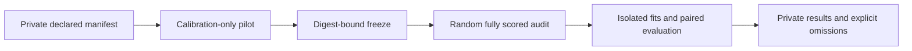

## Summary

Added the opt-in controlled proxy/history benchmark, retaining ordinary ordering
and authoritative acceptance. Fixed its audit-to-history corpus identity mismatch
and verified bounded scoring against a real scorer. Representative comparison
results remain unavailable. Part of #261.

## Spec

### Intent and Rationale

- Reuse the existing feature, composite, model, telemetry and pruning mechanisms
  to compare random, partial, composite, target-only and transfer ordering.
- Separate implementation correctness from evidence of a representative benefit.

### Essential Design Decisions

- Research runs never apply cuts; audit sampled losers individually and keep
  source, calibration and validation partitions separate.
- Earlier v1 audit telemetry remains readable: normalise its digest-valued corpus
  identity only for `random-audit` rows matching the manifest's corpus digest.
  New audit telemetry writes the ordinary corpus cache identity. Other provenance
  and cutoff checks remain in place; no persisted format version changes.
- Missing representative data leaves metrics unknown and the verdict inconclusive.
  Absent measurements do not justify removing the optional ranker.
- The linear adaptation and fixed composite are smaller components inspired by
  the papers, not reproductions of CAST or SHINE.

### Undiscoverable Facts

- The mounted checkout search found no corpus `.bin` files, candidate histories
  or experiment journals outside hidden directories and build/dependency caches.
  No representative manifest was supplied; availability on other hosts is unknown.
- The scorer built from public source revision
  `742c5df30fc98ece3afe784be1aca18f925b47b3` and ran successfully on fixtures.
  This was a development build on a shared aarch64 Linux host.
- Both paper identities and method sections were fetched again on 13 November
  2026; their adaptations and limits are documented in the protocol.

## Evidence

- #261: Experiment: Compare cheap proxy ranking with transfer from sparse search histories.
- Merged PR #118, commit `63e1b8c734b7accc03d304a2ef955d38e5f179e7`,
  supplies the existing features/model/telemetry reused by the benchmark.
- `docs/experiments/ranking-v1.md` describes the methods, partitions, cost
  accounting and commands. `docs/experiments/ranking-v1.template.json` remains
  illustrative, not a frozen representative manifest.
- `docs/experiments/ranking-v1-availability.json` records zero representative
  trials and null metrics, alongside fresh integration results, code/scorer/
  lockfile/executable identities and reproducibility commands.
- Preflight with the real scorer and illustrative template paths exited 1 with
  14 unavailable parent/corpus tasks. It did not run a calibration pilot.
- Backend/CLI only. Real scorer full and sampled results agreed through ordinary
  and bounded adapters: 32 full records and one sampled record at rate 0.05,
  phase 7. Fixture correctness does not establish a ranking benefit.

## Acceptance Criteria

- **missing** — Predeclare controls, seeds, sample size, compute limits and success/failure criteria. Identify code/model/data versions; separate calibration from untouched validation and count all preparation/search costs. — reason: the template and enforcement exist, but verified representative provenance, a calibration pilot and a frozen private manifest remain unavailable.
- **missing** — Audit a randomly selected fully scored pool to measure true top-5% recall, false rejection and cold-start/negative-transfer behaviour. — reason: representative parents, corpora and historical logs were not found; no representative pools were scored.
- **missing** — Deliver a reproducible command/manifest and machine-readable results with paired distributions, uncertainty, failures and actual coverage. Fixtures alone do not demonstrate an optimisation benefit. — reason: reproducible infrastructure and integration evidence exist; paired representative results, uncertainty and research costs remain unmeasured.

## Test Plan

- `./quality.sh < /dev/null` passed with the built scorer explicitly configured:
  shell contracts, spelling, Markdown, Actions lint, dependency audit, formatting,
  all-target Clippy, workspace tests and rustdoc. Earlier passes were not used as
  a substitute for this run.
- `cargo test --locked --example priority_ordering_bench`: 11 passed.
  `ockham/examples/priority_ordering_bench/tests.rs` extends
  `audit_scores_sampled_losers_individually_and_preserves_parent` to export real
  audit telemetry and reload it as later history. The round trip failed with
  `historical parent/corpus provenance mismatch` against checkpoint `bf65e57`
  before the correction and now passes. This research code is absent on Develop;
  the observed failure was against the checkpointed implementation.
- Added `historical_loader_normalises_legacy_audit_identity_and_rejects_other_corpora`
  in that file: legacy records initially failed, then passed after correction.
  Ordinary identities and legacy digests reach transfer evaluation; unrelated
  corpora and digest-valued ordinary records receive the specific provenance error.
- `cargo test --locked --lib model::pairwise`: three passed, covering ordering,
  adaptation, cold starts, invalid inputs and deterministic fits.
- `cargo test --locked --test real_scorer --test bounded_scorer -- --nocapture`:
  both passed with `NEAT_SCORER_BIN` pointing at the real binary.
  `ockham/tests/real_scorer.rs::real_scorer_scores_the_incumbent_baseline` adds
  bounded full/sample comparisons; it pins supported behaviour already present
  before this change. `ockham/tests/bounded_scorer.rs` retains the negative
  argument/bound/error contracts.
- No existing assertions were removed. The importer caller `audit::collect` and
  evaluator `historical_rows` retain provenance checks; imported legacy rows are
  normalised before the evaluator's existing check. The latter path is exercised
  by the new compatibility test. No second audit-telemetry writer was found.
- Documentation sweep covered the README controlled-comparison and candidate-log
  sections, CONTRIBUTING prerequisites, and the complete experiment protocol.
  Updated the protocol's data/separation and current-finding sections and its
  machine-readable availability record.
- Security: no new endpoint, dependency or privileged operation; argument-vector
  scorer execution and existing digest/finite-value checks retained. Staged paths
  contain no secrets or hidden files. No destructive operation or path guard added.

## Merge verification

CI and independent code review are not yet verified.

## Not performed and remaining risk

Representative pilot, frozen private manifest, validation scoring and paired
benefit/cost assessment were not performed because their inputs were unavailable.
Actual lineage independence and historical acquisition costs remain unverified.
macOS execution was not checked. No optimisation benefit or deployment is claimed.
