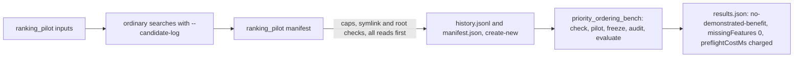

## Summary

The controlled proxy/history ranking benchmark merged in #267 and #274. This
PR adds a synthetic, non-representative pilot of that protocol, run with the
real scorer. It brings back the generator from the closed PR #279 and fixes
the blocking review finding that stalled #279. It commits the raw search logs,
so the curation can be re-run and checked byte for byte. Input generation, the
manifest step's own time and the preflight `check` stage are now charged in
`totalResearchMs`. The audit now gives synapse candidates a feature vector, so
no candidate is ranked featureless. The archived pilot is the re-run at this
branch's code (`aa41403`) from the committed raw logs and timings. It replaces
the two archives of #279 and the earlier `fad4e74` run.
`ranking_pilot manifest` read its inputs with no byte limit and followed task
paths through symlinks. It now caps every read and digest, refuses symlinks
and paths that escape the pilot directory, creates its outputs exclusively,
and finishes every read before its first write. The synthetic finding is
negative: partial-score ordering alone beats the composite and pairwise arms
even with every candidate featured, sparse-history transfer adds nothing over
the target-only fit, and it shows negative transfer at cold start. A representative run
still needs private corpora and histories this host does not have.
This replaces the stalled PR #284 and answers its review:
`scorer_may_be_a_symlink` now asserts the recorded scorer digest and path,
and the preparation-time test can no longer pass with the inputs term
dropped. The preflight is now charged too; the remaining uncounted stages
are named below.
Part of #261.

## Spec

### Intent and Rationale

- The issue asks for a reproducible command and manifest, and for
  machine-readable paired results with uncertainty, failures and coverage. The
  synthetic pilot exercises that whole path end to end with the real scorer,
  and records its negative finding without claiming a benefit.
- The #279 reviewer found that `write_manifest` read raw logs, parents,
  corpora and the scorer with no limit. It also found that a dangling
  `history.jsonl` symlink let `telemetry::append` write outside the pilot
  directory. Bounding and confining those reads fixes that finding at its
  source and leaves the bench unchanged.

### Essential Design Decisions

- Limits live in one `Limits` struct, and `main` passes `Limits::DEFAULT`:
  parent 16 MiB, raw log 64 MiB (the bench's own history cap), `acquisition-ms`
  64 bytes, corpus 100,000,000 bytes and scorer 1 GiB. The manifest's
  `maxCorpusBytes` is written from the same `corpus_bytes`, so the cap the
  manifest step checked is the cap the bench enforces. Tests pass smaller
  limits through the same parameter.
- Pilot-owned paths are refused when they are a symlink or resolve outside the
  canonical pilot root. Outputs are refused when anything, including a dangling
  symlink, exists at the path, and are then created with `create_new`. The
  scorer is a separately chosen input: it may be a symlink and may live
  anywhere, but it must be a regular file, and its digest is streamed and
  capped.
- `telemetry::load_from_reader` holds the existing parse and version check, and
  `telemetry::load` calls it. The capped raw-log bytes are parsed in place
  rather than read again from disk.
- For valid inputs the output bytes are unchanged. History lines are
  serialised the way `telemetry::append` writes them, and the history digest is
  taken from the bytes written.

### Undiscoverable Facts

- PR #279 was closed by the worker's stall handling. Its CI was green, but the
  file-bounds review finding was never addressed. Its archives, made at
  `a27d638` and `e02ef9f`, are not on this branch and are replaced here. The
  run at `fad4e74` reproduced their paired results, coverage and verdict; only
  the timings differ.
- The scorer was rebuilt at the pinned revision on 18 November 2026, twice
  (for the `fad4e74` run and again for the `aa41403` re-run). Both times its
  executable digest matched the archived pin, `d057a334…`.
- The `aa41403` re-run did not repeat the source searches. It used the
  committed raw logs, `acquisition-ms` and `inputs-ms`; the regenerated
  corpora and parents matched the committed digests and both curated
  histories were byte-identical.
- This host still has no representative NEAT-AI corpus, candidate history or
  parent (`docs/experiments/ranking-v1-availability.json`). The pilot's corpora
  are generated and homogeneous.
- Containment is checked by path and then the file is opened again, with no
  no-follow open. A concurrent swap of a path inside the pilot directory is not
  covered. This is accepted for a local, operator-run research example.

## Evidence

- Backend and research example only; no UI file changed.
- `docs/research/ranking-pilot-v1/README.md` is the pilot record: design,
  versions and pins, results, costs, coverage and failures, the cost recount,
  checksums and reproduction steps. Its new `Manifest step input boundaries`
  subsection documents the limits.
- `docs/experiments/ranking-v1.md` gains the `Synthetic pilot` section, and
  `Current finding` now says the synthetic pilot ran but is not
  representative.
- `ockham/examples/priority_ordering_bench/audit.rs`: `audit::ms` now rounds
  up (`ceil_ms`), so feature, fit, adaptation and ranking work under 1 ms is
  charged rather than counted as 0. `synapse_features` gives every synapse
  visit a vector in the existing 15 columns (the source neuron's activation
  statistics, `|weight|`, one outgoing edge, one synapse's growth units, the
  source's depth); `audit_features` merges it with the library's hidden-neuron
  vectors inside the timed feature block. The library sweep and
  `FEATURE_NAMES` are unchanged.
- `experiment.rs`: `check` records `checkMs`; `evaluate` requires
  `--preflight` and validates it with `preflight_check_ms` (phase, `available`
  status, manifest identity, integer `checkMs`). `evaluation.rs` reports it as
  `preflightCostMs` inside `totalResearchMs`.
- The bench manifest gains an optional `preparationMs` (default 0, not
  serialised when 0, so older manifests keep their identity). The report gains
  `preparationCostMs`, which is added to `totalResearchMs`.
  `ranking_pilot inputs` writes `inputs-ms`. `ranking_pilot manifest` requires
  that file and writes `preparationMs` as its value plus the manifest step's own
  time, excluding curation, which `acquisitionMs` already charges. In the run
  this is 25 ms, plus 19 ms of preflight, of 4,049 ms.
- `docs/research/ranking-pilot-v1/` holds one archive from `aa41403`: the
  manifest, preflight, pilot, freeze, gzipped audit and results, plus
  `inputs-ms`, `source-N/acquisition-ms` and the gzipped raw logs
  `source-N/raw-candidates.jsonl.gz`. #279's two archives and its
  `cost-recount/` are not carried over; they were never on `Develop`. The
  `fad4e74` archive is replaced; the README's `Change from the fad4e74 run`
  records how adding synapse features moved each primary-cell comparison
  (transfer − partial −0.694 to −0.611; transfer − target-only −0.083 to 0.0;
  partial and the composite unchanged). The README records a
  maintenance decision with a predeclared removal rule for the pairwise and
  transfer arms.
- #261: Experiment: Compare cheap proxy ranking with transfer from sparse search histories.
- #267 and #274: the merged PRs that delivered the benchmark.
- #279: the closed PR whose pilot this restores.

## Acceptance Criteria

<!-- vibe-spec-review inputs="diff+issue-body" -->

- **met** — Scope: a hypothesis to test, not an established improvement —
  evidence: `docs/research/ranking-pilot-v1/README.md` ("No success is
  claimed"), `results.json` verdict `no-demonstrated-benefit` — reviewer: met
- **met** — Extend or benchmark existing features/model/telemetry rather than
  create another ranker — evidence: changes sit inside the existing
  `priority_ordering_bench`; `audit::synapse_features` fills the existing 15
  `FEATURE_NAMES` columns; `ockham/examples/ranking_pilot.rs` only generates
  inputs and a manifest — reviewer: met
- **met** — Compare partial-data score alone, multiple cheap proxies, and a
  pairwise ranker adapted from historical corpus/task versions — evidence:
  `docs/research/ranking-pilot-v1/results.json` `paired` (`partial`,
  `multiple-proxies`, `target-pairwise`, `transfer-pairwise` against
  `random`, `partial` and `target-pairwise`); transfer fits on source
  histories from separate families, lineages and versions; `missingFeatures`
  is 0 in every pool;
  `priority_ordering_bench/tests.rs::every_synapse_visit_gets_a_source_signal_feature_vector`,
  `ockham/tests/ranking_pilot_archive.rs` — reviewer: met. The reviewer
  noted that each source history has only 3 labelled rows and only ablation
  rows, while 186 of the 237 validation candidates are synapse cuts. This
  weakens the transfer test but does not void the comparison.
- **partial** — Candidate features: sample error, output variance, functional
  paths, connections, compiled latency and gradient/Fisher signal only if
  inexpensive/available — evidence: `results.json` `featureSchema`
  (`partialDelta` as sample error, `logFanIn`/`logFanOut` as connections);
  `docs/experiments/ranking-v1.md` — reviewer: partial — reason: output
  variance (only activation variance is used), functional paths and compiled
  latency are absent. No availability or cost case is made for leaving them
  out, although a wall-clock probe exists
  (`ockham/src/strata/bench.rs::wall_clock_probe`).
- **met** — Separate parent lineages and corpus versions between fitting and
  testing — evidence: `manifest.json` (distinct lineage, version and parent
  digest per task; calibration and validation disjoint) — reviewer: met
- **met** — Audit a randomly selected fully scored pool to measure true top-5%
  recall, false rejection and cold-start/negative-transfer behaviour —
  evidence: `results.json` `coverage` (16 seeded pools, 632 of 632 generated
  candidates fully scored, all complete), per-trial recall and false
  rejection, the calibration-0 cell, `negativeTransferTasks` — reviewer: met
- **met** — Count feature and training overhead before permitting rejection —
  evidence: `featureMs`/`trainingMs`/`adaptationMs`/`rankingMs` in all 360
  trials,
  `priority_ordering_bench/tests.rs::cost_milliseconds_round_up_so_sub_millisecond_work_is_counted`;
  operational rejection stays disabled — reviewer: met
- **met** — Verify the exact paper and method before relying on it —
  evidence: `docs/experiments/ranking-v1.md` method section (on `Develop`) —
  reviewer: met
- **met** — First inspect current code, merged work and repository
  instructions. Reuse existing mechanisms — evidence: reuses the #267/#274
  bench, `features::extract`, `telemetry` (`load` shares
  `load_from_reader`) and `Sweep` — reviewer: met
- **met** — Opt-in experiment only; preserve ordinary behaviour, interfaces,
  immutable parents and full authoritative acceptance. No automatic deployment
  or default change — evidence: changes confined to `ockham/examples/`,
  tests and docs, plus the additive `telemetry::load_from_reader`; the
  library sweep and `FEATURE_NAMES` are unchanged — reviewer: met
- **met** — Predeclare controls, seeds, sample size, compute limits and
  success/failure criteria — evidence: `manifest.json` (control, seeds 7 and
  19, visits, `maxTaskMs`, `maxRunMs`, thresholds, minimum groups), bound
  into preflight, freeze and results — reviewer: met
- **met** — Identify code/model/data versions — evidence: `manifest.json`
  `codeRevision` `aa41403`, `scorerSha256`, parent, corpus and history
  digests; README pins the scorer revision, rustc and executable digests —
  reviewer: met. The reviewer noted that a squash merge leaves `aa41403`
  reachable only through the PR ref.
- **met** — Separate calibration from untouched validation — evidence: pilot
  and freeze open calibration tasks only; validation is touched only by audit
  and evaluate — reviewer: met
- **met** — Count all preparation/search costs — evidence: `results.json`
  `preparationCostMs` 25, `preflightCostMs` 19 (the preflight's `checkMs`),
  `historicalAcquisitionMs` 1,881, stage sum equal to `totalResearchMs` 4,049;
  `priority_ordering_bench/tests.rs::preflight_check_time_is_reported_and_added_to_the_research_total`,
  `::preflight_validation_refuses_mismatched_identity_and_missing_check_time`,
  `ranking_pilot.rs::manifest_preparation_includes_the_recorded_inputs_time`,
  `ockham/tests/ranking_pilot_archive.rs` — reviewer: met. The remaining
  uncounted items are disclosed: building the binaries, the final results
  write and the manifest step's own writes. The reviewer judged them
  self-referential, one-off or negligible.
- **met** — Provide deterministic positive/negative correctness tests for new
  behaviour and pass the repository's normal quality checks. Research runs are
  separate from routine feature CI — evidence: the synapse-feature and
  preflight tests in `priority_ordering_bench/tests.rs`, the refusal tests in
  `ranking_pilot.rs`, `ockham/tests/ranking_pilot_archive.rs`; none of them
  runs a scorer — reviewer: met. The reviewer ran `cargo test --workspace`,
  clippy, fmt, codespell and markdownlint but not `quality.sh`, which the
  worker re-runs.
- **met** — Deliver a reproducible command/manifest and machine-readable
  results with paired distributions, uncertainty, failures and actual coverage
  — evidence: `manifest.json`, README `Reproduce`, `results.json`
  (`paired[].taskDeltas`, `recallDeltaCi95` from 1,000 bootstrap replicates,
  `coverage[].failures`, selected/generated/fullyScored/`missingFeatures`),
  `ranking_pilot.rs::committed_raw_logs_recurate_to_the_committed_histories`
  — reviewer: met. The reviewer noted that the uncertainty rests on three
  groups, and that a full rerun reproduces the direction and verdict but not
  the exact digests.
- **met** — Fixtures alone do not demonstrate an optimisation benefit —
  evidence: README and `ranking-v1.md` say so; verdict
  `no-demonstrated-benefit` — reviewer: met
- **partial** — Record negative findings and remove optional code that does
  not earn its maintenance cost — evidence: README `Finding`, `Change from the
  fad4e74 run` and `Maintenance decision`, `ranking-v1.md` `Synthetic pilot`
  — reviewer: partial — reason: the negative findings are recorded (reviewer:
  met), but the pairwise and transfer arms trail `partial` (−0.611) at about
  eight times the cost and are kept. Removal is deferred to a representative
  run under the predeclared rule, and that run cannot happen on this host.
- **met** — Do not claim success before representative runs — evidence:
  verdict `no-demonstrated-benefit`, "The representative run remains
  outstanding", `Part of #261` — reviewer: met
- **met** — Keep public implementation and fixtures application-agnostic;
  private corpora/results and operational integration remain private —
  evidence: generated corpora and generic task names; manifest paths name
  only scratch directories — reviewer: met
- **met** — Leave unassigned until an implementer actively starts. `work-on`
  authorises the investigation, not skipping prerequisite verification —
  evidence: the prerequisite checks (method verification, availability
  preflight, scorer rebuild with a digest match) are documented — reviewer:
  met. The reviewer noted that assignment cannot be checked from the diff.
- **unrequested** — Input bounds, symlink and containment checks in
  `ranking_pilot manifest`, and the public `telemetry::load_from_reader` —
  reviewer: unrequested — reason: they fix the blocking #279 review finding
  on the pilot generator; the API addition is small and additive.
- **unrequested** — Crate version 0.1.103 to 0.1.104 in `ockham/Cargo.toml`
  and `Cargo.lock` — reviewer: unrequested — reason: the worker's automatic
  version commit for the library change in `telemetry.rs`.
- **unrequested** — `evaluate` now requires `--preflight` — reviewer:
  unrequested — reason: it breaks the earlier `evaluate` command line. It
  serves "count all preparation/search costs", and the docs are updated.

## Standards Review

<!-- vibe-standards-review inputs="diff+CODING-STANDARDS.md" -->

- **violation** — doc–code agreement: the `ranking_pilot.rs` module doc said
  the preflight `check` stage is not timed — evidence:
  `ockham/examples/ranking_pilot.rs:17` — reason: fixed in this diff
- **violation** — doc–code agreement: the `ranking-v1.md` cost paragraph left
  the preflight out of the `totalResearchMs` sum — evidence:
  `docs/experiments/ranking-v1.md:223` — reason: fixed in this diff
- **violation** — doc–code agreement: `ranking-v1.md` said only rows with
  neuron features embed telemetry, but synapse rows now do too, with
  bench-derived vectors — evidence: `docs/experiments/ranking-v1.md:68`,
  `ockham/examples/priority_ordering_bench/audit.rs:395` — reason: fixed in
  this diff. The doc now says that `synapse` rows carry the bench's derived
  vector, that the committed source histories hold only ablation rows, and
  that an exporter must choose by `kind`.
- **violation** — test strength: the preflight refusal cases checked only
  `is_err()`, and the archive test only that some synapses exist — evidence:
  `ockham/examples/priority_ordering_bench/tests.rs:974`,
  `ockham/tests/ranking_pilot_archive.rs:153` — reason: fixed in this diff;
  the tests now match the error messages and pin 496 synapse candidates
- **violation** — markdownlint MD018: a summary line began with `#279's` —
  evidence: `docs/archive/pr-summaries/pr-summary-261.md:12` — reason: fixed
  in this diff
- **clean** — There is no `CODING-STANDARDS.md`, so the reviewer used
  `CONTRIBUTING.md`. It checked principles 1–7: creatures are only read,
  the work stays in the opt-in bench, and the library features and schema are
  unchanged. Principle 8 needs no further version bump, because these commits
  touch only examples, tests and docs. No existing assertion was removed or
  weakened, checked against `origin/Develop` and `f33dc0f`. New tests assert
  values, not just success. Every README cost, paired-result, cold-start and
  coverage figure matches `results.json`. All 13 README checksums match
  `sha256sum`. Clippy with `-D warnings`, fmt and codespell are clean.
  Advisory, not chased: the new commit subjects lack the optional 🪒 prefix.
  There is no test for duplicate-edge weight choice or for the key-collision
  refusal in `audit_features`.

## Test Plan

- Added to `ockham/examples/ranking_pilot.rs`: tests that go through
  `write_manifest`. Each refusal test starts from a valid fixture, asserts the
  specific cause, asserts that no history and no manifest were written, and
  then has a positive control:
  - `oversized_raw_log_is_refused_at_the_boundary`
  - `oversized_corpus_is_refused_at_the_boundary`, which also asserts that
    `maxCorpusBytes` equals the limit
  - `oversized_parent_is_refused`
  - `oversized_acquisition_ms_is_refused`
  - `oversized_scorer_is_refused`
  - `symlinked_raw_log_is_refused`
  - `symlinked_corpus_bin_is_refused`
  - `symlinked_task_directory_is_refused`
  - `dangling_history_symlink_is_refused_and_its_target_not_created`
  - `dangling_manifest_symlink_is_refused_and_its_target_not_created`
  - `scorer_may_be_a_symlink`, which also asserts that `scorerSha256` is the
    digest of the link target's bytes and that `scorer` is the absolute link
    path, not the target (added after the PR #284 review)
- Added for preparation cost and reproducibility:
  - `ranking_pilot.rs`: `inputs_record_their_generation_time`,
    `manifest_preparation_includes_the_recorded_inputs_time`,
    `pilot_without_inputs_ms_is_refused_naming_it`,
    `symlinked_inputs_ms_is_refused`, and
    `committed_raw_logs_recurate_to_the_committed_histories`. The preparation
    test records 1,000,000,000 ms in `inputs-ms` and bounds `preparationMs`
    above it and below it plus 600,000 ms, so a dropped inputs term fails
    whatever the step's own time (tightened after the PR #284 review). The last one
    re-runs the manifest step on the committed raw logs and checks that the
    histories are byte-identical. Its negative control cuts the log to a
    single unlabelled row, which is refused.
  - `priority_ordering_bench/tests.rs::manifest_preparation_time_is_reported_and_added_to_the_research_total`,
    plus `preparationCostMs` in the existing audit-time sum test.
  - `ockham/tests/ranking_pilot_archive.rs` now also checks the research-cost
    sum, `preparationCostMs`, the acquisition sum and the coverage totals.
- Added for synapse features and the preflight cost
  (`priority_ordering_bench/tests.rs`):
  `every_synapse_visit_gets_a_source_signal_feature_vector` (values for a
  hidden, an input and an unmeasured source),
  `synapse_features_leave_neuron_vectors_untouched_and_unknown_keys_absent`,
  `preflight_check_time_is_reported_and_added_to_the_research_total` (1,234 ms
  raises the total by exactly 1,234) and
  `preflight_validation_refuses_mismatched_identity_and_missing_check_time`
  (wrong identity, missing or non-integer `checkMs`, inconclusive status and
  wrong phase refused, a valid preflight accepted). Extended:
  `comparison_reports_audit_time_outside_every_pool_ledger` (preflight 9,000 ms
  in the sum), `manifest_preparation_time_is_reported_and_added_to_the_research_total`
  and `audit_scores_sampled_losers_individually_and_preserves_parent` (every
  generated row, synapses included, has features).
  `ranking_pilot_archive.rs` now checks `preflightCostMs` equals the
  preflight's `checkMs` and is in the sum, and that `missingFeatures` totals 0
  with exactly 496 synapse candidates audited. Against the `fad4e74` archive these new
  archive assertions fail (no `preflightCostMs`; 496 missing features over all 16 pools, 186 of them in validation); they
  pass on the re-run.
- Restored from #279: the other tests in `ockham/examples/ranking_pilot.rs`,
  `ockham/tests/ranking_pilot_archive.rs` (archive digests, verdict and
  coverage), and
  `ockham/examples/priority_ordering_bench/tests.rs::cost_milliseconds_round_up_so_sub_millisecond_work_is_counted`.
  Restored tests changed only to pass `&Limits::DEFAULT` or the corpus limit;
  no assertion was removed.
- `telemetry::load` now delegates to `load_from_reader`. The existing
  telemetry tests cover its messages and pass unchanged.
- With stdin from `/dev/null`: `--example ranking_pilot` 23 passed,
  `--example priority_ordering_bench` 22 passed, `--test ranking_pilot_archive`
  1 passed. Clippy with `-D warnings` and `cargo fmt --check` are clean.
  `./quality.sh` last passed on `cd5d26c`; the worker re-runs it on this head.
- The existing tests on `Develop` that the diff edits are in
  `priority_ordering_bench/tests.rs`:
  `comparison_reports_audit_time_outside_every_pool_ledger` gains the
  preparation and preflight terms in its cost sum, every `evaluate` call gains
  the preflight argument, and
  `audit_scores_sampled_losers_individually_and_preserves_parent` gains a
  features assertion. No assertion is removed. The `ceil_ms` test is new.

## Not performed and remaining risk

No representative pilot, frozen private manifest, validation scoring or
paired representative benefit and cost assessment, because no private
corpora, histories or representative parents exist on this host. All evidence
here is synthetic and does not demonstrate an optimisation benefit. The
keep-or-remove decision on the pairwise and transfer arms waits on that run,
under the rule predeclared in the README. Uncounted costs remain: building
the binaries, writing the final results, the manifest step after its first
write, and hand-timed source searches. Output variance, functional paths and
compiled latency were not added as features. The re-run did not repeat the
source searches; it reused the committed raw logs and timings. The run commit
`aa41403` is on this branch, but a squash merge
would leave it reachable only through the PR head. The manifests carry absolute
scratch paths from the generating host. A concurrent path swap is not guarded.
macOS was not checked. CI and PR review have not been observed.
