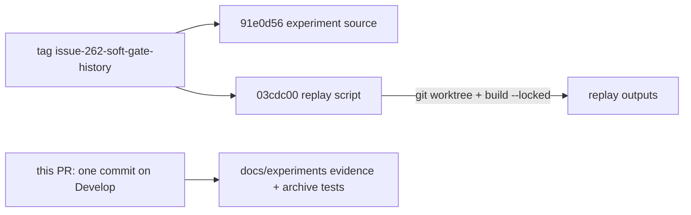

## Summary

Archives the #262 soft-gate investigation: protocol, locked manifests, negative
synthetic smoke results, the failed preflight, a verified historical replay and
the retirement decision. The optional soft-gate runtime was built, measured on a
synthetic fixture and removed because it had not earned its maintenance cost, so
`ockham/src/` is unchanged from `Develop`. The representative controlled
comparison remains unperformed. Part of #262.

## Spec

### Intent and Rationale

- Test one frozen-parent hidden-neuron gate ranking across nested
  full/90%/75%/50% budgets against independent pruning searches, reusing core
  inference/pruning, corpus streaming, activation statistics and the full
  directory scorer rather than a second pruning engine.
- The experiment ran on a public synthetic TANH fixture only; the paired score
  difference was negative and the held-out-error and latency criteria failed,
  so the runtime was retired and only evidence is kept.

### Essential Design Decisions

- The experimental source (`91e0d56ee27627382989a09dbc31b54b64f90d20`) and the
  replay script (`03cdc00a843571753ac7dfc6832b0f1bb7d90be7`) live only in
  history, preserved by the pushed tag `issue-262-soft-gate-history`. The
  protocol and `soft-gate-retirement-v1.json` replay them from a worktree of
  that commit; the maintained tree carries no replay script.
- The branch is one commit on `Develop` (the earlier commit-by-commit history
  is what the tag preserves). This was required: the worker's pre-push gate
  scans every commit ahead of the base, and any commit touching a `.sh` file
  makes it run `ci.yml`'s runlib refresh step outside Actions, where it fails
  on `RUNNER_TEMP: unbound variable`. That blocked the two earlier attempts.
- The maintenance decision is kept separate from the scientific verdict:
  removal is recorded, efficacy is inconclusive, and no benefit, deployment or
  default change is claimed.
- The historical method supports only forward-only, untyped
  IDENTITY/LOGISTIC/TANH networks (explicit exclusion, no fictitious
  gradients); manifests record calibration/untouched validation splits,
  paired seeds, family limits, costs and success criteria.

### Undiscoverable Facts

- No suitable representative mature-creature/corpus pair was available, so
  actual representative coverage is zero creatures and zero pairs.
- `soft-gate-replay-verification-v1.json` records the command as it was run
  (`scripts/replay-soft-gate-smoke.sh …` inside the 03cdc00-era tree); it is
  checksum-linked evidence and is left unchanged.
- The gate failure was reproduced in this run: a push whose commits deleted
  the script was refused with `/tmp/….sh: line 2: RUNNER_TEMP: unbound
  variable`; the squashed push passed the gate (5 changed-file checks).

## Evidence

Backend/docs only; no UI file is touched.

- `docs/experiments/soft-gate-smoke-results-v1.json`: ten paired seeds, 20
  completed families over 512 synthetic records (64 calibration, 128
  validation). Achieved hidden counts 20/18/15/10. Paired mean score difference
  −0.0001831, conditional 95% interval [−0.0002441, −0.0001222].
- `docs/experiments/soft-gate-replay-verification-v1.json`: an earlier run
  replayed the protocol from the pinned source with the real scorer; the
  paired distribution and interval match the original.
- `docs/experiments/soft-gate-retirement-v1.json` checksum-links every evidence
  file and names `replayScriptCommit` and `historyTag`.
- `git merge-base --is-ancestor` confirmed both pinned commits are ancestors of
  the tag `issue-262-soft-gate-history` (`4cd162c`) on origin.

## Acceptance Criteria

- **missing** — Compare independent pruning searches under equal total cost.
  Measure full/held-out error, latency and Pareto frontier. — reason: performed
  only on the public synthetic smoke fixture; no representative creature/corpus
  pair was available, so the representative comparison is still to run.
- **missing** — Do not claim success before representative runs. — reason: no
  success is claimed, but the representative runs this criterion waits on have
  not been performed, so the investigation's verdict stays open.

## Test Plan

- `ockham/tests/soft_gate_archive.rs` (this PR's only test file):
  - `archived_negative_result_and_coverage_match_the_retirement_decision` —
    negative findings, zero representative coverage, paired mean and interval,
    failed preflight, evidence checksums.
  - `historical_replay_preserves_the_paired_distribution_and_reports_zero_real_coverage`
    — replay record matches the original distribution and manifest checksums.
  - `retired_experiment_is_absent_from_the_installed_command` — `--help` has no
    `soft-gate` command.
  - `replay_command_pins_a_historical_script_that_builds_the_experiment_source`
    — retirement record pins a 40-hex script commit inside the replay command
    and the maintained tree has no replay script.
- `cargo test -p neat_ai_ockham --test soft_gate_archive < /dev/null`: passed,
  4 tests, on the final tree.
- `./quality.sh < /dev/null`: exit 0, "All quality checks passed!", on the
  final tree except the later docs-only tag wording in
  `docs/experiments/soft-gate-v1.md` and
  `docs/experiments/soft-gate-retirement-v1.json`; after that edit the archive
  tests, markdownlint, codespell and JSON validation were re-run and passed.
- No base-branch test is edited or removed.

## Merge verification

CI and ordinary pull-request review have not yet been observed.
