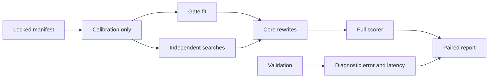

## Summary

Added the opt-in `soft-gate prepare/run` experiment, deterministic correctness
tests, a pinned method and reproducible public smoke evidence. Representative
performance and the resulting retention decision remain unverified. Part of #262.

## Spec

### Intent and Rationale

- Test one per-creature hidden-neuron ranking across several pruning budgets;
  the existing logistic candidate ranker remains a separate mechanism.
- Reuse corpus streaming, activation statistics, structure snapshots, core
  pruning requests and the directory scorer rather than introducing another engine.

### Essential Design Decisions

- v1 estimates mask derivatives numerically through canonical core inference.
  Ordinary parent weights/biases are frozen; temporary outgoing-edge modulation
  supplies gates. v1 supports 1–4096 hidden neurons in untyped, forward-only
  networks with IDENTITY/LOGISTIC/TANH non-constant activations and frozen
  constants. Numerical differentiation and f32 rounding are explicit limitations.
- Capacity means retained original hidden identities. One removal sequence
  produces nested full/90%/75%/50% candidates; compensation, cascades, support
  nodes, actual sizes, overshoot and unreachable targets are reported separately.
- Each complete four-budget family includes preparation, fitting/search,
  rewrites and evaluation costs. The control restarts from the parent for each
  reduced target. Cost-unmatched or incomplete pairs cannot earn retention.
- Validation does not enter fitting or selection. Full MSE scoring with the
  complete record count is required for an authoritative-improvement flag;
  experimental results remain diagnostic and do not publish an incumbent.

### Undiscoverable Facts

- The directly usable local `.bin` data found were identity fixtures. No
  representative creature/corpus pair was supplied for this investigation.
- The paper method and appendix were read through arXiv HTML. Raw PDF/TeX
  downloads returned HTTP 403; no raw-paper checksum is claimed. The manifest
  pins the reference-code commit and SHA-256 checksums of its three method files.

## Evidence

- Backend/CLI only. The release CLI completed 20 four-budget families over ten
  paired seeds with the real scorer and the committed
  `docs/experiments/soft-gate-smoke-manifest-v1.json` declaration.
- `docs/experiments/soft-gate-smoke-results-v1.json` records 512 synthetic
  records, 64 calibration records, 128 validation records and zero representative
  creatures. Achieved hidden/synapse/growth counts were 20/60/26, 18/54/23.4,
  15/45/19.5 and 10/30/13.
- The mean paired full-score difference was −0.0001831, with conditional 95%
  interval [−0.0002441, −0.0001222]. Held-out error and latency criteria also
  failed on this fixture. Timings are indicative measurements on a shared,
  parallel host; this is not a representative negative result.
- The compressed full results preserve rankings, identities, latency samples
  and rewrite trails. The compact report records their decompressed checksum.
  The failed first preflight is preserved separately: the adapter requires the
  reserved `baseline` stem, now enforced by the real output parser in tests.
- #262: Experiment: Learn one soft-gate ranking for nested pruning budgets.

## Acceptance Criteria

- **missing** — Deliver a reproducible command/manifest and machine-readable
  results with paired distributions, uncertainty, failures and actual coverage.
  Fixtures alone do not demonstrate an optimisation benefit. — reason: commands,
  manifests and smoke evidence are delivered; the representative controlled
  comparison remains unperformed because suitable data were unavailable.
- **missing** — Record negative findings and remove optional code that does not
  earn its maintenance cost. Do not claim success before representative runs. —
  reason: the synthetic result is recorded without a benefit claim; representative
  evidence needed to decide retention or removal of the opt-in implementation
  is still absent.

## Test Plan

- `cargo test -p neat_ai_ockham --lib soft_gate`: passed, ten tests.
  `ockham/src/soft_gate/fit.rs` covers frozen parents, canonical inference,
  analytic derivative agreement, reproducibility, activation refusals and budgets.
- `ockham/src/soft_gate/family.rs::family_is_nested_by_original_identity_and_preserves_the_full_parent`
  and `cascade_overshoot_and_unreachable_budgets_are_reported` exercise actual
  core pruning, nesting, protected IO and immutable parents.
- `ockham/src/soft_gate/manifest.rs::invalid_manifests_refuse_the_specific_contract_and_valid_controls_pass`
  covers invalid versions/parameters/ranges, overlap, bounded data and calibration
  placement independent of validation values.
- `ockham/src/soft_gate/study_tests.rs` covers sampled/partial/non-finite/wrong-cost
  scorer rejection, split isolation, both real rewrite paths, Pareto flags and
  positive/negative retention decisions using controlled measurements. Its MSE
  oracle uses core inference and the real scorer-output parser. The parser-bound
  test reproduced the missing-baseline fault before the filename fix and passed
  afterwards; the original CLI smoke also failed on that exact adapter message.
- `cargo test -p neat_ai_ockham --test soft_gate_cli`: passed, four tests in
  `ockham/tests/soft_gate_cli.rs`, covering real CLI dispatch, manifest/data drift,
  durable scorer/budget failures, private Unix outputs and parent preservation.
- Targeted clippy and formatting passed. The bounded foreground
  `./quality.sh < /dev/null` passed with `NEAT_SCORER_BIN` enabling
  `ockham/tests/real_scorer.rs::real_scorer_scores_the_incumbent_baseline`.
  The README layout omission found by the first gate was corrected;
  `ockham/tests/readme_contract.rs` and the complete gate then passed.
- No existing test assertions were removed. No twinned rule was changed.
  Docs sweep covered README Usage, Composite and learned priority/Training and
  Repository layout; the experiment protocol documents the new command.
- Security self-check: bounded/validated inputs, full input checksums, existing
  argument-based scorer invocation, private Unix output modes, no new dependencies
  or endpoints, and no hidden/credential files staged. No path-confinement guard
  was introduced.

## Merge verification

- CI and ordinary code review have not yet been observed.

Not checked: representative mature-creature performance and the final retention
decision. Numerical finite differences and the restricted activation subset
limit the experiment's applicability.
