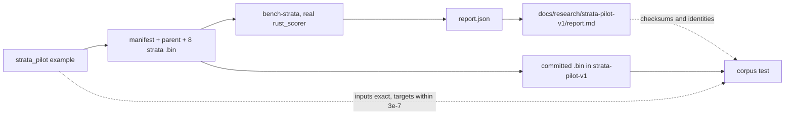

# PR Summary — Issue #263

## Summary

Runs the merged `bench-strata` experiment (from #268) once with the real
`rust_scorer` on a synthetic stratified pilot, and commits the record. A new
example, `ockham/examples/strata_pilot.rs`, writes the pilot inputs
deterministically, and four tests pin what it writes.
`docs/research/strata-pilot-v1/` holds the manifest, parent, the eight
`records.bin` corpora (about 25 KB), the raw report and a write-up. A test pins
the committed corpora to their checksums and checks the generator against them
within a libm tolerance.

The branch also repairs `.gitleaks.toml`. Under gitleaks 8.30.1 the base
config failed to load, so no secret scan could run.

The pilot is **inconclusive**. On all ten seeds, aggregate, worst-stratum and
Pareto selected the same dead-wood bundle. No arm had a minority regression,
and the predeclared criterion is not met for either treatment.

The paper's full text could still not be fetched, so the method stays unpinned.
No representative run was possible. Library code, CLI and defaults are
unchanged. Part of #263.

## Spec

### Intent and Rationale

- After #268 merged, the open gaps were a real-scorer run, the removal decision
  and the method pin. With no private corpora, the most this host can produce is
  a real-scorer synthetic pilot. It follows the pattern of
  `docs/research/connection-budget-v1/`.
- The generator is an example, not library code, so it adds nothing to the
  installed binary or the public API.
- This replaces PR #271, which was closed after its review stalled. That
  review asked for a test that pins the generated corpora. This branch adds it as
  `committed_corpora_match_the_record_and_regenerated_targets`.

### Essential Design Decisions

- **Inputs:** the fixture has four strata, one of them a minority (`rare`, 48
  records per split). Each stratum has a specialist neuron, and there are shared
  and dead-wood neurons. Targets are the parent's outputs after near-zero
  weights are removed, so cutting the dead wood wins on complexity and every
  other cut loses.
- **Pinning:** the eight `.bin` corpora are committed. An earlier revision
  pinned only the sha256 of regenerated corpora, but targets pass through
  neat-core's TANH, which is `f32::tanh` and calls the host libm `tanhf`. With
  an older glibc libm preloaded, regenerated targets moved by up to `1.2e-7`
  (about two ulps) and every checksum failed. The pins now apply to bytes that do not
  depend on libm:
  - each committed file's sha256 must equal the `report.md` table, and its
    identity and record count must equal `report.json`;
  - the committed manifest must resolve to those directories;
  - regenerated inputs, which use only SHA-256 and f64 arithmetic, must equal
    the committed inputs exactly;
  - regenerated and teacher targets must be within `TARGET_TOLERANCE = 3e-7`
    of the committed ones. Every stratum's largest teacher-versus-parent gap
    (at least `1.79e-6`) must still exceed 4 x that tolerance.

  The generated `manifest.json` and `parent.json` involve no libm call, and a
  test still checks them byte for byte.
- **gitleaks config:** the base `.gitleaks.toml` held an empty `[allowlist]`
  (`commits = []`). gitleaks 8.30.1 refuses that config with "`[[allowlists]]`
  must contain at least one check for: commits, paths, regexes, or stopwords",
  so the secret scan could not run. It is now `[extend] useDefault = true`,
  which loads, so gitleaks' default rules apply to every PR scan.
- **Removal:** the code stays opt-in. The pilot shows no benefit, but it is no
  representative negative result either, so removal waits on a representative
  run. `docs/strata-experiment.md` "Status" records this decision.

### Undiscoverable Facts

- **Paper:** on 2026-11-14 the host proxy refused every fetch, in three
  rounds. The URLs tried were `arxiv.org/{abs,pdf,html}/2610.27812`,
  `export.arxiv.org`, the Semantic Scholar API, Hugging Face Papers,
  `paperswithcode.co`, `alphaxiv.org`, `scholar.archive.org` and the
  `r.jina.ai` reader. A fourth check later that day also failed: `curl` to
  `arxiv.org`, `export.arxiv.org` and the Semantic Scholar API could not
  connect. The authors' promised code, `github.com/AMD-AGI/SliMOO`,
  returns 404. Web search gives only excerpts: SliMOO v1 (2026-10-20), TLIP
  single-layer probing with 8,192 tokens per task, a task-layer prior and
  NSGA-II.
- **Scorer:** built from NEAT-AI-scorer `742c5df30fc98ece3afe784be1aca18f925b47b3`
  (sha256 `d057a334…bbf7`), which has the same neat-core pin, v0.23.4, as
  Ockham.
- **Rerun:** a second run reproduced every selection, score, paired difference
  and criterion. The Pareto archive size differed, because latency is measured
  on the wall clock.

## Evidence

This changes an example, its tests, docs, committed pilot data and the
gitleaks config. There are no UI files and no `ockham/src/` change.

Pilot results (`docs/research/strata-pilot-v1/report.json`):

- 10 of 10 hidden neurons were measured, with 0 failures. The fitted
  temperature was 0.25 for both informed arms.
- Aggregate, worst-stratum and Pareto each selected `{d0,d1,d2,d3}` on every
  seed. The validation delta was 5.947e-7, with 0 minority regressions.
- The paired differences of each treatment against aggregate were all 0, with
  95% interval `[0, 0]`. Both criteria are `met: false`.
- The random control won on 4 of 10 seeds. Worst-stratum minus random had a
  validation delta of 4.755e-7, with 95% interval `[3.862e-7, 5.649e-7]`.
- The run made 208 scorer invocations. Wall-clock figures are indicative only,
  because the host is shared.

## Acceptance Criteria

<!-- vibe-spec-review inputs="diff+issue-body" -->

- **missing** — Read and pin the full method before reproducing it — evidence: `report.json` `method.source` says "full text not retrieved". `docs/strata-experiment.md` records the failed fetch rounds — reviewer: missing — reason: the full text is still unread. A fourth check on 2026-11-14 also failed: `curl` to `arxiv.org/abs/2610.27812`, `export.arxiv.org` and the Semantic Scholar API cannot connect (HTTP 000), and `github.com/AMD-AGI/SliMOO` returns 404.
- **partial** — Measure per-neuron removal cost on 3–5 representative calibration strata — evidence: `report.json` `coverage`, 10 of 10 neurons on 4 strata — reviewer: partial — reason: the strata are synthetic, and no representative run was possible.
- **met** — Compare aggregate, exp(-max/T) and a bounded Pareto archive on stratum error, connections and latency — evidence: `ockham/src/strata/{sampler,pareto}.rs` (merged in #268), with every arm in `report.json` `runs` and `arms` — reviewer: met
- **met** — Fit scales and temperature without holdout access — evidence: `ockham/src/strata/bench.rs` fits on calibration only, and `report.json` `fitted` and `method.temperatureFit` record it — reviewer: met
- **met** — Measure minority regressions, full fitness, removals and wins/hour — evidence: `report.json` `arms[]` `minorityRegressions`, `validationDelta`, `hiddenRemoved`, `synapsesRemoved` and `winsPerHour` — reviewer: met
- **met** — Canonically build and score combined cuts — evidence: `report.json` `runs[].bundlesScored`, with the selected bundles scored on validation — reviewer: met
- **met** — First inspect current code, merged work and repository instructions. Reuse existing mechanisms — evidence: `ockham/examples/strata_pilot.rs` reuses `corpus::write_bin_file`, `fixtures` and `strata::manifest::load`, and there is no `ockham/src/` change — reviewer: met
- **met** — Opt-in experiment only; preserve ordinary behaviour, interfaces, immutable parents and full authoritative acceptance — evidence: the only new code is the `[[example]] strata_pilot` target; `existing_directory_is_refused_and_left_untouched` — reviewer: met
- **partial** — Predeclare controls, seeds, sample size, compute limits and success/failure criteria — evidence: `docs/research/strata-pilot-v1/manifest.json`, `report.json` `versions` and `costs`, and `two_fresh_directories_are_byte_identical_and_load`, which asserts that validation differs from calibration — reviewer: partial — reason: the manifest first appears in the same commit as the results, so predeclaration before the run cannot be shown. This diff corrects the temperature-fit cost in `docs/strata-experiment.md` "Compute limits" and states in `report.md` "Costs" that the rerun's calls are not counted, but it cannot count them.
- **met** — Provide deterministic positive/negative correctness tests for new behaviour and pass the repository's normal quality checks — evidence: `ockham/examples/strata_pilot.rs::tests::committed_corpora_match_the_record_and_regenerated_targets` (positive) and `existing_directory_is_refused_and_left_untouched` (negative). Both pass with the host glibc 2.41 libm and with an older glibc libm preloaded. `./quality.sh < /dev/null` passed over this tree — reviewer: met
- **partial** — Deliver a reproducible command/manifest and machine-readable results with paired distributions, uncertainty, failures and actual coverage — evidence: `report.md` "Reproduce", the committed inputs in `docs/research/strata-pilot-v1/`, and `report.json` `paired[].differences`, `ci95`, `failures` and `coverage` — reviewer: partial — reason: the results are synthetic only. `bench-strata` was not rerun from the committed directory, because this host has no `rust_scorer`, and representative coverage is zero.
- **partial** — Record negative findings and remove optional code that does not earn its maintenance cost. Do not claim success before representative runs — evidence: `docs/strata-experiment.md` "Status" and `report.md` "Interpretation" — reviewer: partial — reason: the findings are recorded and no success is claimed. The removal decision waits on a representative run, which needs private corpora that this host does not have.
- **met** — Keep public implementation and fixtures application-agnostic — evidence: the strata are named `alpha`, `beta`, `gamma` and `rare`, and there are no host paths or private names in the diff or in `report.json` — reviewer: met
- **partial** — Leave unassigned until an implementer actively starts — evidence: the worker assigns the issue only when it claims it for an active run — reviewer: partial — reason: the issue is assigned under an active claim, but the prerequisite of reading the paper is still unmet.
- **unrequested** — crate version 0.1.93 to 0.1.94 in `ockham/Cargo.toml` and `Cargo.lock` — reviewer: unrequested — reason: the CI auto-increment commit `1364bf7`, which has no functional effect.
- **unrequested** — `.gitleaks.toml`: empty `[allowlist]` replaced with `[extend] useDefault = true` — reviewer: unrequested — reason: gitleaks 8.30.1 refuses the base config ("`[[allowlists]]` must contain at least one check for: commits, paths, regexes, or stopwords"). The reviewer also found that a config without `[extend]` loads no rules: a planted GitHub-token pattern gave "no leaks found" under it, and "leaks found: 1" with `useDefault = true`. The default rules now apply to every PR scan. CI pins gitleaks 8.24.2, and whether that version also rejects the old config was not checked.
- **unrequested** — `docs/archive/pr-summaries/pr-summary-263.md` replaces the #268 summary — reviewer: unrequested — reason: the run instructions require each PR's summary to replace the earlier one. Git history and #268 keep the earlier record.

## Standards Review

<!-- vibe-standards-review inputs="diff+CODING-STANDARDS.md" -->

- **violation** — docs must match the code: the older-libm drift was called "one ulp", but all targets are below 0.85, so `1.2e-7` is about two ulps — evidence: `ockham/examples/strata_pilot.rs:377` and `docs/research/strata-pilot-v1/report.md:139` — reason: fixed in this diff. Both now say "about two ulps", and the `3e-7` tolerance is unchanged. The reviewer recomputed the teacher in f64, and the committed targets lie within `9.3e-8` of it.
- **clean** — The repository has no `CODING-STANDARDS.md`, so the reviewer checked against `CONTRIBUTING.md` and `quality.sh`. Areas checked:
  - `sha256sum` of the eight committed `records.bin` files, `parent.json`, `manifest.json` and `report.json` matches `report.md`;
  - the report's cost, version and fixture claims match `report.json` and `parent.json`;
  - the test is deterministic across hosts: inputs and committed bytes are compared exactly, and only libm-dependent targets use a tolerance;
  - the `.bin` files are binary to git, and committing about 25 KB under `docs/research/` follows the `connection-budget-v1` precedent; the `.gitignore` artefact rule covers only root runtime outputs;
  - `.gitleaks.toml` is valid v8 config, and `gitleaks git origin/Develop..HEAD` finds no leaks;
  - `cargo fmt --check`, clippy with `-D warnings`, `markdownlint-cli2` and `scripts/spell-check.sh` are clean;
  - the version bump is mirrored in `Cargo.lock`.

  Mutation table: targets from the parent, the dead-wood threshold, the input stream index and a flipped committed byte each fail `committed_corpora_match_the_record_and_regenerated_targets`.

## Test Plan

- `ockham/examples/strata_pilot.rs` and its tests are added. `ockham/Cargo.toml`
  gets `[[example]] strata_pilot` with `test = true`, so the tests run under
  `cargo test --workspace`:
  - `committed_corpora_match_the_record_and_regenerated_targets` checks five
    things:
    - each of the eight committed `records.bin` files has the sha256 that
      `report.md` gives it, and the committed `manifest.json` resolves to
      those directories;
    - each committed stratum's `corpus_info` identity and record count equal
      `versions.calibration` and `versions.validation` in `report.json`;
    - regenerated inputs equal the committed inputs and `record_input` exactly,
      and every stratum has its own input at full scale and the others scaled
      down;
    - regenerated targets, and the teacher's outputs on this host, are within
      `TARGET_TOLERANCE` (`3e-7`) of every committed target;
    - in each stratum, some committed target differs from the unmodified
      parent's output by more than 4 x `TARGET_TOLERANCE`.
  - `two_fresh_directories_are_byte_identical_and_load` checks determinism, the
    record counts, that validation is not a copy of calibration, byte identity
    with the committed `manifest.json` and `parent.json`, and the parent's
    structure.
  - `rare_calibration_is_full_scale_in_input_three_only` checks the stratum
    scaling.
  - `existing_directory_is_refused_and_left_untouched` checks the refusal, and
    that a sentinel file survives.
- Portability: at the previous head, the old checksum test failed with
  `LD_PRELOAD=/opt/semgrep/lib/python3.13/site-packages/semgrep/bin/libs/libm.so.6`,
  an older glibc libm (`cal/alpha/records.bin sha256 differs from report.md`).
  At this head, the same test binary gives 4 passed with and without that
  preload. The largest target drift measured under that preload was
  `1.192e-7`.
- Mutations, each red on the new test, then restored:
  - targets from the parent instead of the teacher (regenerated target
    differs);
  - dead-wood threshold `1e-4` changed to `1e-9` (regenerated target differs);
  - input stream index `j` changed to `j + 1` (regenerated inputs differ);
  - one byte flipped in committed `val/rare/records.bin` (sha256 differs from
    `report.md`).
- `cargo test -p neat_ai_ockham --example strata_pilot`: 4 passed.
  `cargo clippy -p neat_ai_ockham --examples --tests -- -D warnings`: clean.
  `markdownlint-cli2`: 0 issues.
- `gitleaks dir` with the base config: `Failed to load config` (see the
  gitleaks entry above). With this branch's config it reports `no leaks found`,
  including over `docs/research/strata-pilot-v1/`.
- Real-scorer pilot run, then a fresh rerun: both exited 0. The selections,
  scores, paired results and criteria were identical.
- `./quality.sh < /dev/null` over this working tree (`eb5b065` plus the
  changes in this commit): `All quality checks passed!` (exit 0). After that
  run, only one doc comment and markdown wording changed. The example tests
  (4 passed), `cargo fmt --check` and `markdownlint-cli2` were rerun.
- No existing test from `Develop` was edited. The replaced test was added on
  this branch, and its successor keeps every check except exact equality of
  regenerated target bytes.
- Not run: any representative run, because no private corpora were available.
  `bench-strata` was not rerun from the committed directory, because no
  `rust_scorer` binary is on this host. The test checks that the committed
  manifest loads and resolves to the committed corpora.

## Merge verification

CI and pull-request review have not been observed yet.

Not done, and still a risk:

- the paper method is not pinned;
- there is no representative run;
- the removal decision is still open.
- CI pins gitleaks 8.24.2, and its result with the new `.gitleaks.toml` has
  not been observed yet.
