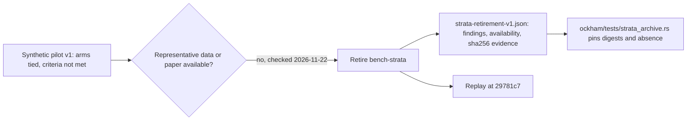

# PR Summary — Issue #263

## Summary

Retires the opt-in `bench-strata` research harness. This is the outcome #263
provides for in "Record negative findings and remove optional code that does
not earn its maintenance cost", and it follows the #261 and #262 retirements.

- **Removed:** the `bench-strata` subcommand, the `ockham/src/strata/` module,
  the `strata_pilot` example and `ockham/tests/strata_bench.rs`.
- **Why:**
  - The only run, a synthetic real-scorer pilot, was `inconclusive`. The
    aggregate, worst-stratum and pareto arms selected the same bundle
    `{d0, d1, d2, d3}` on all ten seeds, and every difference against
    aggregate was 0, with interval `[0, 0]`. Neither treatment met its
    criterion.
  - Since #268, #272 and #275, the source paper's full text has never been
    retrievable, and no representative corpus or scorer has been available on
    any checked host.
- **Recorded:** `docs/experiments/strata-retirement-v1.json` holds the
  decision, the negative findings, the 2026-11-22 availability check and the
  replay command. It also pins SHA-256 digests for the 11 archived pilot inputs
  and outputs, and `ockham/tests/strata_archive.rs` checks them.
- **Replay:** the harness stays replayable at commit
  `29781c784dc35cf6fc23ab404ee928c8fce49171`.
- **Not claimed:** no success, and no representative negative result.

Closes #263.

## Spec

### Intent and Rationale

- After three merged PRs, nothing left in #263 can be advanced on any host.
  The paper is unreachable, and representative strata would be private under
  the issue's own rule. Keeping roughly 4,500 lines of opt-in code for a run
  that cannot happen costs maintenance and earns nothing.
- Retirement mirrors the #261 (`ranking-retirement-v1.json`) and #262
  (`soft-gate-retirement-v1.json`) shape. The record, the digest-pinned
  evidence and a replay commit keep the comparison runnable without
  maintaining it.

### Essential Design Decisions

- **Predeclared rule:** the protocol said removal waits on a representative
  run. That run has never been possible, so this PR departs from the rule. The
  departure is written out in the record's `maintenanceReason`, in the banner
  of `docs/strata-experiment.md` and in its Status section. It is a
  maintenance decision, not evidence against the method.
- **Closes rather than Part of:** this is the reviewer departure. The
  independent Spec reviewer rated the representative comparison `partial` and
  "Read and pin the full method" `missing`. This PR still closes #263, as #261
  did. Pinning the method is a precondition of reproducing it, and the
  reproduction is now retired. A representative run's corpora and results
  would stay private under the issue's own rule. The record's `outstanding`
  field names the unperformed representative comparison.
- **Shared code kept:** `refuse_unless_frozen` stays in
  `ockham/src/incumbent.rs`, used by `audit-preservation`, with its tests in
  `ockham/src/preservation.rs`. `preservation.rs` now takes the identical
  1 MiB `MAX_MANIFEST_BYTES` from `additivity::manifest` instead of adding a
  copy.
- **Docs kept as history:** `docs/strata-experiment.md` and the pilot report
  stay as historical records, each with a retirement banner, so existing links
  still resolve.

### Undiscoverable Facts

- **Availability on 2026-11-22:**
  - `curl` to `arxiv.org/abs/2610.27812`, `export.arxiv.org/abs/2610.27812`,
    `arxiv.org/pdf/2610.27812v1` and the Semantic Scholar API returned `000`.
  - WebFetch of `arxiv.org/html/2610.27812v1`,
    `openreview.net/forum?id=KkPVejhpML` and `paperswithcode.co/paper/129664`
    got "proxy refused the connection".
  - `gh api repos/AMD-AGI/SliMOO` returned 404.
  - A filesystem-wide `find` found no `rust_scorer`.
  - Web search still returns only the abstract-level description.
- **Prior attempts:** the issue was deferred on 2026-11-15 for these same
  missing inputs, and none of them has appeared since.

## Evidence

This is a backend and docs change, with no UI files.

- `docs/experiments/strata-retirement-v1.json` is the new decision record.
- These docs were updated after reading every passage that names the harness:
  - the `README.md` section "Stratum-guided pruning experiment (retired)", and
    its layout tree;
  - the `docs/strata-experiment.md` banner, title and "Status";
  - the `docs/research/strata-pilot-v1/report.md` banner, "Versions and pins",
    the checksum and reproduce notes, and the manifest link;
  - the `docs/experiments/ranking-v1.md` compiled-latency bullet, now in the
    past tense;
  - the doc comments in `ockham/src/incumbent.rs`, `ockham/src/output_guard.rs`
    and `ockham/src/lib.rs`.
- No `strata` reference remains in `ockham/src`, `ockham/examples`,
  `quality.sh`, `scripts/` or `.github`. The only exception is the unrelated
  `strata_records` in `connection_budget`, which is not about this harness.

## Standards Review

<!-- vibe-standards-review inputs="diff+CODING-STANDARDS.md" -->

- **violation** — A doc in the diff described removed code as present at head
  ("is added on the issue #263 branch", "The `bench-strata` source is
  unchanged") — evidence: `docs/research/strata-pilot-v1/report.md:28` —
  reason: fixed in this diff
- **violation** — A changed sentence called the retired probe "the existing
  probe … compiles" — evidence: `docs/experiments/ranking-v1.md:161` — reason:
  fixed in this diff
- **clean** — The repository has no `CODING-STANDARDS.md`, so the reviewer
  used `CONTRIBUTING.md` and `README.md`. It found no rule enforced by review
  only. It checked:
  - principles 1–8: the ordinary pruning path, acceptance and the scorer are
    untouched, and the version bump is left to CI;
  - the README contract: the layout tree matches `ockham/src`, and no new
    flags were added;
  - that no named test is missing;
  - that no permissive stub was added;
  - that no workflow changed;
  - that no dangling `strata` references remain;
  - that the record's digests match the pilot's checksum table.
  - The `readme_contract.rs` `SUBCOMMANDS` change was not forced by the
    removal. The entry was dropped because the subcommand is gone and its
    flags are no longer part of the README contract. Left in, the test would
    still pass: at head, `neat_ai_ockham bench-strata --help` exits 0 and
    prints the top-level help, because clap takes `bench-strata` as the
    positional CREATURE. The absence of `bench-strata` is guarded only by
    `strata_archive.rs::retired_command_is_absent_from_the_installed_binary`.

## Test Plan

- **Added** `ockham/tests/strata_archive.rs`:
  - `every_evidence_file_exists_and_matches_its_recorded_sha256` checks the
    11 digests: the manifest, the parent, the report and the 8 `records.bin`
    files.
  - `archived_report_has_no_representative_coverage_and_tied_informed_arms`
    checks that both treatment criteria have `met: false` with
    `regressionReduction` 0, that there are 40 runs, and that the informed
    arms select `["d0","d1","d2","d3"]` on seeds 1–10.
  - `retired_command_is_absent_from_the_installed_binary` checks that
    `--help` lacks `bench-strata`, with `audit-preservation` present as a
    positive control.
  - `replay_names_the_pinned_commit_and_the_retired_command_is_gone_from_head`
    checks the literal pinned commit, that the replay command names
    `bench-strata`, and that `ockham/src/strata` is absent.
- **Edited** `ockham/tests/readme_contract.rs`: dropped `bench-strata` from
  `SUBCOMMANDS`.
  - Why: the subcommand no longer exists, so its flags are no longer part of
    the README contract. Keeping the entry would not have failed the test:
    `bench-strata --help` exits 0 at head and prints output byte-identical to
    the top-level `--help`, because clap takes `bench-strata` as the
    positional CREATURE. With the entry temporarily put back at head,
    `cargo test --test readme_contract` passed 10 of 10.
  - Still protected: the flag-contract tests still cover the top-level command
    and the three remaining subcommands. The retired command's absence is
    covered only by `strata_archive.rs` as above.
- **Removed with the code:** `ockham/tests/strata_bench.rs` and the
  `strata_pilot` example tests.
  - Evidence that the behaviour and its callers are gone: no
    `strata::`, `bench_strata` or `BenchStrata` reference remains under
    `ockham/`.
  - The shared freeze check keeps its coverage in `ockham/src/preservation.rs`:
    `frozen_audit_with_the_predeclared_digest_records_it`,
    `mismatched_digest_is_refused_before_anything_is_read_or_written` and
    `malformed_digest_is_refused`.
- **Results:**
  - `./quality.sh < /dev/null` passed on `7f08ecf` with "All quality checks
    passed!", and passed again on the final head `dd3ddd5`, after the review
    fixes.
  - `cargo test --test strata_archive --test readme_contract` passed: 4 and 10
    tests.
