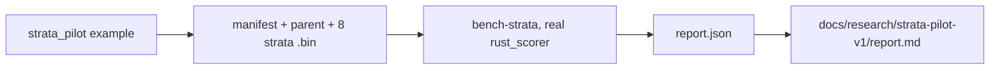

# PR Summary — Issue #263

## Summary

Runs the merged `bench-strata` experiment (from #268) once with the real
`rust_scorer` on a synthetic stratified pilot, and commits the record. A new
example, `ockham/examples/strata_pilot.rs`, writes the pilot inputs
deterministically. `docs/research/strata-pilot-v1/` holds the manifest, parent,
raw report and a write-up.

The pilot is **inconclusive**. On all ten seeds, aggregate, worst-stratum and
Pareto selected the same dead-wood bundle. No arm had a minority regression,
and the predeclared criterion is not met for either treatment.

The paper's full text could still not be fetched, so the method stays unpinned.
No representative run was possible. Library code, CLI and defaults are
unchanged. Part of #263.

## Spec

### Intent and Rationale

- After #268 merged, the open gaps were a real-scorer run, the removal decision
  and the method pin. With no private corpora, the most this host can produce is
  a real-scorer synthetic pilot. It follows the pattern of
  `docs/research/connection-budget-v1/`.
- The generator is an example, not library code, so it adds nothing to the
  installed binary or the public API.

### Essential Design Decisions

- **Inputs:** the fixture has four strata, one of them a minority (`rare`, 48
  records per split). Each stratum has a specialist neuron, and there are shared
  and dead-wood neurons. Targets are the parent's outputs after near-zero
  weights are removed, so cutting the dead wood wins on complexity and every
  other cut loses.
- **Pinning:** the committed `manifest.json` and `parent.json` are pinned to the
  generator by a test. The `.bin` files are not committed: they are regenerated
  byte for byte, and their checksums are in the write-up.
- **Removal:** the code stays opt-in. The pilot shows no benefit, but it is no
  representative negative result either, so removal waits on a representative
  run. `docs/strata-experiment.md` "Status" records this decision.

### Undiscoverable Facts

- **Paper:** on 2026-11-14 the host proxy refused every fetch with "proxy
  refused the connection". The URLs tried were
  `arxiv.org/{abs,pdf,html}/2610.27812`, `export.arxiv.org`, the Semantic
  Scholar API, Hugging Face Papers and `paperswithcode.co`. Web search gives
  only excerpts: SliMOO, TLIP single-layer probing, a task-layer prior and
  NSGA-II.
- **Scorer:** built from NEAT-AI-scorer `742c5df30fc98ece3afe784be1aca18f925b47b3`
  (sha256 `d057a334…bbf7`), which has the same neat-core pin, v0.23.4, as
  Ockham.
- **Rerun:** a second run reproduced every selection, score, paired difference
  and criterion. The Pareto archive size differed, because latency is measured
  on the wall clock.

## Evidence

Backend/CLI and docs only; no UI files changed.

Pilot results (`docs/research/strata-pilot-v1/report.json`):

- 10 of 10 hidden neurons were measured, with 0 failures. The fitted
  temperature was 0.25 for both informed arms.
- Aggregate, worst-stratum and Pareto each selected `{d0,d1,d2,d3}` on every
  seed. The validation delta was 5.947e-7, with 0 minority regressions.
- The paired differences of each treatment against aggregate were all 0, with
  95% interval `[0, 0]`. Both criteria are `met: false`.
- The random control won on 4 of 10 seeds. Worst-stratum minus random had a
  validation delta of 4.755e-7, with 95% interval `[3.862e-7, 5.649e-7]`.
- The run made 208 scorer invocations. Wall-clock figures are indicative only,
  because the host is shared.

## Acceptance Criteria

<!-- vibe-spec-review inputs="diff+issue-body" -->

- **missing** — Read and pin the full method before reproducing it — evidence: `docs/strata-experiment.md` "Source paper (full text unread)" — reviewer: missing — reason: the full text is still unread, because every fetch was refused again on 2026-11-14. The bench reproduces the issue's formula, and the deviations are recorded.
- **met** — First inspect current code, merged work and repository instructions. Reuse existing mechanisms — evidence: `ockham/examples/strata_pilot.rs` calls `strata::manifest::load`, `corpus::write_bin_file`, `fixtures` and `compile_creature`. The pilot runs through the merged `bench-strata` — reviewer: met
- **met** — Opt-in experiment only; preserve ordinary behaviour, interfaces, immutable parents and full authoritative acceptance — evidence: no `ockham/src/` change. The only new code is an example target — reviewer: met
- **met** — Predeclare controls, seeds, sample size, compute limits and success/failure criteria — evidence: `docs/research/strata-pilot-v1/manifest.json`, plus the pins and checksums in `report.md` — reviewer: met
- **met** — Provide deterministic positive/negative correctness tests for new behaviour and pass the repository's normal quality checks — evidence: `ockham/examples/strata_pilot.rs::tests::two_fresh_directories_are_byte_identical_and_load`, `rare_calibration_is_full_scale_in_input_three_only` and `existing_directory_is_refused_and_left_untouched`. `./quality.sh` passed at `3bc6f09` — reviewer: met
- **partial** — Deliver a reproducible command/manifest and machine-readable results with paired distributions, uncertainty, failures and actual coverage — evidence: `docs/research/strata-pilot-v1/report.md` "Reproduce" and `report.json` — reviewer: partial — reason: only a synthetic, non-discriminating run exists. Representative coverage is zero, and a representative run needs private corpora that this host does not have.
- **partial** — Record negative findings and remove optional code that does not earn its maintenance cost. Do not claim success before representative runs — evidence: the "Status" section of `docs/strata-experiment.md` and the pilot report — reviewer: partial — reason: the findings are recorded and no success is claimed. The removal decision still waits on a representative run.
- **met** — Keep public implementation and fixtures application-agnostic — evidence: generic stratum and neuron names, and hash-derived data only — reviewer: met
- **met** — Leave unassigned until an implementer actively starts — evidence: this is a process criterion, and nothing in the diff contradicts it — reviewer: met

## Standards Review

<!-- vibe-standards-review inputs="diff+CODING-STANDARDS.md" -->

- **clean** — The reviewer found no violation. It checked against `CONTRIBUTING.md`
  and `quality.sh`, because the repository has no `CODING-STANDARDS.md`, and it
  found no review-only rules. It checked:
  - the example only ever writes into a new directory and touches no
    production path;
  - dependencies, lints and Markdown links;
  - the numbers in `report.md` against `report.json`.

  It flagged unsupported claims, all corrected in this diff:
  - the reproduce path and `report.json` provenance;
  - a run-log count;
  - a selective archive-size sentence;
  - byte-identity with nothing checking it, now asserted by a test.

  It also flagged weak example tests, now strengthened.

## Test Plan

- Added `ockham/examples/strata_pilot.rs` and its tests. `ockham/Cargo.toml`
  gets `[[example]] strata_pilot` with `test = true`, so the tests run under
  `cargo test --workspace`. The tests:
  - `two_fresh_directories_are_byte_identical_and_load` checks:
    - generation is deterministic;
    - every count in both splits is right;
    - validation is not a copy of calibration;
    - the output is byte-identical to the committed `manifest.json` and
      `parent.json`;
    - the parent's structure.
  - `rare_calibration_is_full_scale_in_input_three_only` checks the stratum
    scaling.
  - `existing_directory_is_refused_and_left_untouched` checks the refusal, and
    that a sentinel file survives.
- `cargo test -p neat_ai_ockham --example strata_pilot`: 3 passed.
- Real-scorer pilot run, then a fresh rerun: both exited 0. The selections,
  scores, paired results and criteria were identical.
- `./quality.sh < /dev/null` at `3bc6f09`: `All quality checks passed!`
  (exit 0).
- No existing test was edited, and no assertion was removed.
- Not run: any representative run, because no private corpora were available.

## Merge verification

CI and pull-request review have not been observed yet.
