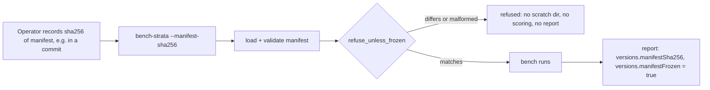

# PR Summary — Issue #263

## Summary

`bench-strata` can now freeze its manifest. The operator records the
manifest's SHA-256 before a representative run and passes it as
`--manifest-sha256 <digest>`. If the manifest bytes differ, the run is refused
before any scoring, scratch directory or report. The report records
`versions.manifestFrozen`, so a later reader can see that the run's controls,
seeds, limits and success rule were fixed when the digest was recorded. This
closes the predeclaration gap that the #272 review left open: there, the
synthetic pilot's manifest was committed in the same commit as its results.

The paper's full text still cannot be fetched, and this host still has no
representative corpora and no `rust_scorer`. The method stays unpinned, no
representative run has been made, and no benefit is claimed. Part of #263.

## Spec

### Intent and Rationale

- #268 (bench) and #272 (synthetic real-scorer pilot) are merged. Their
  remaining gaps are an unpinned method, no representative run, and
  predeclaration that cannot be shown. Only the last can be closed on this
  host.
- A digest check is the smallest way to show predeclaration. It reuses the
  `sha256` that `strata::manifest::load` already computes, and leaves the
  manifest schema unchanged.

### Essential Design Decisions

- `run_bench` takes a required `frozen_manifest_sha256: Option<&str>`. `None`
  keeps the previous behaviour, and no caller can omit the argument without
  the compiler saying so.
- `refuse_unless_frozen` (public in `ockham/src/strata/bench.rs`) runs straight
  after the manifest is loaded and validated. It runs in `run_bench` and also on
  the CLI's first read, which builds the latency probe, so every manifest read
  that a frozen run uses is checked. A digest is 64 hex digits in either case.
  A malformed value is echoed in the error, cut to 80 characters.
- `versions.manifestFrozen` is an added field in output-only JSON (`Versions`
  derives only `Serialize`), so the schema stays `ockham-strata-bench/1`. The
  committed pilot `report.json` predates the field and was not regenerated. The
  docs say that the pilot was not frozen.
- A freeze proves that the bytes did not change after the digest was recorded,
  not when it was recorded. The recording time comes from the operator's own
  record, such as a commit.

### Undiscoverable Facts

- **Paper:** on 2026-11-15, `curl` to `arxiv.org/{abs,pdf}/2610.27812`,
  `export.arxiv.org` and the Semantic Scholar API could not connect
  (`000`). WebFetch of `arxiv.org/abs/2610.27812` and
  `arxiv.org/html/2610.27812v1` got "proxy refused the connection".
  `github.com/AMD-AGI/SliMOO` returned 404. Web search still gives only the
  abstract-level description (SliMOO: task-layer probing, a
  task-layer prior, NSGA-II), with no hyper-parameters.
- **Inputs:** `rust_scorer` is not on `PATH`, and no representative corpus is
  available on this host.
- **Re-check after the completion gate (same day):** curl to
  `arxiv.org/abs`, `export.arxiv.org` and the Semantic Scholar API still got
  `000`, and `github.com/AMD-AGI/SliMOO` still returned 404. WebFetch of
  `arxiv.org/html/2610.27812v1` and of the paperswithcode mirror got "proxy
  refused the connection". A web search still turned up no hyper-parameters.
  A filesystem-wide `find` found no `rust_scorer` binary. The five `partial`
  criteria below each need the paper's full text or a representative corpus
  and scorer, so they stay `partial`. A representative manifest or result was
  not invented to fill the gap.

## Evidence

This is a backend/CLI change to an opt-in bench, with no UI files.

- #268: Experiment: Compare worst-stratum ablation guidance and Pareto pruning
  (Issue #263), the merged bench.
- #272: Experiment: Compare worst-stratum ablation guidance and Pareto pruning
  (Issue #263), the merged synthetic pilot.
- Docs updated: `docs/strata-experiment.md` (a new "Freezing the manifest"
  section, the `versions` bullet in "Report", and a "Status" bullet) and the
  `README.md` section "Stratum-guided pruning experiment (opt-in)".

## Acceptance Criteria

<!-- vibe-spec-review inputs="diff+issue-body" -->

- **partial** — Estimate per-neuron removal cost on 3–5 representative calibration strata. Compare aggregate-only pruning with probabilities proportional to exp(-max_t I[t,i]/temperature) and a bounded Pareto archive over stratum error, connections and measured latency. Fit scales/temperature without final-holdout access. Measure minority-stratum regressions, full fitness, removals and wins per hour. Canonically build and score combined cuts — evidence: `ockham/src/strata/bench.rs` (merged in #268), `docs/research/strata-pilot-v1/report.json` — reviewer: partial — reason: no representative strata are available on this host; only fixtures and the synthetic pilot have run
- **partial** — Read and pin the full method before reproducing it — evidence: `docs/strata-experiment.md` "Source paper (full text unread)" — reviewer: partial — reason: the full text is still unfetchable (curl `000`, proxy refusal, and the code repository returns 404 on 2026-11-15), so the method is not pinned
- **met** — First inspect current code, merged work and repository instructions. Reuse existing mechanisms; if functionality already exists, this issue still owns the missing controlled comparison rather than a second implementation — evidence: `ockham/src/strata/bench.rs::refuse_unless_frozen` compares against `loaded.sha256` from `strata::manifest::load` — reviewer: met
- **met** — Opt-in experiment only; preserve ordinary behaviour, interfaces, immutable parents and full authoritative acceptance. No automatic deployment or default change — evidence: optional flag; `None` keeps prior behaviour in every existing `ockham/tests/strata_bench.rs` call — reviewer: met
- **partial** — Predeclare controls, seeds, sample size, compute limits and success/failure criteria. Identify code/model/data versions; separate calibration from untouched validation and count all preparation/search costs — evidence: `ockham/tests/strata_bench.rs::mismatched_digest_is_refused_before_any_work_and_the_correct_digest_is_accepted`, `versions.manifestFrozen` — reviewer: partial — reason: the freeze mechanism now exists, but no representative manifest has been frozen with it
- **met** — Provide deterministic positive/negative correctness tests for new behaviour and pass the repository's normal quality checks. Research runs are separate from routine feature CI — evidence: `ockham/tests/strata_bench.rs::frozen_run_with_the_predeclared_digest_records_that_it_was_checked` (positive), `malformed_digest_is_refused_before_any_work` and `bench_strata_refuses_a_wrong_manifest_sha256_before_the_scorer_runs` (negative); `./quality.sh < /dev/null` passed — reviewer: met — reason: the reviewer could not run the gate; it was run here on the head and passed
- **partial** — Deliver a reproducible command/manifest and machine-readable results with paired distributions, uncertainty, failures and actual coverage. Fixtures alone do not demonstrate an optimisation benefit — evidence: `docs/strata-experiment.md` "Freezing the manifest" and "Report"; `docs/research/strata-pilot-v1/report.json` — reviewer: partial — reason: only synthetic results exist; no representative run is possible here
- **partial** — Record negative findings and remove optional code that does not earn its maintenance cost. Do not claim success before representative runs — evidence: `docs/strata-experiment.md` "Status" — reviewer: met — reason: no success is claimed and the findings are recorded, but the removal decision still needs a representative run, so this stays partial
- **met** — Keep public implementation and fixtures application-agnostic; private corpora/results and operational integration remain private — evidence: the new code, docs and tests use no private names or paths — reviewer: met
- **met** — Leave unassigned until an implementer actively starts. `work-on` authorises the investigation, not skipping prerequisite verification — evidence: this run assigned nothing, and merged work, the paper and host inputs were checked before coding — reviewer: missing — reason: the reviewer said it is "not assessable" from a diff; assignment is issue state, not code

## Standards Review

<!-- vibe-standards-review inputs="diff+CODING-STANDARDS.md" -->

- **clean** — The repository has no `CODING-STANDARDS.md`, so the reviewer used `CONTRIBUTING.md`, `README.md` and `docs/strata-experiment.md`. It found no rule enforced by review only. It checked:
  - the eight CONTRIBUTING principles (the parent is never written, scorer acceptance is unchanged, no TypeScript);
  - that the docs match the code;
  - that no named test is missing;
  - that no new stub stands in for another binary;
  - that no workflow changed;
  - that `sha2` is already a dependency;
  - that both edited existing tests (the end-to-end `manifestFrozen == false` assertion, and `--help` listing `--manifest-sha256`) fail without the code they test.

  Its optional notes on the CLI's unchecked first manifest read, the "before any work" wording and a truncation assertion that applied to every input were fixed in `48604d5`.

## Test Plan

- Added to `ockham/tests/strata_bench.rs`:
  - `frozen_run_with_the_predeclared_digest_records_that_it_was_checked`: the
    digest, computed independently with `sha2` and passed in upper case, is
    accepted. The in-memory and on-disk report have `manifestFrozen == true`
    and `manifestSha256` equal to the lowercase digest.
  - `mismatched_digest_is_refused_before_any_work_and_the_correct_digest_is_accepted`:
    a digest that differs by one character is refused. The error names both
    digests and "predeclared", there is no report and no `report.json.work`,
    and the scorer gets zero calls. A positive control on the same fixture,
    with the correct digest, is accepted and writes its report.
  - `malformed_digest_is_refused_before_any_work`: 63 hex digits, 64 characters
    with one non-hex, and 200 characters are each refused with "64 hex digits".
    Nothing is written or scored, and only the 200-character case is checked
    for truncation to 80 characters.
  - `bench_strata_refuses_a_wrong_manifest_sha256_before_the_scorer_runs`
    (CLI): exits non-zero with "predeclared" on stderr, never reaches
    `--scorer /nonexistent`, and writes no report.
- Edited existing tests (no assertion removed):
  - the end-to-end test also asserts `versions.manifestFrozen == false`;
  - `bench_strata_help_lists_its_flags` also expects `--manifest-sha256`;
  - four existing `run_bench` calls gain `None`.
- TDD: the new tests were written first and failed to compile against the
  unchanged `run_bench` (`E0061: this function takes 4 arguments but 5
  arguments were supplied`).
- Callers of `run_bench` checked: `ockham/src/main.rs` (passes the flag) and
  the four test calls. The other `run_bench` callers belong to
  `additivity::bench` and are unaffected.
- `cargo test -p neat_ai_ockham --test strata_bench`: 11 passed.
  `cargo test -p neat_ai_ockham --test readme_contract`: 10 passed. Clippy
  with `-D warnings`, `cargo fmt --check` and rustdoc with `-D warnings` were
  clean.
- `./quality.sh < /dev/null` on head `48604d5`: `All quality checks passed!`
  (exit 0).
- Docs sweep: I read `docs/strata-experiment.md` ("Manifest", "Report",
  "Status") and the README section. The pilot `report.md` is a historical
  record and is unchanged.

## Merge verification

CI and pull-request review have not been observed yet.

Not done, and still a risk:

- the paper method is not pinned;
- no representative run has been made, and none is frozen;
- the removal decision is still open;
- the committed pilot `report.json` has no `manifestFrozen` field;
- macOS was not checked.
