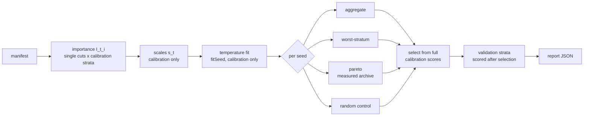

# PR Summary — Issue #263

## Summary

Adds an opt-in, offline experiment command,
`neat_ai_ockham bench-strata <manifest.json> --out <report.json>`. It
compares four arms on the same parent and calibration strata: aggregate-only
pruning, worst-stratum guidance (p ∝ exp(−max_t I[t,i]/T)), a bounded Pareto
archive, and a seeded random control. Bundles are built through core's
canonical prune path and selected only from full scorer results. The selected
creatures are then scored on untouched validation strata, and the command writes
a machine-readable report with paired distributions, bootstrap intervals,
failures, coverage and costs. Ordinary runs, defaults and interfaces are
unchanged.

No representative run has been made, and the paper's full method could not be
retrieved, so this is the harness only. Part of #263.

## Spec

### Intent and Rationale

- The issue asks for a controlled comparison, not a new pruning mode, so this
  is a separate subcommand. It reuses `load_incumbent`,
  `compute_activation_stats`, `prune_hidden_neuron`/`prune_hidden_group`,
  `corpus_info`, `DirectoryScorer`/`ExternalScorer` and `SplitMix64`.
- Per-neuron, per-stratum removal cost I[t,i] comes from the real scorer. All
  single cuts sit in one directory, scored once per calibration stratum, so no
  scorer logic is copied.
- The aggregate arm uses the same sampler and the same temperature fit as the
  worst-stratum arm, with a different statistic: the record-weighted mean of
  scaled costs versus their maximum. A paired difference therefore isolates the
  statistic the issue asks about.

### Essential Design Decisions

- **Predictions only order.** Every arm's selection is the best full-score
  calibration win. The Pareto arm pre-screens on predicted cost only to choose
  what gets scored. It then archives *measured* calibration worst-stratum loss,
  synapses and latency, and picks the lowest-loss archived win.
- **Fitting never sees validation.** Scales (the per-stratum median |I|) and
  temperatures (a grid, `fitSeed`) are fitted on calibration only. `fitSeed`
  may not be an evaluation seed, and no validation directory may equal a
  calibration directory. Validation records are scored only after every arm of
  a seed has selected.
- **Equal compute.** Each arm spends `bundlesPerArm` full calibration
  evaluations per seed. Pareto spends `min(bundlesPerArm, distinct built
  candidates)`. Costs are split into preparation (importance, statistics,
  temperature fit, parent latency) and per-arm work; `winsPerHour` takes an
  even share of preparation per arm.
- **Fail loud and keep the parent safe.** Scorer errors abort the run, naming
  the stage. The parent is never written. An existing `<report>.work` scratch
  directory is refused, and the scratch directory is removed on success and on
  error. Latency is wall-clock and indicative only: it enters the Pareto
  dominance test through a relative `latencyTolerance`, so noise can change the
  selection only between exactly tied losses.

### Undiscoverable Facts

- arXiv:2610.27812 could not be fetched in this run (`proxy refused the
  connection`). The method reproduces the issue's own formula, and the report's
  `method.source` and the docs say so.
- No `rust_scorer` binary or private elite corpora were available, so every
  end-to-end run uses an in-test scorer. That scorer follows `rust_scorer`'s
  directory-mode contract (`ockham/src/scorer.rs` module doc).
- Core splices single-input IDENTITY hidden neurons as an exact rewrite, so the
  fixtures use HARD_TANH neurons.

## Evidence

Backend/CLI only; no UI files changed.

- `./quality.sh < /dev/null` ran on head `92c4812`: `All quality checks
  passed!` (exit 0).
- `ockham/tests/strata_bench.rs`: 7 passed. On the trap fixture (one neuron is
  costly only on the small `rare` stratum), aggregate has 5 minority
  regressions and worst-stratum 0, so the worst-stratum criterion is met. With
  uniform costs it is not met.
- The test scorer (`StratumScorer`) mirrors `rust_scorer`'s directory-mode
  contract from `ockham/src/scorer.rs`: output keyed by file stem, `baseline`
  required, full mode only, every creature parsed and validated, widths checked
  against the corpus, and record counts from `corpus_info`.
  `stub_refuses_a_creature_whose_input_width_differs_from_the_corpus` shows it
  is no more permissive than the real scorer on width.
- Issue numbers the diff cites: #263: Experiment: Compare worst-stratum
  ablation guidance and Pareto pruning.

## Acceptance Criteria

<!-- vibe-spec-review inputs="diff+issue-body" -->

- **met** — Estimate per-neuron removal cost on 3–5 representative calibration strata — evidence: `ockham/src/strata/bench.rs`, `ockham/src/strata/manifest.rs` (3..=5 refusals tested) — reviewer: met
- **met** — Compare aggregate-only pruning with probabilities proportional to exp(-max_t I[t,i]/temperature) — evidence: `ockham/src/strata/sampler.rs`, `ockham/tests/strata_bench.rs::end_to_end_worst_stratum_avoids_the_minority_regression_that_aggregate_walks_into` — reviewer: partial — reason: the reviewer wanted Ockham's ordinary loop as the control. This bench does not run that loop; the aggregate arm shares the sampler and temperature fit so the paired difference isolates the statistic the issue names (documented in `docs/strata-experiment.md`)
- **met** — a bounded Pareto archive over stratum error, connections and measured latency — evidence: `ockham/src/strata/pareto.rs` unit tests, the e2e archive and selection assertions — reviewer: partial — reason: the reviewer saw an archive built on predicted error and raw wall-clock latency. Commit `92c4812` now archives measured calibration worst-stratum loss with a relative latency tolerance
- **met** — Fit scales/temperature without final-holdout access — evidence: e2e assertion that no `single-`/`fit-` creature is scored on a validation directory; `fitSeed` overlap refusal in `manifest.rs` — reviewer: met
- **met** — Measure minority-stratum regressions, full fitness, removals and wins per hour — evidence: `RunRecord` in `ockham/src/strata/report.rs`, asserted in the e2e test — reviewer: met
- **met** — Canonically build and score combined cuts; individual importance never proves bundle quality — evidence: `prune_hidden_group` builds and full-score selection in `bench.rs`; Pareto selection from measured losses (`pareto::select_win` tests) — reviewer: partial — reason: the Pareto part the reviewer flagged was fixed in `92c4812`
- **met** — First inspect current code, merged work and repository instructions. Reuse existing mechanisms — evidence: reused `load_incumbent`, `compute_activation_stats`, `prune_hidden_*`, `corpus_info`, `DirectoryScorer`, `SplitMix64` — reviewer: partial — reason: the reviewer named the control arm (above) and a per-hour formula. The private `throughput.rs` `per_hour` works on `VisitCounts` and returns 0 for zero time, while this report needs `null`, so it does not fit
- **met** — Opt-in experiment only; preserve ordinary behaviour, interfaces, immutable parents and full authoritative acceptance. No automatic deployment or default change — evidence: separate `bench-strata` subcommand; e2e parent-bytes check — reviewer: met
- **met** — Predeclare controls, seeds, sample size, compute limits and success/failure criteria — evidence: manifest `seeds`, `fitSeed`, `bundlesPerArm`, `paretoCandidates`, `statsRecords`, `success`; `criteria` in the report — reviewer: met
- **met** — Identify code/model/data versions; separate calibration from untouched validation and count all preparation/search costs — evidence: `versions` (`ockhamVersion`, `neatCoreSource`, `scorerIdentity`, `parentChecksum`, `manifestSha256`, per-stratum corpus identities); `costs.prepMs` now includes the parent latency probe — reviewer: partial — reason: the missing core version and the uncounted parent probe were fixed in `92c4812`
- **met** — Provide deterministic positive/negative correctness tests for new behaviour and pass the repository's normal quality checks — evidence: `ockham/tests/strata_bench.rs` (7) plus 57 module tests; `./quality.sh` passed on `92c4812` — reviewer: met
- **met** — Deliver a reproducible command/manifest and machine-readable results with paired distributions, uncertainty, failures and actual coverage — evidence: `report.rs` `paired` with seeded bootstrap `ci95`, `failures`, `coverage` — reviewer: partial — reason: the reproducibility gap (Pareto membership depended on wall-clock latency) was fixed in `92c4812`
- **missing** — Fixtures alone do not demonstrate an optimisation benefit — reviewer: met — reason: the code labels the report correctly, but no representative run exists, so no benefit (or lack of one) is shown yet
- **missing** — Record negative findings and remove optional code that does not earn its maintenance cost. Do not claim success before representative runs — reviewer: partial — reason: no success is claimed, but there is no representative-run finding to record or act on yet; that needs private corpora and the real scorer
- **met** — Keep public implementation and fixtures application-agnostic — evidence: generic stratum and neuron names, no private data — reviewer: met
- **missing** — Read and pin the full method before reproducing it — reviewer: missing — reason: arXiv:2610.27812 could not be fetched here (proxy refused the connection); the issue's formula is reproduced and the gap is stated in the report
- **unrequested** — `random` uniform negative-control arm and its paired rows — reviewer: unrequested — reason: a predeclared control the issue asks for
- **unrequested** — Pareto candidates alternate the aggregate and worst-stratum samplers — reviewer: unrequested — reason: the issue does not say how Pareto candidates are drawn; alternating keeps the archive from inheriting one statistic
- **unrequested** — `regressedStrata` per-run count — reviewer: unrequested — reason: shows regressions outside the minority stratum next to the requested minority metric
- **unrequested** — manifest hardening (1 MiB cap, unknown fields refused) — reviewer: unrequested — reason: the manifest is an untrusted input file
- **unrequested** — `--scorer-arg` pass-through — reviewer: unrequested — reason: same meaning as the top-level flag, needed to pass the cost and backend to `rust_scorer`
- **unrequested** — atomic report write and refusal of an existing `<out>.work` — reviewer: unrequested — reason: never deletes a directory the run did not create
- **unrequested** — `ockham/tests/readme_contract.rs` subcommand list gains `bench-strata` — reviewer: unrequested — reason: keeps the README flag contract covering the new flags

## Standards Review

<!-- vibe-standards-review inputs="diff+CODING-STANDARDS.md" -->

- **violation** — the test stub for `rust_scorer` was more permissive than the real scorer and named no contract — evidence: `ockham/tests/strata_bench.rs:58` — reason: fixed in this diff (`StratumScorer` now parses and validates creatures, checks widths against `corpus_info`, refuses sample mode and a missing baseline, names `ockham/src/scorer.rs` as its contract, and has a refusal test)
- **clean** — parent never written; only `ScorerMode::Full` used and nothing accepted or published; opt-in subcommand with no default change; `SplitMix64` visibility change only; no named-but-absent tests; no workflow changes; README layout lists the new files; the `readme_contract.rs` edit still fails without the subcommand. The reviewer found no review-only rules: the repository has no `CODING-STANDARDS.md`, so it checked against `CONTRIBUTING.md`.

## Test Plan

- Added `ockham/tests/strata_bench.rs`. Its tests are:
  - `end_to_end_worst_stratum_avoids_the_minority_regression_that_aggregate_walks_into`
  - `uniform_costs_do_not_meet_the_worst_stratum_criterion`
  - `stub_refuses_a_creature_whose_input_width_differs_from_the_corpus`
  - `existing_scratch_directory_is_refused_and_left_untouched`
  - `scorer_failure_names_its_stage_and_removes_the_scratch_directory`
  - `bench_strata_help_lists_its_flags`
  - `bench_strata_names_a_missing_manifest_and_exits_non_zero`
- The e2e test has positive controls showing that the Pareto selection branch
  runs and that at least one seed archives two or more wins.
- Added module tests: `ockham/src/strata/manifest.rs` covers every refusal,
  each with a legal counterpart that loads. Also added: `sampler.rs`,
  `pareto.rs`, `report.rs` and `bench.rs`.
- Edited `ockham/tests/readme_contract.rs`: `SUBCOMMANDS` gains
  `bench-strata`. No assertion was removed.
- `./quality.sh < /dev/null` on `92c4812`: passed (`All quality checks
  passed!`).
- Not run: any run with the real `rust_scorer` or on representative data (both
  unavailable here). Wall-clock latency and `winsPerHour` are never asserted.
