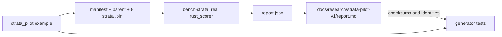

# PR Summary — Issue #263

## Summary

Runs the merged `bench-strata` experiment (from #268) once with the real
`rust_scorer` on a synthetic stratified pilot, and commits the record. A new
example, `ockham/examples/strata_pilot.rs`, writes the pilot inputs
deterministically, and four tests pin what it writes, including every
regenerated corpus against the committed checksums.
`docs/research/strata-pilot-v1/` holds the manifest, parent, raw report and a
write-up.

The pilot is **inconclusive**. On all ten seeds, aggregate, worst-stratum and
Pareto selected the same dead-wood bundle. No arm had a minority regression,
and the predeclared criterion is not met for either treatment.

The paper's full text could still not be fetched, so the method stays unpinned.
No representative run was possible. Library code, CLI and defaults are
unchanged. Part of #263.

## Spec

### Intent and Rationale

- After #268 merged, the open gaps were a real-scorer run, the removal decision
  and the method pin. With no private corpora, the most this host can produce is
  a real-scorer synthetic pilot. It follows the pattern of
  `docs/research/connection-budget-v1/`.
- The generator is an example, not library code, so it adds nothing to the
  installed binary or the public API.
- This replaces PR #271, which was closed after its review stalled. That
  review asked for a test that pins the generated corpora. This branch adds it as
  `generated_corpora_match_the_committed_record_and_teacher_targets`.

### Essential Design Decisions

- **Inputs:** the fixture has four strata, one of them a minority (`rare`, 48
  records per split). Each stratum has a specialist neuron, and there are shared
  and dead-wood neurons. Targets are the parent's outputs after near-zero
  weights are removed, so cutting the dead wood wins on complexity and every
  other cut loses.
- **Pinning:** the `.bin` corpora are not committed. Tests check that the
  generator still reproduces each one's sha256 from the `report.md` table and
  its `report.json` identity and record count. They also check that the
  generator still reproduces the committed `manifest.json` and `parent.json`
  byte for byte.
- **Removal:** the code stays opt-in. The pilot shows no benefit, but it is no
  representative negative result either, so removal waits on a representative
  run. `docs/strata-experiment.md` "Status" records this decision.

### Undiscoverable Facts

- **Paper:** on 2026-11-14 the host proxy refused every fetch, in three
  rounds. The URLs tried were `arxiv.org/{abs,pdf,html}/2610.27812`,
  `export.arxiv.org`, the Semantic Scholar API, Hugging Face Papers,
  `paperswithcode.co`, `alphaxiv.org`, `scholar.archive.org` and the
  `r.jina.ai` reader. The authors' promised code, `github.com/AMD-AGI/SliMOO`,
  returns 404. Web search gives only excerpts: SliMOO v1 (2026-10-20), TLIP
  single-layer probing with 8,192 tokens per task, a task-layer prior and
  NSGA-II.
- **Scorer:** built from NEAT-AI-scorer `742c5df30fc98ece3afe784be1aca18f925b47b3`
  (sha256 `d057a334…bbf7`), which has the same neat-core pin, v0.23.4, as
  Ockham.
- **Rerun:** a second run reproduced every selection, score, paired difference
  and criterion. The Pareto archive size differed, because latency is measured
  on the wall clock.

## Evidence

Backend/CLI and docs only; no UI files changed.

Pilot results (`docs/research/strata-pilot-v1/report.json`):

- 10 of 10 hidden neurons were measured, with 0 failures. The fitted
  temperature was 0.25 for both informed arms.
- Aggregate, worst-stratum and Pareto each selected `{d0,d1,d2,d3}` on every
  seed. The validation delta was 5.947e-7, with 0 minority regressions.
- The paired differences of each treatment against aggregate were all 0, with
  95% interval `[0, 0]`. Both criteria are `met: false`.
- The random control won on 4 of 10 seeds. Worst-stratum minus random had a
  validation delta of 4.755e-7, with 95% interval `[3.862e-7, 5.649e-7]`.
- The run made 208 scorer invocations. Wall-clock figures are indicative only,
  because the host is shared.

## Acceptance Criteria

<!-- vibe-spec-review inputs="diff+issue-body" -->

- **missing** — Read and pin the full method before reproducing it — reviewer: missing — reason: the full text is still unread. A third round of fetches on 2026-11-14 (arXiv, five mirrors and readers) was refused by the host proxy with a 403, and the authors' code repository `AMD-AGI/SliMOO` returns 404. `docs/strata-experiment.md` pins only `arXiv:2610.27812v1` and the search-excerpt notes.
- **met** — First inspect current code, merged work and repository instructions. Reuse existing mechanisms — evidence: `ockham/examples/strata_pilot.rs` calls `strata::manifest::load`, `corpus::write_bin_file`, `fixtures` and `compile_creature`. The pilot runs through the merged `bench-strata` — reviewer: met
- **met** — Opt-in experiment only; preserve ordinary behaviour, interfaces, immutable parents and full authoritative acceptance — evidence: no `ockham/src/` change. The only new code is an example target; `existing_directory_is_refused_and_left_untouched` — reviewer: met
- **partial** — Predeclare controls, seeds, sample size, compute limits and success/failure criteria — evidence: `docs/research/strata-pilot-v1/manifest.json`, plus the pins, checksums and costs in `report.md` — reviewer: partial — reason: the manifest, generator and results land in one diff, so predeclaration before the run cannot be shown from the record. A representative run still needs its own manifest committed first.
- **met** — Provide deterministic positive/negative correctness tests for new behaviour and pass the repository's normal quality checks — evidence: `ockham/examples/strata_pilot.rs::tests::generated_corpora_match_the_committed_record_and_teacher_targets`, `two_fresh_directories_are_byte_identical_and_load`, `rare_calibration_is_full_scale_in_input_three_only` and `existing_directory_is_refused_and_left_untouched`. `./quality.sh` passed at `dc7b82a` — reviewer: partial — reason: the reviewer found the tests sufficient but saw a summary citing the gate at an older commit. The gate was rerun at `dc7b82a`, after the fourth test was added, and it passed.
- **partial** — Deliver a reproducible command/manifest and machine-readable results with paired distributions, uncertainty, failures and actual coverage — evidence: `docs/research/strata-pilot-v1/report.md` "Reproduce" and `report.json` — reviewer: partial — reason: only a synthetic run exists, and it cannot tell the arms apart. Representative coverage is zero. A representative run needs private corpora, and a re-check on 2026-11-14 found none on this host.
- **partial** — Record negative findings and remove optional code that does not earn its maintenance cost. Do not claim success before representative runs — evidence: the "Status" section of `docs/strata-experiment.md` and the pilot report — reviewer: partial — reason: the findings are recorded and no success is claimed. The removal decision still waits on a representative run, which this host cannot make. The pilot cannot discriminate between the arms, so it is not grounds for removal.
- **met** — Keep public implementation and fixtures application-agnostic — evidence: generic stratum and neuron names, and hash-derived data only — reviewer: met
- **met** — Leave unassigned until an implementer actively starts — evidence: this is a process criterion, and nothing in the diff contradicts it — reviewer: missing — reason: the reviewer said "not assessable from the diff". Only the worker assigns the issue, and it does so when it claims the issue for an active run. This run made no assignment change.
- **unrequested** — crate version 0.1.93 to 0.1.94 in `ockham/Cargo.toml` and `Cargo.lock` — reviewer: unrequested — reason: the repository's auto-increment commit, which has no functional effect.
- **unrequested** — `docs/archive/pr-summaries/pr-summary-263.md` replaces the #268 summary — reviewer: unrequested — reason: the run instructions require each PR's summary to replace the earlier one. Git history and #268 keep the earlier record.

## Standards Review

<!-- vibe-standards-review inputs="diff+CODING-STANDARDS.md" -->

- **violation** — `CONTRIBUTING.md` "Local gate": the summary recorded `./quality.sh` at an older commit and listed three tests, while HEAD adds a fourth — evidence: `docs/archive/pr-summaries/pr-summary-263.md:139` — reason: fixed in this diff. The gate was rerun at `dc7b82a` and passed, and the Test Plan below lists all four tests.
- **clean** — The repository has no `CODING-STANDARDS.md`, so the reviewer checked against `CONTRIBUTING.md` and `quality.sh`, which state no review-only rules. Areas checked:
  - the example only writes into a new directory, and no production path or `ockham/src/` code changes;
  - no new dependency, and the neat-core pin is unchanged;
  - `[[example]]` wiring follows the `connection_budget` precedent;
  - every named test exists;
  - no scorer stubs, and no workflow change;
  - the `report.md` identities and counts match `report.json`, and the links resolve.

  Mutation table: corrupting the targets, the dead-wood threshold or the input stream index each fails `generated_corpora_match_the_committed_record_and_teacher_targets`.

## Test Plan

- `ockham/examples/strata_pilot.rs` and its tests are added. `ockham/Cargo.toml`
  gets `[[example]] strata_pilot` with `test = true`, so the tests run under
  `cargo test --workspace`:
  - `generated_corpora_match_the_committed_record_and_teacher_targets` checks
    four things:
    - each of the eight regenerated `records.bin` files has the sha256 that the
      committed `report.md` table gives it;
    - each stratum's `corpus_info` identity and record count equal
      `versions.calibration` and `versions.validation` in `report.json`;
    - every stratum in both splits has its own input at full scale and the
      others scaled down;
    - every target equals the teacher's output exactly, and in each stratum at
      least one target differs from the unmodified parent's output.
  - `two_fresh_directories_are_byte_identical_and_load` checks determinism, the
    record counts, that validation is not a copy of calibration, byte identity
    with the committed `manifest.json` and `parent.json`, and the parent's
    structure.
  - `rare_calibration_is_full_scale_in_input_three_only` checks the stratum
    scaling.
  - `existing_directory_is_refused_and_left_untouched` checks the refusal, and
    that a sentinel file survives.
- `cargo test -p neat_ai_ockham --example strata_pilot`: 4 passed.
- Real-scorer pilot run, then a fresh rerun: both exited 0. The selections,
  scores, paired results and criteria were identical.
- `./quality.sh < /dev/null` at `dc7b82a`: `All quality checks passed!`
  (exit 0).
- No existing test was edited, and no assertion was removed.
- Not run: any representative run, because no private corpora were available.

## Merge verification

CI and pull-request review have not been observed yet.

Not done, and still a risk:

- the paper method is not pinned;
- there is no representative run;
- the removal decision is still open.
