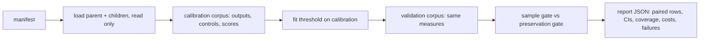

# PR summary — Issue #264

## Summary

Adds an opt-in, report-only `neat_ai_ockham audit-preservation <manifest.json> --out <report.json>` subcommand. For each pruned or quantised child it measures how well the child preserves its parent's held-out outputs. Each measure is normalised against two trivial controls: predicting the parent's mean output, and a record-shuffled copy of the parent's outputs (one per seed). It also reports task loss and latency separately. It compares a preservation gate, with its threshold fitted on calibration records, against the current sample gate on untouched validation records: false rejections of genuinely better children, AUC, and a paired bootstrap interval on the AUC gain. Nothing in the ordinary run path changes, and the command never writes a creature. No representative run has been made, so no benefit is claimed. Part of #264.

## Spec

### Intent and Rationale

- The issue asks whether parent-output similarity, measured against trivial controls, carries diagnostic value beyond the current sampled error. A separate subcommand answers that offline without touching acceptance.
- Normalising by the mean-output and shuffled controls stops a collapsed child that outputs a constant from looking good: one equal to the parent mean scores exactly 0.

### Essential Design Decisions

- Score: `preservationVsMean = 1 − E_child/E_mean` and `preservationVsShuffle = 1 − E_child/mean_s E_shuf(s)`. A denominator of zero, or below 1e-24, gives `null` with the degenerate reason `zeroVarianceParent` or `zeroShuffleError`, so the report never holds NaN or infinity.
- Authoritative `fullDelta` and the current `sampleDelta` are manifest inputs from earlier scorer runs. The audit never runs the scorer and never decides anything, so parent similarity cannot stand in for authoritative fitness.
- The threshold θ is fitted on the calibration corpus only (balanced accuracy, ties go to the smallest θ). Validation records are read only to apply it.
- Reuses `load_incumbent` (creature validation and SHA-256), the corpus streaming helpers, `compile_creature`, and `ordering::SplitMix64`. SplitMix64 is now `pub(crate)`; only its visibility changed.

### Undiscoverable Facts

- Only the abstract of arXiv:2611.13681 was available, and the full method is not pinned. The formulas are this crate's own, and the report and docs say so.
- No private corpora, elite manifest or real scorer outputs were available in this run.

## Evidence

Backend/CLI only. The tests and the gate below were run on the head.

## Acceptance Criteria

<!-- vibe-spec-review inputs="diff+issue-body" -->

- **met** — "compute held-out output preservation normalised against mean-output and record-shuffled controls" — evidence: `ockham/src/preservation.rs::ratio_score_identical_and_degenerate` — reviewer: met
- **met** — "Specify formula and degenerate zero-variance handling" — evidence: `docs/preservation-audit.md`, `ockham/src/preservation.rs::constant_child_at_parent_mean_scores_zero_and_constant_parent_is_degenerate` — reviewer: met
- **partial** — "include deliberately collapsed parent/child fixtures" — evidence: `ockham/src/preservation.rs::end_to_end_fixture_audit_writes_and_returns_the_same_report` — reviewer: partial — reason: the collapsed child runs end to end, but the collapsed parent is tested only through the controls function, not through `run_audit`
- **partial** — "Compare diagnostic value and possible screening benefit with current sample error, measuring false rejection of genuinely better children" — evidence: `ockham/src/preservation.rs` gates and AUC — reviewer: partial — reason: the same children (and their manifest labels) both fit θ and are scored on validation, so validation rates are not measured on unseen children. The sample error comes from the manifest, not the existing screen.
- **met** — "Report task loss and actual latency separately" — evidence: `taskLoss` and `latencyMsPer1kRecords` fields — reviewer: met — reason: the reviewer noted the timing includes corpus reading; the docs say so
- **met** — "Begin report-only: parent similarity never substitutes for authoritative fitness or proves a useful parent" — evidence: `ockham/tests/preservation_audit.rs::an_end_to_end_audit_writes_a_report_and_leaves_the_parent_untouched` — reviewer: met
- **partial** — "Reuse existing mechanisms" — evidence: `load_incumbent`, corpus helpers, `SplitMix64` — reviewer: partial — reason: the Mann–Whitney AUC duplicates the one in `ockham/src/model.rs`; the sampled screen in `promote.rs` is not reused
- **met** — "Opt-in experiment only; preserve ordinary behaviour, interfaces, immutable parents and full authoritative acceptance" — evidence: `ockham/src/main.rs` new subcommand only — reviewer: met
- **partial** — "Predeclare controls, seeds, sample size, compute limits and success/failure criteria. Identify code/model/data versions; separate calibration from untouched validation and count all preparation/search costs" — evidence: manifest validation and the `versions`/`costs` fields — reviewer: partial — reason: no commit hash is recorded, the same children are reused across the two splits, and costs leave out bootstrap and θ search time and the cost of producing the children
- **met** — "Provide deterministic positive/negative correctness tests for new behaviour and pass the repository's normal quality checks" — evidence: 9 unit tests, 3 CLI tests, and `./quality.sh` passed on the head — reviewer: met
- **partial** — "Deliver a reproducible command/manifest and machine-readable results with paired distributions, uncertainty, failures and actual coverage" — evidence: `paired`, `ci95`, `aucGain`, `coverage`, `failures` fields — reviewer: partial — reason: the paired rows are reject flags, not paired score distributions. A non-finite parent output aborts with an error instead of writing a report.
- **partial** — "Record negative findings and remove optional code that does not earn its maintenance cost. Do not claim success before representative runs" — evidence: `docs/preservation-audit.md` status — reviewer: partial — reason: no success is claimed, but no representative run exists yet, so there is no finding to record and no basis to decide removal
- **met** — "Keep public implementation and fixtures application-agnostic" — evidence: synthetic fixtures in `ockham/tests/preservation_audit.rs` — reviewer: met
- **missing** — "Read and pin the full method before reproducing it" — reviewer: missing — reason: the arXiv full text was not retrieved in this environment, and only the abstract is cited
- **unrequested** — `SplitMix64` made `pub(crate)` and `audit-preservation` added to the README contract list — reviewer: unrequested — reason: needed to reuse the existing RNG, and the README contract test requires every subcommand to be listed
- **unrequested** — manifest hardening (1 MiB cap, `deny_unknown_fields`, atomic write, `sampleTolerance`) — reviewer: unrequested — reason: input validation at the trust boundary and a tunable version of the current sample gate

## Standards Review

<!-- vibe-standards-review inputs="diff+CODING-STANDARDS.md" -->

- **clean** — no `CODING-STANDARDS.md` exists, so the review used `CONTRIBUTING.md` principles 1 and 3–8 (creature never written, acceptance only by the full scorer, optional and isolated, no TypeScript, version bump by CI), the README-as-contract rule, and named tests that exist. The `readme_contract.rs` list change still fails without the new subcommand.

## Test Plan

- Added `ockham/tests/preservation_audit.rs`: help output, a missing manifest refused by name, and an end-to-end run that leaves the parent bytes unchanged.
- Added unit tests in `ockham/src/preservation.rs`: ratio and degenerate scores, a collapsed child and a constant parent, AUC edges, threshold fit, bootstrap reproducibility, manifest refusals by field with a valid control, width mismatch refused, and an end-to-end report.
- Modified `ockham/tests/readme_contract.rs`: `SUBCOMMANDS` gains `audit-preservation`; no assertion removed.
- `./quality.sh < /dev/null` on head 2188cad: passed ("All quality checks passed!", exit 0).
- Not covered by a test: the `nonFiniteOutput` path, the 1 MiB manifest cap, and the `met`/`notEvaluable` criterion outcomes (the CLI fixture reaches `notMet`).
