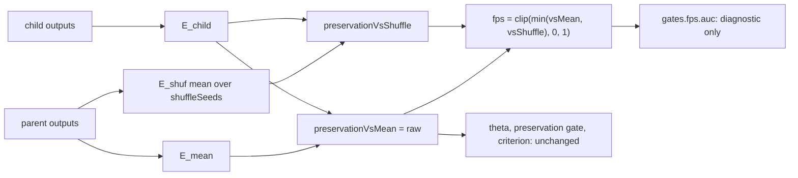

# PR summary — Issue #264

## Summary

The preservation audit is now pinned to the paper's own method. arxiv.org is
still unreachable from the worker host, but the paper's comment field names a
public toolkit, and GitHub is reachable:
`github.com/Praveg432/functional-preservation-score`, commit
`2b716ddb632b6c8674e74615e0b65af3f28c9f17`, `shared/fps.py`. The same
definition is eq. 1 of `paper-arxiv/paper.tex` in that repository.

`audit-preservation` now reports the paper's Functional Preservation Score:

- `fps` and `fpsControl` for each child on each split;
- `fps` on each paired row;
- `gates.fps.auc`, a diagnostic for validation children.

`docs/preservation-audit.md` lists each departure from the pinned method. FPS
is diagnostic only. The predeclared criterion, `theta`, the preservation gate
and the schema string are unchanged.

Representative runs are still impossible here: no private corpora and no
`rust_scorer`. So the screening benefit is unmeasured and the keep-or-remove
decision is still open. Part of #264.

## Spec

### Intent and Rationale

- The method could not be pinned while only the abstract was available. The
  authors' toolkit is the reference implementation the paper cites, so it is
  the source to pin to.
- `preservationVsMean` already equals the paper's `raw` R² score. FPS is
  therefore `clip(min(preservationVsMean, preservationVsShuffle), 0, 1)`. It
  comes from the existing control errors, with no second pass over the corpus.

### Essential Design Decisions

- FPS is `null` whenever a `degenerate` reason is present. The paper instead
  returns made-up fallbacks: `raw` 1.0 or 0.0, and `fps` 0.0. Returning `null`
  follows the audit's existing rule that it never invents a value.
- FPS is diagnostic only. The criterion was predeclared on
  `preservationVsMean`, so moving it to FPS after the manifest freeze would
  break that predeclaration.
- The shuffle null stays the mean over `shuffleSeeds`. The paper uses one numpy
  permutation. That permutation cannot be reproduced in Rust, and changing the
  existing control would change `preservationVsShuffle`.
- The new fields are additive and nothing in the crate reads a report back, so
  `schema` stays `ockham-preservation-audit/1`.

### Undiscoverable Facts

- On 2026-11-15, `curl` to `arxiv.org`, `export.arxiv.org`, `huggingface.co`,
  `api.semanticscholar.org` and `alphaxiv.org` all failed through the proxy
  (`CONNECT tunnel failed, response 403`, or HTTP code `000`). `github.com`
  returned 200.
- `gh search code "2611.13681"` found an arXiv Atom entry. Its comment field
  says "Code, data loaders, and all result artifacts at
  https://github.com/Praveg432/functional-preservation-score". The toolkit is
  MIT-licensed. Only its formula is used here, not its code.
- `which rust_scorer` finds nothing, and no representative corpora are
  available on this host.

## Evidence

This is a backend/CLI change, with no UI files.

- The pinned definition is `shared/fps.py` at `2b716dd`: `raw = 1 - ss_res /
  ss_tot`, `raw_null = max(raw(shuffle), raw(mean_pred))` and
  `fps = clip((raw - raw_null) / (1 - raw_null), 0, 1)`.
- Docs updated:
  - `docs/preservation-audit.md`: "Purpose and status", "Formulas",
    "Degenerate handling", the new "Departures from the pinned method", "Gates
    and the success rule", "Calibration and validation", "Known limitations
    and negative findings" and "Report fields". "Report fields" now says that
    `splits` scores every child on both corpora, and that only the child's own
    role's split feeds `theta`, the gates and its paired row;
  - `README.md`: the section "Preservation audit (opt-in, report-only)".
- A grep of `docs/preservation-audit.md` and `ockham/src/preservation.rs` for
  `abstract` and `pinned` on the head finds no remaining abstract-only or
  not-pinned wording.

## Acceptance Criteria

<!-- vibe-spec-review inputs="diff+issue-body" -->

The issue has no Acceptance Criteria or Definition of done heading. These three
items from its "Execution and acceptance" list are still open. An independent
spec reviewer judged them over `git diff origin/Develop` and the issue body:

- **partial** — "Deliver a reproducible command/manifest and machine-readable results with paired distributions, uncertainty, failures and actual coverage. Fixtures alone do not demonstrate an optimisation benefit" — evidence: `audit-preservation`, manifest with `--manifest-sha256`, report with `paired`, `ci95`, `failures` and `coverage` (`ockham/src/preservation.rs::end_to_end_fixture_audit_writes_and_returns_the_same_report`) — reviewer: partial — reason: only fixture results exist; no representative run is possible here (no private corpora, no `rust_scorer`)
- **partial** — "Compare diagnostic value and possible screening benefit with current sample error, measuring false rejection of genuinely better children" — evidence: `ockham/src/preservation.rs::sample_gate_false_rejection_that_preservation_keeps_is_met`, `gates.sample` vs `gates.preservation` and diagnostic `gates.fps` — reviewer: partial — reason: the comparison runs on fixture children only; `fullDelta` and `sampleDelta` are manifest inputs, and no real children have been compared
- **partial** — "Record negative findings and remove optional code that does not earn its maintenance cost. Do not claim success before representative runs" — evidence: `docs/preservation-audit.md` "Known limitations and negative findings"; `evidence: "fixture-or-unverified"` in the report — reviewer: partial — reason: negative findings are recorded and no success is claimed, but the keep-or-remove decision needs a representative run

## Test Plan

- Added to `ockham/src/preservation.rs`:
  `fps_matches_the_paper_formula_and_picks_the_best_control`. Its eight literal
  cases were computed from the paper's formula, not from the code:
  - mean control best: 0.75;
  - shuffle control best: 0.5;
  - worse than trivial: clipped to 0;
  - an exact match: 1;
  - a tie: `"mean"`;
  - a zero mean control: `null`;
  - a shuffle control below `1e-24`: `null`;
  - a NaN shuffle control: `null`.
- Extended in `ockham/src/preservation.rs` (no assertion removed):
  - `shuffle_control_task_loss_and_latency_are_reported`:
    - the exact copy has `fps` 1.0;
    - the collapsed child has `preservationVsMean < 0` and `fps == 0.0`, so the
      clip is shown;
    - for `cal-w110`, the precondition `shuffle mean > meanControlError` holds,
      then `fpsControl == "mean"` and `fps` equals its `preservationVsMean`.
  - `collapsed_parent_audit_is_degenerate_and_not_evaluable`: each child's `fps`
    and `fpsControl` are `null`, and `gates.fps.auc` is `null`.
  - `sample_gate_false_rejection_that_preservation_keeps_is_met`:
    `gates.fps.auc == 1.0`, `v-copy` `fps` is 1.0, and `v-bad1` `fps` is 0.0.
    `v-slip`'s validation-split `fps` differs from its calibration-split
    `fps`, and its paired row carries the validation value. The criterion is
    still `met`.
  - `constant_parent_validation_leaves_preservation_gate_and_coverage_null`:
    `gates.fps.auc` and `v-slip`'s paired-row `fps` are `null`, while
    `v-slip`'s calibration-split `fps` is a number.
  - `non_finite_parent_split_fails_every_child_and_is_not_evaluable`: failed
    children have `null` `fps` and `fpsControl`. The test's `SplitRun` literal
    gains the new `fps` field.
- TDD: the extended tests were written first, and they failed to compile:
  - `error[E0425]: cannot find function 'fps_score' in this scope`;
  - `error[E0560]: struct 'preservation::SplitRun' has no field named 'fps'`.
- Red check for the split assertions: changing `evaluate` to read `cal.fps[i]`
  instead of `val.fps[i]` fails the tests. With both reads changed, the two
  tests above fail. With only the `gates.fps.auc` read changed,
  `constant_parent_validation_leaves_preservation_gate_and_coverage_null`
  fails. With only the paired-row read changed, both fail. The code was then
  restored.
- Results:
  - `cargo test -p neat_ai_ockham --lib preservation`: 22 passed;
  - `--test preservation_audit`: 4 passed;
  - `--test readme_contract`: 10 passed;
  - clippy `-D warnings` and `cargo fmt` were clean;
  - `./quality.sh < /dev/null` on the head's tree: "All quality checks passed!".

## Merge verification

CI and pull-request review have not been observed yet.

Not done, and still a risk:

- the method is pinned to the authors' toolkit, not to the arXiv PDF, which
  could not be fetched;
- no representative run has been made, and none is frozen;
- the keep-or-remove decision is still open;
- macOS was not checked.
