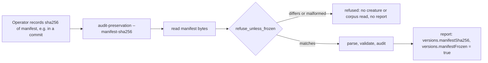

# PR summary — Issue #264

## Summary

`audit-preservation` can now freeze its manifest. The report records
`versions.manifestSha256`, the SHA-256 of the manifest bytes. With the new
optional `--manifest-sha256 <SHA256>` flag, a run whose manifest differs from
the predeclared digest is refused before the manifest is parsed, before any
creature or corpus is read, and before anything is written. A matching run
records `versions.manifestFrozen = true`. Before this change the report echoed
the manifest but did not identify it, so nobody could show that the controls,
seeds, sample size, limits and success rule were fixed before the run.

The paper's full text still cannot be fetched, and no representative corpora
exist on this host. The method stays unpinned, no representative run has been
made, and no benefit is claimed. Part of #264.

## Spec

### Intent and Rationale

- #269 delivered the audit. Its open gaps were the paper method, representative
  runs, and predeclaration that could not be shown. Only the last can be closed
  on this host.
- A digest check is the smallest way to show predeclaration. It reuses
  `crate::incumbent::sha256_hex` and leaves the manifest schema unchanged.

### Essential Design Decisions

- `run_audit` takes a required `frozen_manifest_sha256: Option<&str>`, so the
  compiler names every caller. `None` keeps the earlier behaviour apart from
  the two added report fields.
- The check (`refuse_unless_frozen`, private in `ockham/src/preservation.rs`)
  runs straight after `read_manifest` and before `parse_manifest`. A digest is
  64 hex digits in either case. A malformed value is echoed in the error, cut
  to 80 characters.
- A freeze proves that the manifest bytes did not change after the digest was
  recorded, not when it was recorded. The recording time comes from the
  operator's own record, such as a commit. The docs say so.
- Open PR #275 (Issue #263) adds a similar check for `bench-strata` in
  `ockham/src/strata/bench.rs`. It is not on Develop, so this audit has its own
  private helper. The two checks are not shared yet.

### Undiscoverable Facts

- On 2026-11-15, `curl` to `arxiv.org/abs/2611.13681` and `export.arxiv.org`
  got `CONNECT tunnel failed, response 403`. The method is still not pinned.
- `rust_scorer` is not on `PATH`, and no private or representative corpora are
  available here.
- Re-checked at 2026-11-15T02:36Z, after the completion checks named five
  criteria as not met: both arXiv URLs still return `CONNECT tunnel failed,
  response 403`, `which rust_scorer` finds nothing, and a host-wide search
  found only throwaway test creatures under `/tmp`. Each of the five needs the
  paper or a representative run, so none was changed to `met` and no code was
  added for them.

## Evidence

This is a backend/CLI change, with no UI files.

- Docs updated:
  - `docs/preservation-audit.md`: a new "Freezing the manifest" section, a
    pointer from "Predeclared parameters and compute limits", the `versions`
    bullet in "Report fields", the "Flow" chart, and the retry note in "Known
    limitations and negative findings";
  - `README.md` section "Preservation audit (opt-in, report-only)".
- Issue numbers cited: #269 (the merged audit PR for this issue) and #275 (open
  PR, "Experiment: Compare worst-stratum ablation guidance and Pareto pruning
  (Issue #263)").

## Acceptance Criteria

<!-- vibe-spec-review inputs="diff+issue-body" -->

- **met** — "For pruned/quantised descendants compute held-out output preservation normalised against mean-output and record-shuffled controls" — evidence: `ockham/src/preservation.rs::shuffle_control_task_loss_and_latency_are_reported` (merged in #269) — reviewer: met
- **met** — "Specify formula and degenerate zero-variance handling" — evidence: `docs/preservation-audit.md` "Degenerate handling", `ockham/src/preservation.rs::constant_child_at_parent_mean_scores_zero_and_constant_parent_is_degenerate` — reviewer: met
- **met** — "include deliberately collapsed parent/child fixtures" — evidence: `ockham/src/preservation.rs::collapsed_parent_audit_is_degenerate_and_not_evaluable` — reviewer: met
- **partial** — "Compare diagnostic value and possible screening benefit with current sample error, measuring false rejection of genuinely better children" — evidence: `ockham/src/preservation.rs::sample_gate_false_rejection_that_preservation_keeps_is_met`, `preservation_false_rejection_above_sample_rate_is_not_met` — reviewer: met — reason: the comparison works on fixtures, but `sampleDelta`/`fullDelta` are still manifest inputs and no representative children have been compared, so the screening benefit is unmeasured
- **met** — "Report task loss and actual latency separately" — evidence: `ockham/src/preservation.rs::shuffle_control_task_loss_and_latency_are_reported` — reviewer: met
- **met** — "Begin report-only: parent similarity never substitutes for authoritative fitness or proves a useful parent" — evidence: `ockham/tests/preservation_audit.rs::an_end_to_end_audit_writes_a_report_and_leaves_the_parent_untouched` — reviewer: met
- **missing** — "Read and pin the full method before reproducing it" — reviewer: missing — reason: arXiv:2611.13681 is still unfetchable (`CONNECT tunnel failed, response 403` on 2026-11-15)
- **met** — "First inspect current code, merged work and repository instructions. Reuse existing mechanisms" — evidence: `ockham/src/preservation.rs::run_audit` hashes with `crate::incumbent::sha256_hex` — reviewer: met
- **met** — "Opt-in experiment only; preserve ordinary behaviour, interfaces, immutable parents and full authoritative acceptance. No automatic deployment or default change" — evidence: optional flag in `ockham/src/main.rs`; every existing `run_audit` test call passes `None` and keeps its assertions — reviewer: met
- **partial** — "Predeclare controls, seeds, sample size, compute limits and success/failure criteria. Identify code/model/data versions; separate calibration from untouched validation and count all preparation/search costs" — evidence: `ockham/src/preservation.rs::mismatched_digest_is_refused_before_anything_is_read_or_written`, `frozen_audit_with_the_predeclared_digest_records_it`, `versions.manifestSha256` — reviewer: met — reason: the freeze now exists, but no representative manifest has been frozen with it, and `preparationMs` is still self-reported rather than measured
- **met** — "Provide deterministic positive/negative correctness tests for new behaviour and pass the repository's normal quality checks" — evidence: `ockham/src/preservation.rs::frozen_audit_with_the_predeclared_digest_records_it` (positive), `malformed_digest_is_refused` and `ockham/tests/preservation_audit.rs::a_wrong_manifest_sha256_is_refused_and_no_report_is_written` (negative); `./quality.sh < /dev/null` passed on 0049a6e — reviewer: partial — reason: the reviewer is read-only and could not run the gate; it was run here on the head and passed
- **partial** — "Deliver a reproducible command/manifest and machine-readable results with paired distributions, uncertainty, failures and actual coverage. Fixtures alone do not demonstrate an optimisation benefit" — evidence: `docs/preservation-audit.md` "Freezing the manifest" and "Report fields" — reviewer: met — reason: the command and report exist, but only fixture results exist, and the issue says fixtures alone do not demonstrate a benefit
- **partial** — "Record negative findings and remove optional code that does not earn its maintenance cost. Do not claim success before representative runs" — evidence: `docs/preservation-audit.md` "Known limitations and negative findings" — reviewer: partial — reason: no success is claimed and the findings are recorded, but the keep-or-remove decision needs a representative run
- **met** — "Keep public implementation and fixtures application-agnostic" — evidence: synthetic fixtures only in `ockham/src/preservation.rs` tests — reviewer: met
- **met** — "Leave unassigned until an implementer actively starts" — evidence: this run assigned nobody — reviewer: missing — reason: the reviewer said "not assessable" from a diff; assignment is issue state
- **unrequested** — the `latencyMsPer1kRecords` sentence moved to its own bullet in `docs/preservation-audit.md` — reviewer: unrequested — reason: it had been joined onto the unrelated arXiv bullet that this diff edits

## Standards Review

<!-- vibe-standards-review inputs="diff+CODING-STANDARDS.md" -->

- **clean** — The repository has no `CODING-STANDARDS.md`, so the reviewer used `CONTRIBUTING.md` and `README.md`. It found no rule enforced by review only. It checked:
  - that the audit stays report-only and the freeze is an opt-in refusal (principles 1, 4 and 6);
  - that the docs and the flow chart match the code;
  - that no named test is missing;
  - that no stub stands in for another binary;
  - that no workflow changed;
  - that both edited existing tests fail without the code they test.

  It also flagged `ockham/src/preservation.rs:1251-1253` as likely to fail `cargo fmt --check`, while saying it could not run the check. I ran `cargo fmt --all --check` on the head and it exited 0, and the full gate's fmt stage passed, so that is not a violation.

## Test Plan

- Added to `ockham/src/preservation.rs` (`mod tests`):
  - `frozen_audit_with_the_predeclared_digest_records_it`: the digest is computed independently with `sha2` and passed in upper case. The returned and on-disk reports have `manifestFrozen == true` and `manifestSha256` equal to the lowercase digest.
  - `mismatched_digest_is_refused_before_anything_is_read_or_written`: the manifest's parent names a missing file. A one-character-off digest is refused, naming both digests and "predeclared". The error does not name the missing parent, and no report or `.tmp` is written. Positive controls:
    - the correct digest on the same manifest gets past the freeze and fails on the missing parent;
    - the untouched fixture with its digest is accepted.
  - `malformed_digest_is_refused`: 63 hex digits, 64 characters with a non-hex `g`, and 200 characters are each refused with "64 hex digits", with no report written. Only the 200-character case is checked for the cut to 80 characters.
- Added to `ockham/tests/preservation_audit.rs`: `a_wrong_manifest_sha256_is_refused_and_no_report_is_written`. The CLI exits non-zero with "predeclared" on stderr for a manifest that would not even parse, and writes no report.
- Edited existing tests (no assertion removed):
  - `end_to_end_fixture_audit_writes_and_returns_the_same_report` also asserts `manifestFrozen == false` and `manifestSha256`;
  - `audit_preservation_help_lists_out_and_says_report_only` also expects `--manifest-sha256`;
  - the 12 existing `run_audit` calls gain `None`.
- TDD: the new tests were written first and failed to compile against the old signature (`E0061: this function takes 2 arguments but 3 arguments were supplied`).
- Callers of `run_audit` checked: `ockham/src/main.rs` (passes the flag) and the test calls above. No other caller exists.
- Results:
  - `cargo test -p neat_ai_ockham --lib preservation`: 21 passed;
  - `--test preservation_audit`: 4 passed;
  - `--test readme_contract`: 10 passed;
  - clippy `-D warnings` and `cargo fmt --check` were clean;
  - `./quality.sh < /dev/null` on 0049a6e: "All quality checks passed!" (exit 0).

## Merge verification

CI and pull-request review have not been observed yet.

Not done, and still a risk:

- the paper method is not pinned;
- no representative run has been made, and none is frozen;
- the keep-or-remove decision is still open;
- the freeze check duplicates the one in open PR #275 and is not shared with it;
- macOS was not checked.
