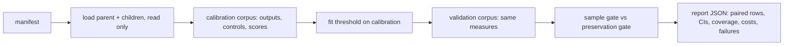

# PR summary — Issue #264

## Summary

Adds an opt-in, report-only `neat_ai_ockham audit-preservation <manifest.json> --out <report.json>` subcommand. For each pruned or quantised child it measures how well the child preserves its parent's held-out outputs. Each measure is normalised against two trivial controls: predicting the parent's mean output, and a record-shuffled copy of the parent's outputs (one per seed). It also reports task loss and latency separately. It compares a preservation gate against the current sample gate. The gate's threshold is fitted on calibration children over calibration records. The comparison runs on disjoint validation children over untouched validation records, and reports false rejections of genuinely better children, AUC, and a paired bootstrap interval on the AUC gain. Nothing in the ordinary run path changes, and the command never writes a creature. No representative run has been made, so no benefit is claimed. Part of #264.

## Spec

### Intent and Rationale

- The issue asks whether parent-output similarity, measured against trivial controls, carries diagnostic value beyond the current sampled error. A separate subcommand answers that offline without touching acceptance.
- Normalising by the mean-output and shuffled controls stops a collapsed child that outputs a constant from looking good: one equal to the parent mean scores exactly 0.

### Essential Design Decisions

- Score: `preservationVsMean = 1 − E_child/E_mean` and `preservationVsShuffle = 1 − E_child/mean_s E_shuf(s)`. A denominator of zero, or below 1e-24, gives `null` with the degenerate reason `zeroVarianceParent` or `zeroShuffleError`, so the report never holds NaN or infinity.
- Authoritative `fullDelta` and the current `sampleDelta` are manifest inputs from earlier scorer runs. The audit never runs the scorer and never decides anything, so parent similarity cannot stand in for authoritative fitness.
- Each child has a required `role` (`calibration` or `validation`). θ is fitted only on calibration children scored on the calibration corpus (balanced accuracy, ties go to the smallest θ). The gates count only validation children scored on the validation corpus, so neither a validation child nor a validation record informs θ.
- Reuses `load_incumbent` (creature validation and SHA-256), the corpus streaming helpers, `compile_creature`, `ordering::SplitMix64`, and `model::auc` for the Mann–Whitney AUC. `SplitMix64` and `model::auc` are now `pub(crate)`; only their visibility changed.
- `ockham/build.rs` records `git describe --always --dirty --abbrev=40` as `versions.gitCommit`. Uncommitted edits add `-dirty`; without git the value is `"unknown"`.
- Costs add `evaluationMs` (θ search, gates and the AUC-gain bootstrap), `totalMs` (the whole wall clock) and `childPreparationMs`, which sums each child's declared `preparationMs`. The audit cannot measure the cost of producing a child, so the manifest declares it.
- A non-finite parent output on a split no longer aborts the audit. Every child on that split fails by name, `splits.<split>.parent.failure` is set, and the report is written as `notEvaluable`.

### Undiscoverable Facts

- Only the abstract of arXiv:2611.13681 was available, and the full method is not pinned. Fetching `arxiv.org` was retried this run and failed (no network access).
- neat-core clamps non-finite activations: a NaN corpus input gives a huge finite output, not a non-finite one. In that fixture the doubled-weight child scored `preservationVsMean = 1.0`, the same as an exact copy. This negative finding is recorded in `docs/preservation-audit.md`. The formulas are this crate's own, and the report and docs say so.
- No private corpora, elite manifest or real scorer outputs were available in this run.

## Evidence

Backend/CLI only. The tests and the gate below were run on the head.

## Acceptance Criteria

<!-- vibe-spec-review inputs="diff+issue-body" -->

- **met** — "compute held-out output preservation normalised against mean-output and record-shuffled controls" — evidence: `ockham/src/preservation.rs::ratio_score_identical_and_degenerate` — reviewer: met
- **met** — "Specify formula and degenerate zero-variance handling" — evidence: `docs/preservation-audit.md`, `ockham/src/preservation.rs::constant_child_at_parent_mean_scores_zero_and_constant_parent_is_degenerate` — reviewer: met
- **met** — "include deliberately collapsed parent/child fixtures" — evidence: `ockham/src/preservation.rs::collapsed_parent_audit_is_degenerate_and_not_evaluable`, `ockham/src/preservation.rs::end_to_end_fixture_audit_writes_and_returns_the_same_report` — reviewer: met
- **partial** — "Compare diagnostic value and possible screening benefit with current sample error, measuring false rejection of genuinely better children" — evidence: `ockham/src/preservation.rs::evaluate` (role-split children), `end_to_end_fixture_audit_writes_and_returns_the_same_report` — reviewer: partial — reason: θ and the gates now use disjoint children, but `sampleDelta`/`fullDelta` are still manifest inputs and the sampled screen in `promote.rs` is not run
- **met** — "Report task loss and actual latency separately" — evidence: `taskLoss` and `latencyMsPer1kRecords` fields — reviewer: met — reason: the reviewer noted the timing includes corpus reading; the docs say so
- **met** — "Begin report-only: parent similarity never substitutes for authoritative fitness or proves a useful parent" — evidence: `ockham/tests/preservation_audit.rs::an_end_to_end_audit_writes_a_report_and_leaves_the_parent_untouched` — reviewer: met
- **met** — "Reuse existing mechanisms" — evidence: `ockham/src/preservation.rs::auc` delegates to `model::auc`; `load_incumbent`, corpus helpers, `SplitMix64` — reviewer: met
- **met** — "Opt-in experiment only; preserve ordinary behaviour, interfaces, immutable parents and full authoritative acceptance" — evidence: `ockham/src/main.rs` new subcommand only — reviewer: met
- **partial** — "Predeclare controls, seeds, sample size, compute limits and success/failure criteria. Identify code/model/data versions; separate calibration from untouched validation and count all preparation/search costs" — evidence: `ockham/build.rs`, `versions.gitCommit`, `costs.evaluationMs`/`totalMs`/`childPreparationMs`, `role_and_preparation_cost_refusals_name_their_field` — reviewer: partial — reason: preparation and search cost is optional and self-reported, not measured (the reviewer's dirty-tree gap was then fixed with `--dirty`)
- **met** — "Provide deterministic positive/negative correctness tests for new behaviour and pass the repository's normal quality checks" — evidence: 9 unit tests, 3 CLI tests, and `./quality.sh` passed on the head — reviewer: met
- **met** — "Deliver a reproducible command/manifest and machine-readable results with paired distributions, uncertainty, failures and actual coverage" — evidence: paired rows with scores, `non_finite_parent_split_fails_every_child_and_is_not_evaluable`, coverage by role — reviewer: met
- **partial** — "Record negative findings and remove optional code that does not earn its maintenance cost. Do not claim success before representative runs" — evidence: `docs/preservation-audit.md` "Known limitations and negative findings" — reviewer: partial — reason: the negative findings are recorded and no success is claimed, but no representative run exists (no private corpora here), so nobody has yet decided whether the code is worth keeping
- **met** — "Keep public implementation and fixtures application-agnostic" — evidence: synthetic fixtures in `ockham/tests/preservation_audit.rs` — reviewer: met
- **missing** — "Read and pin the full method before reproducing it" — reviewer: missing — reason: fetching arXiv:2611.13681 failed again this run (no network access); only the abstract is cited
- **unrequested** — `SplitMix64` and `model::auc` made `pub(crate)`, and `audit-preservation` added to the README contract list — reviewer: unrequested — reason: needed to reuse the existing RNG, and the README contract test requires every subcommand to be listed
- **unrequested** — manifest hardening (1 MiB cap, `deny_unknown_fields`, atomic write, `sampleTolerance`) — reviewer: unrequested — reason: input validation at the trust boundary and a tunable version of the current sample gate

## Standards Review

<!-- vibe-standards-review inputs="diff+CODING-STANDARDS.md" -->

- **clean** — no `CODING-STANDARDS.md` exists, so the review used `CONTRIBUTING.md` principles 1 and 3–8 (creature never written, acceptance only by the full scorer, optional and isolated, no TypeScript, version bump by CI), the README-as-contract rule, and named tests that exist. The `readme_contract.rs` list change still fails without the new subcommand.

## Test Plan

- Added `ockham/tests/preservation_audit.rs`: help output, a missing manifest refused by name, and an end-to-end run that leaves the parent bytes unchanged.
- Added unit tests in `ockham/src/preservation.rs`: ratio and degenerate scores, a collapsed child and a constant parent, AUC edges, threshold fit, bootstrap reproducibility, manifest refusals by field with a valid control, width mismatch refused, and an end-to-end report.
- Modified `ockham/tests/readme_contract.rs`: `SUBCOMMANDS` gains `audit-preservation` alongside Develop's `bench-strata` (from #263); no assertion removed.
- Follow-up commit 626fa63 adds `collapsed_parent_audit_is_degenerate_and_not_evaluable`: a constant parent runs through `run_audit` and reaches `notEvaluable`. It adds `non_finite_parent_split_fails_every_child_and_is_not_evaluable`, which drives the parent-failure split and `evaluate` directly because the core clamps non-finite activations. It also adds `role_and_preparation_cost_refusals_name_their_field`, and the end-to-end test gains role, paired-row, gitCommit and cost assertions.
- `./quality.sh < /dev/null` on the working tree committed as 626fa63: passed ("All quality checks passed!", exit 0).
- After merging Develop (which brought in the `bench-strata` subcommand), the conflicts in `README.md`, `ockham/src/lib.rs`, `ockham/src/main.rs` and `ockham/tests/readme_contract.rs` were resolved by keeping both subcommands. `cargo fmt`, `cargo clippy --all-targets --all-features -D warnings`, markdownlint and the `readme_contract` and `strata_bench` tests passed on the merged tree.
- After the spec review, `build.rs` switched to `git describe --dirty`. The preservation unit and CLI tests and clippy were then re-run and passed; the worker re-runs the full gate.
- Known gap noted by the spec reviewer: `run_split` still scores every child on both corpora. So `failures` and `recordsActivated` include out-of-role passes, which `evaluate` ignores and which never inform θ.
- Not covered by a test: a child `nonFiniteOutput` through activation (unreachable with the clamping core), the 1 MiB manifest cap, and the `met` criterion outcome.
