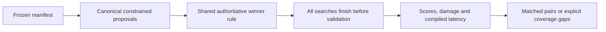

## Summary

Added an opt-in, frozen-manifest connection-budget experiment with canonical
typed pruning, shared full-corpus acceptance and machine-readable pilot results.
Completed a separately frozen synthetic comparison against all three controls at
matched achieved connection counts and counted compute. Both studies remain
inconclusive; representative benefit remains unverified. Part of #265.

## Spec

### Intent and Rationale

- Compare global allocation against equal per-neuron/per-depth budgets and a
  configured current-Ockham pipeline, reusing pruning, activation statistics,
  sensitivity, screening and promotion already present on `Develop`.
- Keep research execution and latency measurements outside routine CI; the
  example's deterministic correctness tests run in the normal Cargo gate.

### Essential Design Decisions

- Version 1 freezes data, code, executable/scorer identities, environment digest,
  controls and success criteria before validation. Importance uses calibration
  alone and is recalculated after topology changes; quotas retain initial
  regions, with explicit rounding and infeasibility rules.
- Removals use core through an exact typed-key wrapper. Proposal constraints
  preserve non-zero input/output support and refuse cleanup overshoot or quota
  undercut. Existing pair-based callers retain their first-role behaviour.
- Budget proposals and ordinary promotion share one strict full-score winner
  function. Parents remain immutable. Direct full evaluation bypasses sampled
  screening in the original whole-budget protocol. The new opt-in per-removal
  protocol gives allocation arms the existing Ockham screening and full promotion
  schedule; rejected removals are skipped. No population re-entry or publication
  path was added. The omitted protocol field preserves v1 specification hashes.
- The control uses existing mixed sweeps, one-candidate batches and the common
  structural constraints, without bundles or fleet features. It does not measure
  the ordinary default CLI's economics. Synthetic evidence cannot support a
  representative conclusion, and criteria were not changed after validation.
- The follow-up uses eight layered synthetic networks, two seeds and two/four
  removals from 20 connections. It retains the original 10% compute tolerance,
  limits and success thresholds. Quota-aligned weak edges make quota and global
  choices coincide; this design cannot establish an unequal-allocation benefit.
  Both proposals must be authoritatively accepted before a pair can match.

### Undiscoverable Facts

- No representative creature/corpus pair was available locally. Public inputs
  and results are generated, application-agnostic teacher fixtures.
- The full paper was read through the web reader. The proxy refused PDF download
  with `CONNECT tunnel failed, response 403`; the manifest pins version
  `2611.09233v1` and extracted-text SHA-256, explicitly not PDF bytes.
- The real scorer was built from revision
  `742c5df30fc98ece3afe784be1aca18f925b47b3`; the archived study pins executable
  hashes and code revision `a48160f85c30d571c12f687ff23dddca44f2cd42`.
- The matched follow-up froze the updated working tree based on `62d1a62`;
  its exact source digest is
  `ec315f3a95c1b9b9d062b1ce84ecb5016821fc580eb71f7d780bb06e7d7722d0`.
  The final source matches that digest; `codeRevision` names the preceding head.

## Evidence

- `docs/connection-budgets.md` documents the method, structural rules, compute
  limits, comparison criteria and reproducible command. The README Development
  section and `docs/pruning-ownership.md` describe the new surfaces.
- `docs/research/connection-budget-v1/manifest.json`, `results.jsonl`,
  `summary.json` and `report.md` preserve the frozen study and actual evidence:
  128/128 runs completed, no failures/timeouts, every target reached through
  authoritative acceptance. Only 4/96 planned pairs matched compute;
  those four cover two teacher units, with zero full/held-out score differences.
  The remaining 92 pairs are explicit compute exclusions. Representative
  coverage is zero; the conclusion is inconclusive.
- `docs/research/connection-budget-matched-v1/{manifest.json,results.jsonl,summary.json,report.md}`
  records the separately frozen follow-up: 128/128 runs, no failures, timeouts or
  missed targets, and 87/96 matched pairs. At achieved targets 18 and 16,
  per-neuron and per-depth each match 16/16 pairs across eight units. Ockham
  matches 12/16 pairs across seven units and 11/16 across six units; nine compute
  exclusions remain. All five compute dimensions meet the unchanged 10% rule
  for matched pairs, without padding. Paired distributions and clustered
  familywise 95% uncertainty are archived. Quota score differences are zero;
  global scores are lower than Ockham on the artificial zero-output task.
  Ockham coverage misses the 80% success threshold; the conclusion is inconclusive.
- Deterministic costs: 1,594 proposal visits, 32,640 statistics records,
  256,512 scorer-reported record evaluations and 267,264 reserved evaluations.
  Diagnostic and latency inference are counted separately. Timing samples are
  indicative measurements on a shared, parallel host.
- Follow-up costs: 395 proposal visits, 24,576 statistics records,
  358,016 scorer-reported and 383,232 reserved record evaluations; diagnostics
  and latency inference are separately counted. The report includes a reproducible
  `matched-pilot` / `freeze` / `run` command using fresh paths.
- Real scorer protocol checks returned four records in full mode and two at
  50% sampling. A real malformed corpus exited 1 with the cause
  `has size 3 bytes, which is not a whole multiple of the 12-byte record size`;
  scorer-failure tests assert that observed cause.
- #265: Experiment: Compare global connection budgets with per-region pruning quotas.

## Acceptance Criteria

<!-- vibe-spec-review inputs="diff+issue-body" -->

- **met** — Compare equal per-neuron/per-depth quotas and current Ockham at matched achieved budget/compute. — evidence: `docs/research/connection-budget-matched-v1/summary.json` records 87/96 matched pairs across all three controls and both achieved targets; `ockham/examples/connection_budget/tests.rs::per_removal_protocol_shares_search_costs_and_requires_authoritative_wins` proves shared costs and full-score rejection; `ockham/examples/connection_budget/summary.rs::each_compute_dimension_has_an_independent_ten_percent_boundary` proves matching boundaries — reviewer: met

The independent Spec reviewer recomputed all six comparisons and checked manifest
linkage, accepted counts, paired scores and explicit exclusions. This verdict
means the comparison was performed; synthetic evidence, nine excluded Ockham
pairs and the representative-data gap preclude an optimisation-benefit claim.

## Standards Review

<!-- vibe-standards-review inputs="diff+CODING-STANDARDS.md" -->

- **clean** — The independent Standards reviewer checked `CONTRIBUTING.md` principles: immutable parents, canonical typed pruning/validation, existing authoritative full-corpus promotion, opt-in isolated execution, bounded accounted work, backward-compatible frozen defaults, version bump and truthful synthetic evidence. No `CODING-STANDARDS.md` exists in this repository. The reviewer independently verified archived manifest linkage, matching counts and documented exclusions.

## Test Plan

- `cargo test --example connection_budget --test typed_prune --test full_proposal < /dev/null`
  passed: 21 example tests and four API tests. `ockham/examples/connection_budget/tests.rs` covers
  allocation differences, quota boundaries, stable ties, depth/typed roles,
  cascades, connectivity, parent immutability, scorer failures, limits and freeze
  drift through the real search runner.
- Follow-up regression tests cover equal measured search costs across all four
  arms, full-score rejection, continued visits after rejection, old default
  serialization, protocol freeze drift, layered multi-cut fixture declarations,
  every compute-matching dimension and rejected comparator exclusions.
- `ockham/examples/connection_budget/summary.rs` tests cover clustered bootstrap
  uncertainty, synthetic/representative verdicts and exclusion accounting.
  `ockham/tests/typed_prune.rs` covers exact and absent roles;
  `ockham/tests/full_proposal.rs` covers strict thresholds, full-mode acceptance,
  scorer faults, invalid inputs and preservation of an existing output directory.
- New API tests initially failed to compile before implementation. The absent-role
  test then failed because core normalised the request to a standard edge; the
  exact-key guard made it pass. This is a new request contract, not a claim that
  core's established normalisation was a defect.
- `cargo test --lib promote::tests < /dev/null` passed all 27 existing promotion
  tests. Shared callers checked: `sweep::propose_synapse` retains pair semantics;
  `run.rs` replay/fresh promotion paths retain the shared winner decision.
  No existing test assertions were removed. Winner selection has one shared
  implementation; no second acceptance rule was introduced.
- The real frozen-manifest commands completed both 128-run studies successfully.
  Research execution and latency trials are separate from unit tests.
- `./quality.sh < /dev/null` passed: shell/script contracts, spelling, Markdown,
  Actions lint, dependency audit, format, all-target Clippy, tests and rustdoc.
  This included 704 library tests and the example's 21 deterministic tests.
- Security checks: closed specification schemas and bounded work; typed process
  arguments without shell interpolation; fresh output directories; no new
  dependency, credential, endpoint or UI surface. Staging used explicit paths;
  public artefacts contain synthetic data and environment digests, not values.

## Merge verification

- Independent Spec and Standards reviews passed over the updated diff and actual
  follow-up evidence. CI is pending.

## Not checked

Representative runs, default-CLI economics, quiet-host latency and a PDF byte
checksum remain unverified. The follow-up falls below the predeclared Ockham
matched-coverage success threshold. The gate's optional
real-scorer discovery tests had no discoverable binary; real-scorer evidence here
comes from the explicitly pinned pilot and protocol checks. No deployment was
performed.
