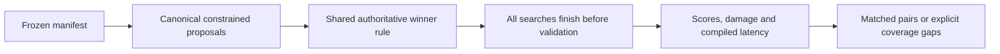

## Summary

Added an opt-in, frozen-manifest connection-budget experiment with canonical
typed pruning, shared full-corpus acceptance and machine-readable pilot results.
The synthetic pilot is inconclusive; representative matched comparisons remain
unfinished. Part of #265.

## Spec

### Intent and Rationale

- Compare global allocation against equal per-neuron/per-depth budgets and a
  configured current-Ockham pipeline, reusing pruning, activation statistics,
  sensitivity, screening and promotion already present on `Develop`.
- Keep research execution and latency measurements outside routine CI; the
  example's deterministic correctness tests run in the normal Cargo gate.

### Essential Design Decisions

- Version 1 freezes data, code, executable/scorer identities, environment digest,
  controls and success criteria before validation. Importance uses calibration
  alone and is recalculated after topology changes; quotas retain initial
  regions, with explicit rounding and infeasibility rules.
- Removals use core through an exact typed-key wrapper. Proposal constraints
  preserve non-zero input/output support and refuse cleanup overshoot or quota
  undercut. Existing pair-based callers retain their first-role behaviour.
- Budget proposals and ordinary promotion share one strict full-score winner
  function. Parents remain immutable. Direct full evaluation bypasses sampled
  screening for budget proposals, not authoritative acceptance; no population
  re-entry or publication path was added.
- The control uses existing mixed sweeps, one-candidate batches and the common
  structural constraints, without bundles or fleet features. It does not measure
  the ordinary default CLI's economics. Synthetic evidence cannot support a
  representative conclusion, and criteria were not changed after validation.

### Undiscoverable Facts

- No representative creature/corpus pair was available locally. Public inputs
  and results are generated, application-agnostic teacher fixtures.
- The full paper was read through the web reader. The proxy refused PDF download
  with `CONNECT tunnel failed, response 403`; the manifest pins version
  `2611.09233v1` and extracted-text SHA-256, explicitly not PDF bytes.
- The real scorer was built from revision
  `742c5df30fc98ece3afe784be1aca18f925b47b3`; the archived study pins executable
  hashes and code revision `a48160f85c30d571c12f687ff23dddca44f2cd42`.

## Evidence

- `docs/connection-budgets.md` documents the method, structural rules, compute
  limits, comparison criteria and reproducible command. The README Development
  section and `docs/pruning-ownership.md` describe the new surfaces.
- `docs/research/connection-budget-v1/manifest.json`, `results.jsonl`,
  `summary.json` and `report.md` preserve the frozen study and actual evidence:
  128/128 runs completed, no failures/timeouts, every target reached through
  authoritative acceptance. Only 4/96 planned pairs matched compute;
  those four cover two teacher units, with zero full/held-out score differences.
  The remaining 92 pairs are explicit compute exclusions. Representative
  coverage is zero; the conclusion is inconclusive.
- Deterministic costs: 1,594 proposal visits, 32,640 statistics records,
  256,512 scorer-reported record evaluations and 267,264 reserved evaluations.
  Diagnostic and latency inference are counted separately. Timing samples are
  indicative measurements on a shared, parallel host.
- Real scorer protocol checks returned four records in full mode and two at
  50% sampling. A real malformed corpus exited 1 with the cause
  `has size 3 bytes, which is not a whole multiple of the 12-byte record size`;
  scorer-failure tests assert that observed cause.
- #265: Experiment: Compare global connection budgets with per-region pruning quotas.

## Acceptance Criteria

- **missing** — Compare equal per-neuron/per-depth quotas and current Ockham at matched achieved budget/compute. — reason: the synthetic pilot has only four compute-matched pairs and none against Ockham; an adequately covered representative comparison remains unperformed because no representative model/corpus pair was available.

## Test Plan

- `cargo test --example connection_budget --test typed_prune --test full_proposal < /dev/null`
  passed: 21 new tests. `ockham/examples/connection_budget/tests.rs` covers
  allocation differences, quota boundaries, stable ties, depth/typed roles,
  cascades, connectivity, parent immutability, scorer failures, limits and freeze
  drift through the real search runner.
- `ockham/examples/connection_budget/summary.rs` tests cover clustered bootstrap
  uncertainty, synthetic/representative verdicts and exclusion accounting.
  `ockham/tests/typed_prune.rs` covers exact and absent roles;
  `ockham/tests/full_proposal.rs` covers strict thresholds, full-mode acceptance,
  scorer faults, invalid inputs and preservation of an existing output directory.
- New API tests initially failed to compile before implementation. The absent-role
  test then failed because core normalised the request to a standard edge; the
  exact-key guard made it pass. This is a new request contract, not a claim that
  core's established normalisation was a defect.
- `cargo test --lib promote::tests < /dev/null` passed all 27 existing promotion
  tests. Shared callers checked: `sweep::propose_synapse` retains pair semantics;
  `run.rs` replay/fresh promotion paths retain the shared winner decision.
  No existing test assertions were removed. Winner selection has one shared
  implementation; no second acceptance rule was introduced.
- The real frozen-manifest command completed the 128-run pilot successfully.
  Research execution and latency trials are separate from unit tests.
- `./quality.sh < /dev/null` passed: shell/script contracts, spelling, Markdown,
  Actions lint, dependency audit, format, all-target Clippy, tests and rustdoc.
  This included 704 library tests and the example's 17 deterministic tests.
- Security checks: closed specification schemas and bounded work; typed process
  arguments without shell interpolation; fresh output directories; no new
  dependency, credential, endpoint or UI surface. Staging used explicit paths;
  public artefacts contain synthetic data and environment digests, not values.

## Merge verification

- CI and independent code review are pending.

## Not checked

Representative runs, adequate matched-compute coverage, default-CLI economics,
quiet-host latency and a PDF byte checksum remain unverified. The gate's optional
real-scorer discovery tests had no discoverable binary; real-scorer evidence here
comes from the explicitly pinned pilot and protocol checks. No deployment was
performed.
