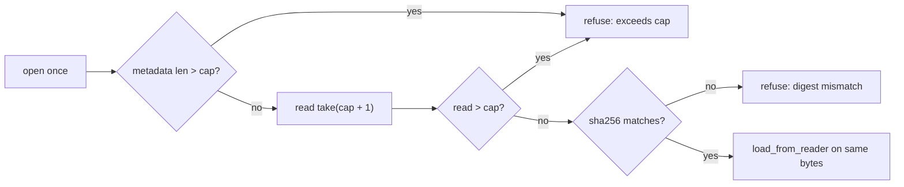

# PR Summary — Issue #285

## Summary

`priority_ordering_bench`'s `load_history` read the whole manifest-named
history up to three times before applying its 64 MiB cap. It now opens the
file once, refuses a file over the cap before reading it, reads through
`take(cap + 1)`, and hashes and parses those same bytes. Closes #285.

## Spec

### Intent and Rationale

- The cap must hold before allocation, so it is checked on the opened file's
  length and enforced again by the bounded read, which also catches a file
  that grows or a stream whose reported length is 0.
- Parsing goes through the new `telemetry::load_from_reader` over the hashed
  bytes, so the digest covers exactly what is parsed.

### Essential Design Decisions

- `load_history` wraps `load_history_capped(m, task, MAX_HISTORY_BYTES)`; the
  cap parameter is the test seam the issue asked for.
- The third read and its `historical log changed while loading` refusal are
  removed: the parsed bytes are the hashed bytes, so a change between the two
  cannot occur.
- The old shared `historical log size/digest mismatch` message is split into
  `historical log exceeds <cap> bytes` and `historical log digest mismatch`.
- Path confinement is not added. The issue's suggested fix covers only the
  bounded read, and the history path is an operator-predeclared, digest-pinned
  manifest field.

### Undiscoverable Facts

- `telemetry::load_from_reader` has the same signature and body as the copy on
  the unmerged #261 branch (`issue-261-experiment-compare-cheap-proxy-ranking-with-transf`),
  so the two branches agree when both land.

## Evidence

Backend-only change. In the red run, the new `/dev/zero` test was built
against the unfixed code and run under `ulimit -v 3000000`. It panicked with
`out of memory` at `ockham/examples/priority_ordering_bench/tests.rs:668` and
exited 101. After the fix it passes, refusing with `historical log exceeds
67108864 bytes`.

Docs: rewrote the history-log bounds sentence in
`docs/experiments/ranking-v1.md` (the "Source tasks require" paragraph). A
grep for `size/digest mismatch`, `changed while loading` and `64 MiB` outside
`docs/archive/` finds no other description of this loader.

## Test Plan

- Added `ockham/examples/priority_ordering_bench/tests.rs::history_stream_longer_than_its_reported_length_is_cut_at_the_cap`
  (unix). A `/dev/zero` history passes through the real `load_history` and the
  64 MiB cap. It reached the bounded-read branch, because metadata reports 0.
  It was red (out of memory) before the fix and passes after.
- Added `ockham/examples/priority_ordering_bench/tests.rs::history_one_byte_over_the_cap_is_refused_and_at_the_cap_is_accepted`.
  A valid, correctly digested history is refused at `cap = len - 1` by the
  metadata branch. The same file loads 40 records at `cap = len` (positive
  control). At that same cap, a wrong digest is refused with `digest mismatch`.
- Existing coverage still passes: `historical_loader_never_labels_unscored_or_future_records`,
  `historical_loader_normalises_legacy_audit_identity_and_rejects_other_corpora`,
  and the telemetry `load` callers in `ockham/src/run.rs` tests. The
  path-labelled error text of `telemetry::load` is unchanged.
- No existing test assertion was removed or edited.
- `cargo clippy --all-targets --all-features -- -D warnings`: clean.
- `./quality.sh < /dev/null` on commit `cc813f8`: exit 0, "All quality checks
  passed!", with both new tests reported `ok`.
