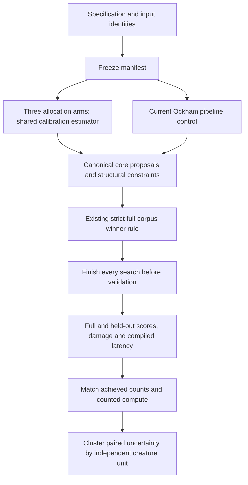

# Connection-budget allocation experiment

This is an opt-in research harness, not an ordering or acceptance default.
The `connection_budget` Rust example compares global allocation, equal retained
connections per target neuron, equal retained connections per depth, and a
bounded current-Ockham pipeline control. Public pilot inputs are synthetic;
they cannot establish a benefit on evolved creatures.

The recorded [v1 pilot](research/connection-budget-v1/report.md) is inconclusive:
128 arm runs completed, with four compute-matched pairs and no representative
creatures. Its frozen manifest and machine-readable results accompany the report.

## Source and transfer assumptions

Reviewed the full 17-page [paper, arXiv 2611.09233v1](https://arxiv.org/pdf/2611.09233v1),
including its appendices. Its method pools rectified latent activations across
layers for a token and retains a fixed total, ranking by activation scaled by
decoder norm. Training combines reconstruction and auxiliary losses. Its
comparison controls total activity; validation and regional reconstruction
errors expose allocation trade-offs. This concerns trained, dynamic activation
sparsity, not permanent removal of connections in an already-fit network.

The pinned SHA-256 is
`786335336bdeaf76ce456aabf353177039ce76310a5f9963b580cdb540c71da3`.
**This hashes extracted text, not PDF bytes**: the web reader's complete lines
0–976, in numeric order, with the `L…@P…:` prefix and following space removed, joined with LF and a
final LF. Direct PDF downloads were refused by the environment proxy with
`CONNECT tunnel failed, response 403`; a PDF byte checksum was not obtained.
The version and the representation's digest travel in the frozen manifest.

The adaptation assumes that a calibration estimate can identify connections
whose permanent loss is tolerable, and that different regions warrant different
retained budgets. Neither assumption follows from the paper. Ockham's mean
compensation changes the residual being ranked: the surrogate here is
`source.std_dev * abs(weight) * SensitivityIndex(target)`. Inputs and hidden
activations come from the existing activation scan on calibration records;
constants have zero residual scale. Sensitivity is the existing topology-only
estimate, not a fitted derivative. Saturation, cancellations, aggregate squashes
and conditional branches can make this approximation misleading. The scorer
still judges the resulting creature.

## Frozen protocol, version 1

`pilot` writes a versioned specification with eight separately generated
teachers, two repeated seeds (`7`, `19`), targets of 30 and 34 connections from
36, and the following controls. A teacher has deliberately weak extra edges;
it has not undergone evolution or fitting. Each subject has 256 full training
records, the first 64 of those for calibration, and 128 separate validation
records. Generation is deterministic and application-agnostic.

`freeze` validates the specification and pins creature bytes, complete ordered
corpus contents, the example executable, scorer executable, source files,
Cargo manifests/lockfile, code revision, crate version and paper representation.
It also pins a digest of the scorer's thread, GPU, IO and worker environment
overrides and `RAYON_NUM_THREADS`, recording no environment values. The freeze
timestamp and specification digest identify the predeclared controls.
Corpus hashing normalises signed zero and includes input/output widths. It
rejects non-finite records, calibration rows absent from full training, identical
validation inputs present in training, duplicate creatures and ambiguous IDs.
Paths are relative to the invocation's working directory unless absolute.
The manifest and output directories must be new. Changes after freezing fail
verification; an existing output directory is never reused.

The allocation arms use the same estimator, calibration data and initial
importance values. After each structural step, candidates, statistics and
importance are recalculated against that arm's resulting topology. No validation
score feeds selection. Validation is hashed for identity and overlap checks
beforehand, then scored only after **every** arm's search has ended.

| Decision | Predeclared rule |
| --- | --- |
| Region | Incoming connections of each target neuron; outputs included |
| Depth | Longest structural path from implicit inputs/constants, depth zero; target determines edge depth; initial depths stay fixed |
| Quotas | Equal retained counts, capped by initial capacity; water-fill capped regions; integer remainders go in stable UUID/numeric-depth order |
| Ranking ties | Existing seeded synapse-pair shuffle, then typed role order |
| Typed edges | Full `(from, to, role)` identity; never silently select another role |
| Cleanup | Canonical core pruning and fixed-point cleanup; measure resulting connection count |
| Useful connectivity | Every output retains a non-zero-weight input path; every initially useful input still reaches some output |
| Target floor | Refuse non-decreasing cuts, cleanup overshoot and quota undercut; no quota redistribution after structural refusals |
| Infeasibility | Targets above a parent's count are invalid specifications; unreachable lower targets retain actual counts and refusal reasons |
| Acceptance | Same-call full training comparison; strictly greater than the incumbent by `minImprovement`; source parents stay immutable |

Connectivity is structural support, not proof that a particular IF branch runs
or a saturated neuron transmits useful information. Constants do not substitute
for an input path, and a zero-weight edge does not satisfy connectivity.

The Ockham control calls the current `Sweep`, sampled screening and
`evaluate_full` implementation, using random mixed neuron/edge visits and
one-candidate batches. It uses the common calibration data, target floor and
connectivity constraints; it recalibrates and restarts after an authoritative
accept. Bundles, merges, fleet cache and a separate exact-cleanup pre-pass are
absent in this protocol. This is a configured pipeline comparison, **not a
measurement of the ordinary 100-candidate CLI default's economics**. Its existing
pair-based edge visitation remains part of the control; the allocation arms
explicitly distinguish typed roles.

Each arm first establishes an authoritative opening baseline. Allocation arms
build a whole budget proposal and score it with `evaluate_full_proposal`; that
function shares the strict winner decision with `evaluate_full`. Budget
proposals are not represented as sampled neuron groups. `best.json` contains an
authoritative accepted creature or the parent; `proposal.json` may be rejected.
No research output performs population re-entry or deployment.



## Costs, comparison and interpretation

The pilot caps each arm at 200 proposal visits, 10,000 statistics records,
24 search scorer calls, 100,000 reserved scorer record evaluations and 30 seconds
of search. Each scorer process has a 10-second timeout with a two-second forced
termination grace. `timeout` or `gtimeout` is required. Exits 124 and 137 are
reported as timeout exits; the same status from the scorer itself or an external
kill is indistinguishable, so the cause text is retained too.

Reservations charge every requested creature for the entire corpus even on a
sampled call; actual returned record counts are recorded separately. Failures
retain their reservations and their cause, without inventing evaluated-record
counts. Statistics
scans likewise reserve their entire calibration corpus up front; completed scan
records are reported separately, and a failed scan does not invent a completed
count. Final measurement has a separate fixed allowance of two full scorer
calls over parent/proposal pairs: training and held-out validation. This
measurement cannot accept a cut after search stops. Freeze/verification hashing,
statistics scans, proposal visits, scorer costs, diagnostic inference and
latency inference have separate counters; wall times include preparation and
scorer execution. Building the shared binaries is outside the per-arm budget.

Primary pairs must have equal **achieved**, reduced connection counts and an
authoritatively accepted global proposal. Proposal visits, statistics records,
scorer calls, reserved record evaluations and reported record evaluations must
each differ by at most 10% of the larger count. Failure, missing measurement,
unaccepted global proposals and unmatched work/counts remain explicit exclusions.
This counts work rather than equating noisy shared-host execution times; it
does not claim to measure identical hardware instructions.

Paired score differences are averaged over repeated seeds/models within each
declared independent unit. A deterministic percentile bootstrap resamples those
units, with Bonferroni familywise 95% intervals across the three comparisons and
the declared targets. Fewer than two units yields null intervals. The pilot
uses 2,000 replicates. Success requires at least eight independent units, 80%
matched coverage in each comparison, lower full and held-out score bounds above
`1e-6`, and worst-output MSE increase at most `1e-4`. A synthetic study cannot
return a supported or negative representative conclusion, regardless of scores.
Underpowered or unmatched results are inconclusive.

Results include neuron/depth connection distributions and input support per
output before/after pruning. Diagnostic MSE increases are measured per output
and four contiguous validation strata, with empty strata marked null. These
diagnostics use MSE even if a study selects another scorer cost. Compiled
inference latency uses a fixed validation prefix, two warm-up passes and ten
measured passes; it excludes IO, compilation and scorer execution. Timings on a
shared, parallel host are indicative and never gate unit tests or deployment.

## Reproduce

Build the released `rust_scorer` separately. From this repository root:

```bash
mkdir -p runs
cargo build --release --example connection_budget < /dev/null
cargo run --release --example connection_budget -- \
  pilot runs/connection-budget-pilot-v1 /absolute/path/to/rust_scorer < /dev/null
cargo run --release --example connection_budget -- \
  freeze runs/connection-budget-pilot-v1/spec-v1.json \
  runs/connection-budget-pilot-v1/frozen-v1.json < /dev/null
cargo run --release --example connection_budget -- \
  run runs/connection-budget-pilot-v1/frozen-v1.json \
  runs/connection-budget-results-v1 < /dev/null
```

Wrap a research invocation in a suitable foreground timeout on unattended hosts.
Do not overwrite an earlier frozen manifest to change controls after validation.
For another machine/build, regenerate the specification with its scorer path and
freeze a new manifest; the archived executable checksum describes the original
run, not an assumption that rebuilt binaries are byte-identical across hosts.
Compare input hashes and protocol fields before treating that run as a replication.

`search.jsonl` is synced after each search; `results.jsonl` adds final
measurement, and `summary.json` reports paired differences, uncertainty,
exclusions and coverage. Per-trial directories retain proposals, accepted
creatures and canonical core cut reports. Private subjects, manifests and
results stay outside public commits.

Deterministic correctness checks run in normal Cargo tests; timing and research
execution require the explicit commands above:

```bash
cargo test --example connection_budget --test typed_prune --test full_proposal < /dev/null
```
