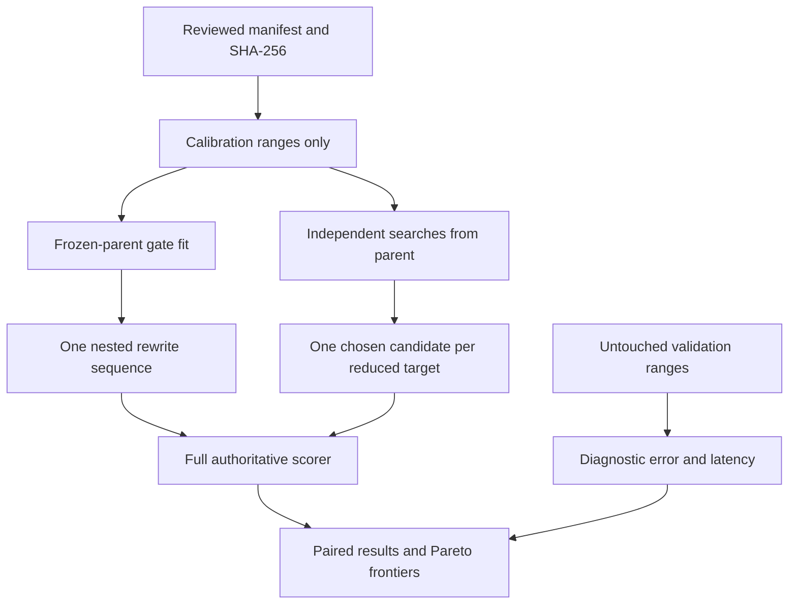

# Soft-gate nested-budget experiment, v1

This opt-in research command learns one ranking on one supplied creature. It
does not change the ordinary optimiser or install a population candidate.
Representative NEAT-AI benefit is **unverified**. The public smoke generator
exercises wiring; its untrained synthetic data cannot establish such a benefit.

## Method pin and adaptations

The research source is [Your Transformer Is Secretly Elastic,
arXiv:2610.20588v1](https://arxiv.org/html/2610.20588v1), sections 3.1–3.2 and
A.3.2–A.3.3. The reference implementation is
[secretly-elastic at 3cc29a2b32045c0ee697b673e2c3be8f92b70e57](https://github.com/WalterSimoncini/secretly-elastic/tree/3cc29a2b32045c0ee697b673e2c3be8f92b70e57).
Its relevant source SHA-256 checksums are embedded in each manifest:

| Reference file under `src/models/prunable/refine/` | SHA-256 |
|---|---|
| `core.py` | `497ea32b356f85e1a5bfcc1804fff8b6fa20ccfc53fec17a683ef4e7e88e41d3` |
| `masking.py` | `24ba6d00ec5cd4f178e5067fd66a69d3a61f6ab59f76f806ff3f2928eaafca7d` |
| `budget.py` | `1be8638223a105b41406ab2f6f76f2974f71f5df91c3634f570642c709312f49` |

The paper freezes model weights and learns median-centred log-scores. A
stop-gradient ranking threshold gives sigmoid masks for multiple sparsity
targets. Its vision configuration uses temperature 0.2 and Adam with learning
rate 0.1, betas 0.9/0.999, no weight decay and 300 steps. Its initial scores
approximate per-weight Fisher information; its joint threshold uses unit FLOPs.
The reference's `budget.py` selects the last unit within the cumulative cost
allowance, retaining at least one unit for the threshold.

NEAT-specific choices in `neat-soft-gate-fd-v1` are:

- Capacity is **retained original hidden-neuron identities**, with unit cost
  one. Hard targets are `floor(fraction * original hidden count)` for full,
  90%, 75% and 50%. Neuron, constant, synapse and growth-unit counts remain
  separate measurements; hidden capacity does not promise equal latency.
- Only forward-only networks with untyped edges and `IDENTITY`, `LOGISTIC`
  or `TANH` non-constant activations are supported, with 1–4096 hidden neurons.
  Listed constants are frozen and excluded from the ranking. Other activations
  are refused, including aggregates and discontinuous functions.
- The pinned core's `CompiledNetwork::activate` owns inference semantics.
  Its `propagate_topological_loop` computes weight/bias update proposals rather
  than derivatives of this gate loss. v1 therefore uses **central finite
  differences of the actual MSE**, not that learning algorithm or invented
  activation derivatives. A hidden gate multiplies its outgoing weights on an
  ephemeral clone; the parent's ordinary weights and biases stay fixed.
  Core applies its normal accumulation, squash, clamping and f32 rounding.
  This edge-modulation parameterisation can round differently from multiplying
  a stored post-activation. It does not replace core inference.
- Initial saliency is the mean squared per-record loss derivative with respect
  to a unit gate, evaluated at gate one, rather than per-weight Fisher scores.
  Scores are clamped to `1e-12`, logged and median-centred once. The derivative
  step defaults to `0.001`; f32 cancellation and saturation remain limitations.
  Fitting differentiates loss with respect to masks while holding each cutoff
  fixed, then applies the analytic sigmoid derivative. Adam epsilon is `1e-8`.
- Each step averages the three reduced-target gradients on the same cyclic
  batch of at most 32 calibration records; the full parent has no learnable
  mask. The paired seed chooses batch phase and deterministic tie order.
- Hard candidates follow one removal sequence through `prune_hidden_neuron`.
  Calibration-only parent activation means supply approximate rewrite hints.
  Bias compensation and exact cascades belong to the core rewrite report,
  separately from gate fitting. These hints are frozen parent statistics,
  not re-estimated statistics of each provisional topology.

Nesting means each smaller candidate's retained original hidden UUID set is a
subset of the preceding set. Constant conversions and newly introduced support
nodes are reported separately. Quantisation and cascade overshoot are reported
against the requested fraction; a target the sequence cannot reach is marked
unreachable. The full candidate is the original parent, including its bytes.

## Predeclaration and cost

`prepare` creates a format-version-1 manifest without fitting or evaluating
validation data. It pins full creature, corpus, scorer and executable SHA-256
checksums, the build's core commit, reference sources, hardware and the recorded
scorer environment. Corpus checksums cover every byte; the ordinary fast corpus
identity remains a cache key. The scorer is explicitly CPU/MSE. On Unix,
experiment directories are created with mode 0700 and manifest/result/candidate
files with mode 0600. Calibration and latency data are each limited to 64 MiB.

Review the generated choices before running. The initial manifest declares ten
paired seeds, 300 fitting steps, 100 independent trials per reduced budget and
equal limits **per complete four-budget family**: 900 active seconds, 100 million
record evaluations, one million explicitly counted compilations, 100,000 rewrite
requests and 100 GB of accounted IO. The default split reserves the last requested
validation records and uses `SampleSpec` to select calibration ranges from the
remaining prefix. Validation does not enter fitting, statistics or selection.
Final full-corpus judging deliberately includes the validation records.

Shared preparation time, including the earlier `prepare` invocation, is charged
in full to both arms. Active family time includes fitting, construction, search,
candidate writes, scoring and diagnostics. Final input-integrity verification
is also charged to both. Record charges include initial saliency, fitting,
statistics, selection, full scoring, validation and latency warmups/repetitions.
Compilation/IO counters describe explicitly instrumented work; wall time also
covers core validation and filesystem overhead outside those counters.

The independent control restarts from the same parent for each reduced target
and each trial. It selects the lowest **calibration MSE**, using seeded random
removal orders and the same core rewrites and compensation hints. Each target
gets one third of the paired gate family's measured construction time, subject
to the declared trial and resource caps. It reserves record/compilation work for
final evaluation. A trial already started finishes. Total measured family costs
must agree within 10% for a retention verdict; unmatched pairs remain reported
and cannot demonstrate success. Gates run first to determine this allowance,
so execution-order and shared-host timing effects remain limitations.

The limits fail closed before subsequent work and after blocking operations;
they cannot interrupt a running scorer call. Use an outer process timeout to
bound a hung external scorer. An overrun is a failed family, never success.
Failures write `results.json` and return a non-zero exit. Existing output
directories and manifest destinations are refused.

Retention requires a representative-data declaration, ten or more complete
seed pairs, a conservative 95% paired-score interval wholly above 0.001, no
more than 1% relative held-out MSE degradation against the paired control
(absolute tolerance `1e-12`), at least 5% latency reduction at 75% and 50%,
reachable budgets, capacity overshoot at most 2.5 percentage points for both
arms, and matched total cost. The interval uses 2.263 standard errors, a
conservative t critical value for at least ten pairs. It describes seed
variation conditional on this one creature/corpus/host, not uncertainty across
creatures. Latency is indicative on a shared host and never a CI assertion.
A completed, cost-matched representative study with at least ten pairs missing
the performance criteria records a removal decision for the optional
implementation; an absent or cost-unmatched representative study is
inconclusive and does not earn a deployment or default change.

## Commands and artefacts

Build the binary before preparation; rebuilding changes its pinned checksum.
Keep real manifests, corpora, candidate files and results in private storage.

```bash
cargo build --release -p neat_ai_ockham < /dev/null
neat_ai_ockham soft-gate prepare parent.json training/ \
  --scorer /absolute/path/to/rust_scorer --out manifest.json \
  --calibration-records 256 --validation-records 256
# Review/edit manifest.json, then record its SHA-256 before running.
timeout 21600 neat_ai_ockham soft-gate run manifest.json \
  --manifest-sha256 <sha256-of-reviewed-manifest> --out new-study/ < /dev/null
```

On macOS use `gtimeout` in place of `timeout`. Resource limits are per family;
the outer timeout must also cover every requested paired seed.

`new-study/manifest.json` preserves the exact declaration. `results.json`
contains paired distributions/uncertainty, failures, actual split coverage,
costs, candidate counts/identities, rewrite compensation, full scorer results,
held-out MSE, inference latency samples and error/growth and error/latency
Pareto flags. Candidate JSON files remain under `seed-<seed>-<arm>/candidates/`.
Only a full MSE scorer response with the complete corpus record count and no
sub-sampling may mark an authoritative improvement over the full parent.
This diagnostic flag does not publish `best.json` or adopt a prune.



For a public wiring run, generate data with
`cargo run --example soft_gate_smoke -- /tmp/new-smoke-directory` and prepare
against its `parent.json` and `data/`. Keep `representative: false`. Reduced
steps are appropriate for this smoke check; lock that change before running.
Representative studies stay outside routine CI.
