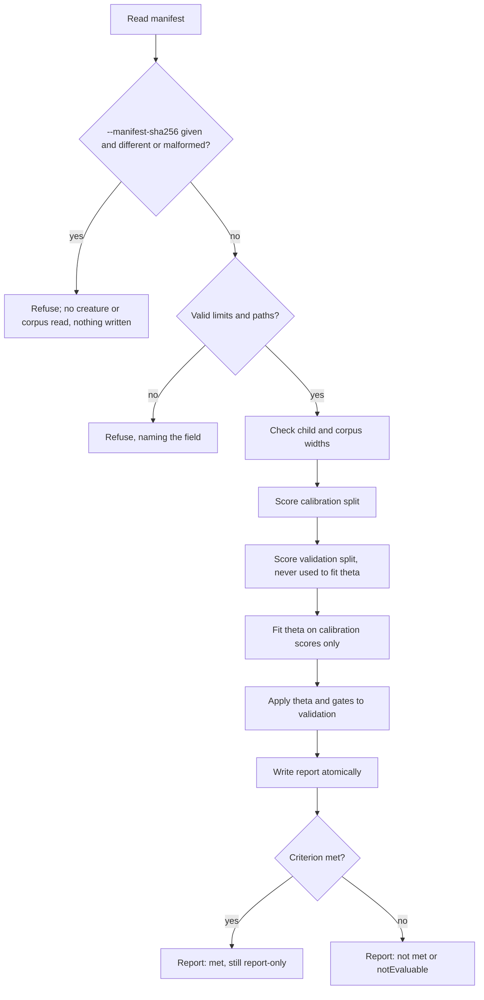

# Preservation audit (report-only)

## Purpose and status

`audit-preservation` tests a hypothesis: a compressed child that keeps its
parent's behaviour on the same records is a better candidate for acceptance
than the sampled error screen alone suggests. The idea comes from
arXiv:2611.13681. The method is pinned to the authors' public toolkit,
`github.com/Praveg432/functional-preservation-score`, commit
`2b716ddb632b6c8674e74615e0b65af3f28c9f17`, file `shared/fps.py` (MIT). The
same definition is eq. 1 of `paper-arxiv/paper.tex` in that repository.
`preservationVsMean` is the paper's `raw` R² score, and `fps` is the paper's
Functional Preservation Score (FPS). The departures from the pinned method are
listed under [Departures from the pinned method](#departures-from-the-pinned-method).

No representative run exists yet. The audit therefore claims no benefit. Its
output is a diagnostic report, nothing more. What a representative run must
contain, and how its result decides whether the command is kept, is fixed in
advance under
[Representative run and retention rule](#representative-run-and-retention-rule-private-not-yet-performed).

## What it never does

- It never changes acceptance, the default run path, or any default flag.
- It never writes a creature. The parent and children are read only.
- It never substitutes for the full scorer. Similarity is not authoritative
  fitness; `fullDelta` remains the only accept evidence.
- Its success rule needs representative runs before it means anything.

## Inputs

Each child is compared with the parent on the same records. A record is one
input vector and one target vector from a corpus of `.bin` files. For each
split, the first `R = min(maxRecords, corpus.record_count)` records are used,
where `K` is the number of outputs.

- `p_rk`, `c_rk`: parent and child outputs on record `r`, output `k`, from
  `neat_core::compile_creature` and `net.activate(inputs, creature.output)`.
- `t_rk`: the target from the corpus.
- `p̄_k`: the parent's mean output on the same split.

Every child must have the parent's input and output widths, and each corpus
must match them. A mismatch is refused, and the error names the child or split.

## Formulas

```text
E_child = (1 / RK) * sum_r sum_k (c_rk - p_rk)^2
E_mean  = (1 / RK) * sum_r sum_k (pbar_k - p_rk)^2
E_shuf(s) = (1 / RK) * sum_r sum_k (p_{pi_s(r),k} - p_rk)^2

preservationVsMean    = 1 - E_child / E_mean
preservationVsShuffle = 1 - E_child / mean_s(E_shuf(s))
fps = clip(1 - E_child / min(E_mean, mean_s(E_shuf(s))), 0, 1)

taskLoss = (1 / RK) * sum_r sum_k (c_rk - t_rk)^2   (parent and child)
```

`pi_s` is a seeded Fisher–Yates permutation of the records, using the crate's
`SplitMix64`. Larger preservation scores mean the child stays closer to the
parent.

`fps` is the paper's score. With `E_shuf = mean_s(E_shuf(s))`, the paper's form
is:

```text
raw(Y)   = 1 - ||Y - Y_ref||^2 / ||Y_ref - mean(Y_ref)||^2     (= preservationVsMean)
raw_null = max(raw(Y_shuffled_ref), raw(mean_pred))             (raw(mean_pred) = 0)
FPS      = clip((raw(Y) - raw_null) / (1 - raw_null), 0, 1)
```

This is algebraically the min form above, and so equals
`clip(min(preservationVsMean, preservationVsShuffle), 0, 1)`. If
`E_shuf < E_mean`, then `raw_null = 1 - E_shuf / E_mean` and
`FPS = 1 - E_child / E_shuf`. Otherwise `raw_null = 0` and `FPS = raw`.
`fpsControl` names the control used: `"shuffle"` only when `E_shuf < E_mean`
strictly, else `"mean"`.

### Degenerate handling

- A denominator that is exactly `0.0`, or below `1e-24`, makes that score
  `null`. The reason is recorded in `degenerate`: `"zeroVarianceParent"` for the
  mean control, `"zeroShuffleError"` for the shuffle control.
- `fps` and `fpsControl` are `null` whenever a `degenerate` reason is present.
- The audit never divides by zero and never emits `NaN` or infinity.
- `collapsedChild` is `true` when every child output column has zero variance on
  the split while the parent does not. Such a child has
  `preservationVsMean <= 0` by construction, and the report says so.
- A non-finite output on any record marks that child with
  `failure: "nonFiniteOutput at record N"`. The child is excluded from the
  comparison and listed in `failures`.

### Departures from the pinned method

- **Degenerate cases.** The paper returns `raw = 1.0` if `ss_res <= 1e-12` and
  `0.0` otherwise when `ss_tot <= 1e-12`, and `fps = 0.0` when
  `1 - raw_null <= 1e-9`. The crate gives `null` plus a `degenerate` reason, and
  never emits a made-up value. Its threshold is `1e-24` on mean errors, not
  `1e-12` on sums.
- **Shuffle null.** The crate uses the mean of `E_shuf` over `shuffleSeeds`
  Fisher–Yates permutations from `SplitMix64`. The paper uses one numpy
  permutation (`default_rng(7)`), redrawn only if it is the identity. The crate
  does not redraw an identity permutation, so a tiny split can give
  `zeroShuffleError`.
- **Records.** A record here is a single input vector. The paper's stimuli are
  time series flattened to rows before scoring, which is the same column-mean
  computation.
- **Intervals.** `ci95` is a bootstrap over records of `preservationVsMean`
  only, using `bootstrapResamples` (the paper uses 10^4 resamples). `fps` has no
  interval.
- **Diagnostic only.** `fps` never enters `theta`, `aucGain` or the criterion.

### Uncertainty

`ci95` is a percentile bootstrap 95% interval (2.5th and 97.5th percentiles) of
`preservationVsMean`. It resamples records, uses `bootstrapResamples`
resamples, and is seeded by `bootstrapSeed`. Per-record sums of squares for the
child and for the mean control are stored so that resampling needs no second
pass over the corpus.

`latencyMsPer1kRecords` is the wall-clock time of the whole streamed pass,
including corpus reading and per-record scoring, not only the activation loop.
It is indicative only and is never used to decide anything.

## Controls

- **Mean-output control.** The parent's mean output on the split is the
  baseline. `E_mean` measures how far the parent's outputs sit from their own
  mean.
- **Record-shuffled control, per seed.** The parent's outputs are paired with
  the wrong records by a seeded permutation. `E_shuf(s)` is computed once per
  seed in `shuffleSeeds`, and the report keeps each value. A child that does no
  better than a shuffled parent has learnt nothing about records.

## Predeclared parameters and compute limits

Fix these before the run. The manifest records them, so the report can be
checked against them afterwards. To show the manifest was not edited after
that, see [Freezing the manifest](#freezing-the-manifest).

| Parameter | Rule |
|---|---|
| `shuffleSeeds` | Required. Non-empty and unique. |
| `bootstrapSeed` | Default `0`. Must not appear in `shuffleSeeds`. |
| `bootstrapResamples` | Default `1000`. Range `100..=100000`. |
| `maxRecords` | Default `4096`. Range `1..=1000000`. Sample size per split. |
| `children` | Range `1..=256`. Names must be unique and non-empty. At least one child per `role`. |
| `children[].role` | Required: `"calibration"` or `"validation"`. |
| `children[].preparationMs` | Optional. Finite and `>= 0`. |
| `sampleTolerance` | Default `0.0`. Finite and `>= 0`. |
| `minAucGain` | Required. Finite. |

`fullDelta` and `sampleDelta` must be finite. `calibration` and `validation`
must not resolve to the same path.

## Freezing the manifest

`--manifest-sha256` freezes the manifest. Record the SHA-256 of the manifest
bytes before the run, then pass that digest to the command:

```bash
sha256sum manifest.json
neat_ai_ockham audit-preservation manifest.json --out report.json \
  --manifest-sha256 <SHA256>
```

Replace `<SHA256>` with the digest recorded before the run. It is 64 hex digits,
in either case. The digest is checked straight after the manifest file is read,
before the manifest is parsed and before any creature or corpus is read. A
malformed value or a mismatch is refused, and nothing is written: no report and
no `<out>.tmp`. A malformed value is echoed in the error, cut to 80 characters.

When the digest matches, the report sets `versions.manifestFrozen` to `true` and
records `versions.manifestSha256`. Without the flag, `manifestFrozen` is `false`.

A freeze proves that the manifest bytes did not change after the digest was
recorded. It does not prove when that happened. The recording time comes from
the operator's own record, so commit the digest (or the manifest) before the run.

## Calibration and validation

The threshold `theta` is fitted on the calibration split only. Both the records
and the children are split: every child carries a `role`. Calibration children,
scored on the calibration corpus, fit `theta`. Validation children, scored on the
validation corpus, are the only ones the gates count. A child has one role, never both.

1. Each calibration `preservationVsMean` score is a candidate `theta`.
2. The chosen `theta` maximises balanced accuracy, `(TPR + TNR) / 2`. A child is
   accepted when its score is at least `theta`, and a child is positive when it
   is genuinely better (`fullDelta > 0`).
3. Ties go to the smallest `theta`.
4. If the calibration split has no better child, or no worse child, or any score
   set is empty, `theta` is `null` and `failures` records
   `"threshold not fittable: <why>"`.

The validation split is scored in the same run, but it never informs `theta`:
`theta` is fixed from the calibration children alone and is then applied to
validation. On validation, the preservation gate rejects a child when its score
is below `theta`. A `null` score counts as not covered: such a child is left out
of `coverage.validationChildrenScored` and `coverage.childrenScored`, and when
any validation child has a `null` score the preservation gate's `rejected`,
`falseRejections` and `falseRejectionRate` are `null` rather than a rate over
children the gate did not judge.

## Gates and the success rule

Two gates are compared on validation: the sample gate and the preservation
gate. The sample gate rejects when `sampleDelta < -sampleTolerance`.

For each gate, the report gives:

- `rejected`: the number of children rejected.
- `falseRejections`: children rejected that are genuinely better.
- `falseRejectionRate`: `falseRejections / betterChildren`. It is `null` when no
  child is better.
- `AUC`: the Mann–Whitney area under the curve (reusing `model::auc`) of the gate's score for
  predicting "better". Ties count as 0.5. It is `null` when undefined.

The report also has `gates.fps.auc`: the AUC of the validation comparison
children's `fps` for predicting "better", computed the same way. It is `null`
when any comparison child's `fps` is `null`. It is diagnostic only: no `theta`
is fitted on `fps`, and it enters neither `aucGain` nor the criterion.

Each child also appears as a paired row, `{name, role, better, fullDelta,
sampleDelta, preservationVsMean, fps, sampleRejects, preservationRejects}`. The
rows hold the paired score distributions. `preservationVsMean` and `fps` are the
child's scores on its own role's corpus. `preservationRejects` is `null` for calibration
children. A bootstrap 95% interval over children (seeded by
`bootstrapSeed`) gives `aucGain = AUC_preservation - AUC_sample`.

The rule is fixed before the run:

- `met` when `aucGain >= minAucGain` **and** the preservation
  `falseRejectionRate` is no greater than the sample `falseRejectionRate`.
- `notEvaluable` when any input is `null`.

Even `met` is only a statement about the fixtures or runs supplied. It is not a
demonstration of benefit until representative runs exist.

## Known limitations and negative findings

- `fullDelta` and `sampleDelta` are supplied in the manifest from earlier scorer
  runs. The audit does not compute them, and it does not run the sampled screen
  in `promote.rs`.
- neat-core clamps non-finite activations, so a NaN or infinite corpus input
  produces a huge finite output, not a non-finite one. The `nonFiniteOutput`
  paths are defensive: the unit test drives them directly. A fixture with a NaN
  input showed that one clamped record dominates every error term. The child
  with a doubled weight still scored `preservationVsMean = 1.0`, the same as
  an exact copy. The score cannot tell children apart when the corpus holds
  such records.
- arxiv.org is still unreachable from this host (`CONNECT tunnel failed,
  response 403` on 2026-11-15), so the method was pinned from the authors'
  toolkit at the commit above rather than from the arXiv PDF.
- Negative finding: the shuffle control is usually about twice the mean control
  on independent records, so `fps` equals `max(preservationVsMean, 0)` unless
  the shuffle error is smaller. On such corpora it adds only the clip at 0 over
  `preservationVsMean`.
- `latencyMsPer1kRecords` times the whole streamed pass, so it includes corpus
  reading and per-record scoring, not only the activation loop.

## Manifest example

```json
{
  "parent": "parent.json",
  "children": [
    { "name": "c1", "creature": "c1.json", "fullDelta": 0.01, "sampleDelta": -0.002,
      "role": "calibration", "preparationMs": 1200 },
    { "name": "c2", "creature": "c2.json", "fullDelta": -0.02, "sampleDelta": 0.001,
      "role": "validation", "preparationMs": 900 }
  ],
  "calibration": "calib-corpus-dir",
  "validation": "valid-corpus-dir",
  "shuffleSeeds": [1, 2, 3],
  "bootstrapSeed": 7,
  "bootstrapResamples": 1000,
  "maxRecords": 4096,
  "sampleTolerance": 0.0,
  "minAucGain": 0.05
}
```

Paths are resolved relative to the manifest's directory when they are relative.
The manifest uses `deny_unknown_fields`, and it is capped at 1 MiB, checked by
metadata before the file is read.

`preparationMs` is the declared cost of producing the child, such as pruning,
search and scorer time. The audit cannot measure that cost itself.

`fullDelta` is the authoritative full-scorer fitness change of the child against
the parent, larger is better, taken from an earlier full-scorer run such as an
Ockham journal. `sampleDelta` is the current sampled screen's change.

## Report fields

The report is written atomically: first to `<out>.tmp`, then renamed. Its
top-level fields are:

- `schema`: `"ockham-preservation-audit/1"`.
- `evidence`: `"fixture-or-unverified"`. It records the status of the
  evidence behind the report.
- `reportOnly`: `"report-only; not a demonstration of benefit"`. This fixed
  sentence is a separate top-level field, not part of `evidence`.
- `method`: the formula text and the source note, which names the pinned
  toolkit commit.
- `versions`: the crate version, `gitCommit` (from `git describe --always
  --dirty` at build time, with `-dirty` for uncommitted edits, or `"unknown"`
  without git),
  SHA-256 of the parent and of each child, the
  identity of each corpus, `manifestSha256` (SHA-256 of the manifest bytes as
  read), and `manifestFrozen` (`true` only when the run was checked against a
  matching `--manifest-sha256`, otherwise `false`).
- `manifest`: an echo of the input manifest.
- `threshold`: the fitted `theta`, or `null`.
- `splits`: `calibration` and `validation`, each with per-child scores for
  every child whatever its role (including `fps` and `fpsControl`). Only a
  child's scores on its own role's split feed `theta`, the gates and its paired
  row. Each split also has `ci95`, `collapsedChild`, `degenerate`, `taskLoss` and
  `latencyMsPer1kRecords`. The split's `parent` entry carries `failure` (a
  non-finite parent output) and `null` task loss and control error when it
  fails.
- `gates`: `sample`, `preservation` and `fps` (diagnostic only).
- `paired`, `aucGain` (value and `ci95`).
- `criterion`: `status` and `rule`.
- `coverage`: children supplied and scored (in total and per role), and
  validation records.
- `costs`: calibration and validation activation milliseconds, `evaluationMs`
  (θ search, gates and the AUC-gain bootstrap), `totalMs` (whole audit wall
  clock), records activated, and `childPreparationMs`. That is the sum of the
  declared `preparationMs`, or `null` unless every child declares one, with
  `childrenWithPreparationCost`.
- `failures`: the refusals that stop a child or the threshold being used. It
  has these kinds of entry: `"<split> child '<name>': nonFiniteOutput at
  record N"` for a child with a non-finite output, `"<split> child '<name>':
  parent nonFiniteOutput at record N (<split> split)"` for every child on a split
  where the parent's output is non-finite (the report is still written), and `"threshold not fittable:
  <why>"` when `theta` cannot be fitted. Degenerate reasons and
  `collapsedChild` are not listed here. They appear on each child's entry under
  `splits`.

## Flow



The flow ends in a report either way. Nothing in it touches the creatures or the
run path.

## Representative run and retention rule (private, not yet performed)

No representative run has been made. The fixtures in the tests only show that
the formulas, controls and gates behave as written; they show no screening
benefit. This section fixes, before any representative run, what such a run
must contain and what its result decides. The command does not check these
conditions: whether a run is representative is the operator's own declaration,
and the report's `evidence` field stays `"fixture-or-unverified"` whatever the
inputs are.

### What counts as representative

- The parent is a mature creature from real use, not a fixture.
- Every child is a pruned or quantised descendant of that parent, saved as a
  creature file. A `--candidate-log` row records a candidate's `sampleDelta`
  and, when the candidate was scored individually on the full corpus, its
  `fullDelta`, both against the incumbent with larger better. The row holds no
  creature, so the child's creature file must come from the operator's own
  record of the cut.
- `fullDelta` comes from the authoritative full scorer and `sampleDelta` from
  the sampled screen the run actually uses, both measured against the same
  parent.
- The calibration and validation corpora are disjoint records from the
  parent's own task.
- Validation holds at least 20 children, at least 5 of them genuinely better
  (`fullDelta > 0`) and at least 5 not. Calibration holds at least one of each,
  so `theta` can be fitted.
- The manifest is frozen with `--manifest-sha256`, and its digest is recorded
  before the run.

### Retention rule

The first complete representative run decides. A later run with a changed
manifest is a new run, and its record must also report the earlier one.

| `criterion.status` | Decision |
|---|---|
| `met` | Keep `audit-preservation` as a report-only diagnostic. Acceptance and every default stay unchanged; using the score in acceptance would need its own controlled experiment. |
| `notMet` | Record the negative finding, then remove `audit-preservation`, its tests and this document, as the #262 soft-gate experiment was retired. |
| `notEvaluable` | No verdict. Fix the inputs that left a value `null` and make a new frozen run. |

### Commands

Run every step on the private host, with the manifest, corpora, creatures and
report in a directory outside any checkout:

```bash
PRIVATE_DIR=/path/outside/any/checkout
mkdir -p "$PRIVATE_DIR"
cargo build --release --locked -p neat_ai_ockham --bin neat_ai_ockham < /dev/null
OCKHAM="${CARGO_TARGET_DIR:-target}/release/neat_ai_ockham"
# Write $PRIVATE_DIR/manifest.json (see Manifest example), then record its digest
# before the run.
SHA=$(sha256sum "$PRIVATE_DIR/manifest.json" | cut -d' ' -f1)
"$OCKHAM" audit-preservation "$PRIVATE_DIR/manifest.json" \
  --out "$PRIVATE_DIR/report.json" --manifest-sha256 "$SHA" < /dev/null
```

`sha256sum` is GNU coreutils; on macOS use `shasum -a 256` instead.

### What may be published

The manifest, the report, child names, paths, corpus identities and the
paired rows stay private. A public record may carry only:
`criterion.status`, `aucGain` (value and `ci95`), the `rejected`,
`falseRejections`, `falseRejectionRate` and `auc` of `gates.sample` and
`gates.preservation`, `gates.fps.auc`, the `coverage` counts,
`costs.totalMs` and `costs.childPreparationMs`, `versions.gitCommit` and
`versions.manifestFrozen`.
