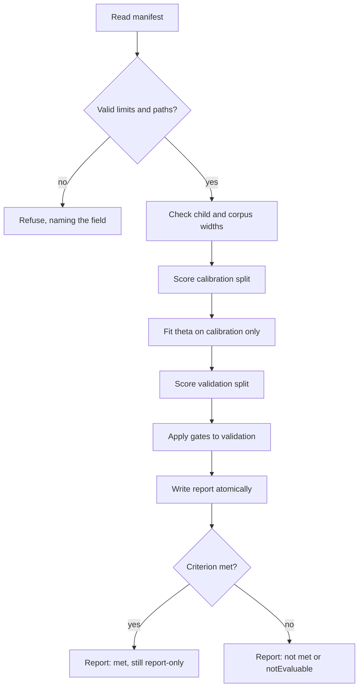

# Preservation audit (report-only)

## Purpose and status

`audit-preservation` tests a hypothesis: a compressed child that keeps its
parent's behaviour on the same records is a better candidate for acceptance
than the sampled error screen alone suggests. The idea comes from
arXiv:2611.13681. Only the abstract was available when this was written; the
full method was not retrieved, so the formulas below are this crate's own
operationalisation, not a transcription of that paper.

No representative run exists yet. The audit therefore claims no benefit. Its
output is a diagnostic report, nothing more.

## What it never does

- It never changes acceptance, the default run path, or any default flag.
- It never writes a creature. The parent and children are read only.
- It never substitutes for the full scorer. Similarity is not authoritative
  fitness; `fullDelta` remains the only accept evidence.
- Its success rule needs representative runs before it means anything.

## Inputs

Each child is compared with the parent on the same records. A record is one
input vector and one target vector from a corpus of `.bin` files. For each
split, the first `R = min(maxRecords, corpus.record_count)` records are used,
where `K` is the number of outputs.

- `p_rk`, `c_rk`: parent and child outputs on record `r`, output `k`, from
  `neat_core::compile_creature` and `net.activate(inputs, creature.output)`.
- `t_rk`: the target from the corpus.
- `p̄_k`: the parent's mean output on the same split.

Every child must have the parent's input and output widths, and each corpus
must match them. A mismatch is refused, and the error names the child or split.

## Formulas

```text
E_child = (1 / RK) * sum_r sum_k (c_rk - p_rk)^2
E_mean  = (1 / RK) * sum_r sum_k (pbar_k - p_rk)^2
E_shuf(s) = (1 / RK) * sum_r sum_k (p_{pi_s(r),k} - p_rk)^2

preservationVsMean    = 1 - E_child / E_mean
preservationVsShuffle = 1 - E_child / mean_s(E_shuf(s))

taskLoss = (1 / RK) * sum_r sum_k (c_rk - t_rk)^2   (parent and child)
```

`pi_s` is a seeded Fisher–Yates permutation of the records, using the crate's
`SplitMix64`. Larger preservation scores mean the child stays closer to the
parent.

### Degenerate handling

- A denominator that is exactly `0.0`, or below `1e-24`, makes that score
  `null`. The reason is recorded in `degenerate`: `"zeroVarianceParent"` for the
  mean control, `"zeroShuffleError"` for the shuffle control.
- The audit never divides by zero and never emits `NaN` or infinity.
- `collapsedChild` is `true` when every child output column has zero variance on
  the split while the parent does not. Such a child has
  `preservationVsMean <= 0` by construction, and the report says so.
- A non-finite output on any record marks that child with
  `failure: "nonFiniteOutput at record N"`. The child is excluded from the
  comparison and listed in `failures`.

### Uncertainty

`ci95` is a percentile bootstrap 95% interval (2.5th and 97.5th percentiles) of
`preservationVsMean`. It resamples records, uses `bootstrapResamples`
resamples, and is seeded by `bootstrapSeed`. Per-record sums of squares for the
child and for the mean control are stored so that resampling needs no second
pass over the corpus.

`latencyMsPer1kRecords` is the wall-clock time of the activation loop. It is
indicative only and is never used to decide anything.

## Controls

- **Mean-output control.** The parent's mean output on the split is the
  baseline. `E_mean` measures how far the parent's outputs sit from their own
  mean.
- **Record-shuffled control, per seed.** The parent's outputs are paired with
  the wrong records by a seeded permutation. `E_shuf(s)` is computed once per
  seed in `shuffleSeeds`, and the report keeps each value. A child that does no
  better than a shuffled parent has learnt nothing about records.

## Predeclared parameters and compute limits

Fix these before the run. The manifest records them, so the report can be
checked against them afterwards.

| Parameter | Rule |
|---|---|
| `shuffleSeeds` | Required. Non-empty and unique. |
| `bootstrapSeed` | Default `0`. Must not appear in `shuffleSeeds`. |
| `bootstrapResamples` | Default `1000`. Range `100..=100000`. |
| `maxRecords` | Default `4096`. Range `1..=1000000`. Sample size per split. |
| `children` | Range `1..=256`. Names must be unique and non-empty. |
| `sampleTolerance` | Default `0.0`. Finite and `>= 0`. |
| `minAucGain` | Required. Finite. |

`fullDelta` and `sampleDelta` must be finite. `calibration` and `validation`
must not resolve to the same path.

## Calibration and validation

The threshold `theta` is fitted on the calibration split only.

1. Each calibration `preservationVsMean` score is a candidate `theta`.
2. The chosen `theta` maximises balanced accuracy, `(TPR + TNR) / 2`. A child is
   accepted when its score is at least `theta`, and a child is positive when it
   is genuinely better (`fullDelta > 0`).
3. Ties go to the smallest `theta`.
4. If the calibration split has no better child, or no worse child, or any score
   set is empty, `theta` is `null` and `failures` records
   `"threshold not fittable: <why>"`.

The validation split is not used until `theta` is fixed. On validation, the
preservation gate rejects a child when its score is below `theta`. A `null`
score counts as not covered.

## Gates and the success rule

Two gates are compared on validation: the sample gate and the preservation
gate. The sample gate rejects when `sampleDelta < -sampleTolerance`.

For each gate, the report gives:

- `rejected`: the number of children rejected.
- `falseRejections`: children rejected that are genuinely better.
- `falseRejectionRate`: `falseRejections / betterChildren`. It is `null` when no
  child is better.
- `AUC`: the Mann–Whitney area under the curve of the gate's score for
  predicting "better". Ties count as 0.5. It is `null` when undefined.

Each child also appears as a paired row, `{name, better, sampleRejects,
preservationRejects}`. A bootstrap 95% interval over children (seeded by
`bootstrapSeed`) gives `aucGain = AUC_preservation - AUC_sample`.

The rule is fixed before the run:

- `met` when `aucGain >= minAucGain` **and** the preservation
  `falseRejectionRate` is no greater than the sample `falseRejectionRate`.
- `notEvaluable` when any input is `null`.

Even `met` is only a statement about the fixtures or runs supplied. It is not a
demonstration of benefit until representative runs exist.

## Manifest example

```json
{
  "parent": "parent.json",
  "children": [
    { "name": "c1", "creature": "c1.json", "fullDelta": 0.01, "sampleDelta": -0.002 }
  ],
  "calibration": "calib-corpus-dir",
  "validation": "valid-corpus-dir",
  "shuffleSeeds": [1, 2, 3],
  "bootstrapSeed": 7,
  "bootstrapResamples": 1000,
  "maxRecords": 4096,
  "sampleTolerance": 0.0,
  "minAucGain": 0.05
}
```

Paths are resolved relative to the manifest's directory when they are relative.
The manifest uses `deny_unknown_fields`, and it is capped at 1 MiB, checked by
metadata before the file is read.

`fullDelta` is the authoritative full-scorer fitness change of the child against
the parent, larger is better, taken from an earlier full-scorer run such as an
Ockham journal. `sampleDelta` is the current sampled screen's change.

## Report fields

The report is written atomically: first to `<out>.tmp`, then renamed. Its
top-level fields are:

- `schema`: `"ockham-preservation-audit/1"`.
- `evidence`: `"fixture-or-unverified"`, with the fixed text
  `"report-only; not a demonstration of benefit"`.
- `method`: the formula text and the source note, which says the abstract only
  was used.
- `versions`: the crate version, SHA-256 of the parent and of each child, and the
  identity of each corpus.
- `manifest`: an echo of the input manifest.
- `threshold`: the fitted `theta`, or `null`.
- `splits`: `calibration` and `validation`, each with per-child scores,
  `ci95`, `collapsedChild`, `degenerate`, `taskLoss` and
  `latencyMsPer1kRecords`.
- `gates`: `sample` and `preservation`.
- `paired`, `aucGain` (value and `ci95`).
- `criterion`: `status` and `rule`.
- `coverage`: children supplied and scored, and validation records.
- `costs`: calibration and validation milliseconds, and records activated.
- `failures`: every refusal or degenerate condition, by name.

## Flow



The flow ends in a report either way. Nothing in it touches the creatures or the
run path.
