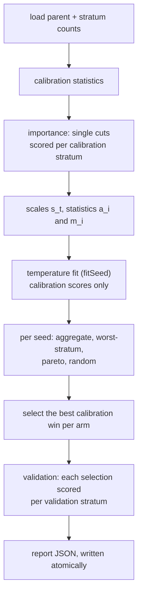

# Stratum-guided pruning experiment (opt-in)

`bench-strata` is an offline benchmark of a pruning-order hypothesis. It is
not a pruning mode: it is opt-in, changes no default, and never accepts or
publishes a creature.

## Purpose

**This is a hypothesis to test, not an established improvement.** Removing
one hidden neuron may hurt a single calibration stratum far more than the
others while barely moving the average. Ordering cuts by their worst-stratum
importance, rather than their aggregate importance, might protect the weakest
stratum. The idea came from the 23 October research shortlist.

The sampler reproduces the formula from the issue:

```text
p_i ∝ exp(−max_t I[t,i] / temperature)
```

### Source paper (full text unread)

The issue cites arXiv:2610.27812. According to search-index excerpts, version
1 is *SliMOO: Interpretable Multi-Objective Evolutionary Search for LLM Depth
Pruning* (Guanchen Li, Yixing Xu, Xuanwu Yin, Dong Li, Emad Barsoum; cs.LG;
submitted 2026-10-20). The issue's own audit had only the abstract.

**The full text has not been read, so the method is not pinned.** On
2026-11-14 the implementation host's proxy refused every fetch of
`arxiv.org/abs/2610.27812`, `arxiv.org/html/2610.27812v1`, OpenReview and
Papers with Code. The notes below come only from web-search result excerpts,
read that day for queries naming `2610.27812`, SliMOO, TLIP and NSGA-II. They
are unverified and may be wrong. Read the paper before relying on them, and
before any reproduction of its method.

A later retry on the same day was refused again, with "proxy refused the
connection", for `arxiv.org/abs/2610.27812`, `arxiv.org/pdf/2610.27812v1`,
`arxiv.org/html/2610.27812`, `export.arxiv.org/abs/2610.27812`, the Semantic
Scholar API, `huggingface.co/papers/2610.27812` and
`paperswithcode.co/paper/129664`. Web-search excerpts again agree with the notes
above, and the method remains unpinned.

A third retry, also on 2026-11-14, got the same result. `curl` got a proxy
`CONNECT` 403 for `arxiv.org/{abs,pdf}/2610.27812`, `export.arxiv.org`, the
Semantic Scholar API, `alphaxiv.org`, `huggingface.co/papers`,
`paperswithcode.co`, `scholar.archive.org` and the `r.jina.ai` reader. The
fetch tool got "proxy refused the connection" for `arxiv.org/abs/2610.27812`,
`arxiv.org/abs/2610.27812v1` and `arxiv.org/html/2610.27812`. The code the
abstract promises, `github.com/AMD-AGI/SliMOO`, returned 404 from the GitHub
API, so the method cannot be pinned from its code either. The only new fact,
again from a search excerpt, is that TLIP profiles with 8,192 tokens per task.
Until someone reads the full text, the reference is
`arXiv:2610.27812v1`, the only version search shows.

The excerpts describe these steps:

- **Probing.** Task-layer importance profiling removes one layer or sublayer
  at a time and records the loss on each task. The result is a task-by-layer
  importance map `I[t,i]`.
- **Prior.** A balanced prior `Î_i = max_t I[t,i]` guides the search. This is
  the statistic this bench calls worst-stratum.
- **Search.** NSGA-II runs over pruning masks at a fixed target sparsity. Its
  initial population mixes prior-guided samples with random feasible masks.
  Each candidate is scored by its deviation from the dense model on every task
  (a vector objective), and kept or dropped by NSGA-II environmental
  selection. The prior narrows exploration. It never stands in for a measured
  score.
- **Temperature.** `τ` adapts to population hypervolume progress. It decays
  after an improvement and rises after stagnation.
- **Final pick.** The final mask is chosen by its hypervolume contribution.

Where those unverified excerpts differ from this bench, the bench is listed
as departing. Each row describes this bench's choice. It does not confirm what
the paper does:

| Paper (unverified excerpts) | This bench |
| --- | --- |
| units are transformer layers or sublayers | units are hidden neurons, cut through core's canonical prune |
| `τ` adapted from hypervolume progress | one `τ` per arm, fitted once from a grid on `fitSeed` calibration bundles |
| NSGA-II over per-task losses | a bounded non-dominated archive on worst-stratum loss, synapses and latency |
| final mask by hypervolume contribution | lowest-loss archived win |
| initial population mixes guided and random masks | separate arms: guided samplers and a uniform `random` control |
| fixed target sparsity | fixed bundle sizes (`bundleSizes`) |

The excerpts give no population size, generation count or exact `τ`
schedule, and none is reproduced here. The report's `method.source` field
records the version, says the full text was not retrieved, and lists these
deviations.

The statistic is scale-normalised per stratum, so strata with different
effect sizes are comparable: `N[t][i] = I[t][i] / s_t`, not raw `I`.

## Predeclared controls

Arms are fixed and reported in this order: `aggregate`, `worst-stratum`,
`pareto`, `random`.

- **aggregate** is the control. It uses the same sampler and temperature fit
  on `a_i = Σ_t w_t N[t][i]`. It therefore differs from worst-stratum only in
  the importance statistic: the aggregate weighted mean rather than the worst
  stratum. It is not Ockham's ordinary pruning loop, which this bench does not
  run.
- **worst-stratum** is the hypothesis: the sampler on `m_i = max_t N[t][i]`.
- **pareto** draws candidates alternately from the aggregate and worst-stratum
  samplers. A deterministic pre-screen, ordered by predicted worst-stratum
  cost, chooses which candidates are full-scored. The scored bundles form a
  non-dominated archive on measured calibration loss, synapses and latency, and
  the selection is the archived win with the lowest loss. Each sampler uses its
  own fitted temperature.
- **random** is the negative control: uniform draws, with equal weights and
  no temperature.

## Seeds, strata and sample size

- `seeds` is a non-empty list of distinct integers. Every arm runs under every
  seed, and the arms of one seed share that seed (common random numbers).
- `fitSeed` drives the temperature fit only. It must not appear in `seeds`.
- Calibration has three to five named strata. Validation names must be exactly
  the same set, and no validation directory may resolve to a calibration one.
- Paired intervals use a seeded percentile bootstrap: 2000 resamples, seeded
  with `fitSeed`. They are `null` with fewer than two seeds.

## Compute limits

- `bundlesPerArm` (default 6) is the number of full calibration evaluations
  each arm spends per seed. Pareto spends
  `min(bundlesPerArm, distinct built candidates)` evaluations, so it may spend
  fewer.
- `paretoCandidates` (default 24) is the number of canonical builds per seed
  for the pareto arm. It must be at least `bundlesPerArm`.
- `bundleSizes` (default `[2, 4]`) cycles across bundles: bundle `j` has size
  `bundleSizes[j % len]`.
- `archiveCap` (default 8) bounds the Pareto archive.
- Scorer calls are counted per phase and per (seed, arm). Importance scores one
  work directory per calibration stratum. The temperature fit scores one
  directory per arm and temperature, per calibration stratum. Evaluation scores
  each full-scored bundle on every calibration stratum. Validation scores one
  directory per validation stratum.

## Success rule

The manifest's `success` block holds the predeclared thresholds:

```json
"success": {"maxFitnessLoss": 0.0, "minRegressionReduction": 1}
```

For each treatment arm (worst-stratum and pareto), compared with aggregate:

- `regressionReduction` is aggregate's minority-stratum regression count minus
  the arm's, counted across seeds.
- `meanFitnessDifference` is the arm's mean validation delta minus aggregate's.
- `met` is true **iff** `regressionReduction >= minRegressionReduction`
  **and** `meanFitnessDifference >= -maxFitnessLoss`.

A minority regression is a validation delta below `-regressionTolerance` on the
minority stratum: the one with the fewest validation records, ties broken by
name. The rule is written as text in each `criteria` entry of the report.

## Calibration and validation

Calibration alone drives every choice: the importance and scales, the sampler
statistics, the temperature fit and selection by full calibration scores.
Before selection, only the metadata of each validation stratum is read: its
corpus identity and record counts. Its records are scored only after every arm
of a seed has made its selection, and no validation score feeds back into a
choice.

## Manifest

The manifest is JSON with camelCase keys, and unknown fields are refused. Its
file size is checked before reading (maximum 1 MiB). Relative paths resolve
against the manifest's directory. This is the full example from the spec:

```json
{
  "parent": "parent.json",
  "calibration": [{"name": "north", "dir": "cal/north"}, {"name": "south", "dir": "cal/south"}, {"name": "rare", "dir": "cal/rare"}],
  "validation":  [{"name": "north", "dir": "val/north"}, {"name": "south", "dir": "val/south"}, {"name": "rare", "dir": "val/rare"}],
  "seeds": [1, 2, 3, 4, 5],
  "fitSeed": 9001,
  "temperatures": [0.25, 0.5, 1.0, 2.0, 4.0],
  "bundleSizes": [2, 4],
  "bundlesPerArm": 6,
  "paretoCandidates": 24,
  "archiveCap": 8,
  "latencyTolerance": 0.05,
  "latencyRecords": 256,
  "statsRecords": 4096,
  "minImprovement": 0.0,
  "regressionTolerance": 0.000001,
  "success": {"maxFitnessLoss": 0.0, "minRegressionReduction": 1}
}
```

Required: `parent`, `calibration`, `validation`, `seeds`, `fitSeed`, `success`.

Defaults: `temperatures` `[0.25, 0.5, 1, 2, 4]`; `bundleSizes` `[2, 4]`;
`bundlesPerArm` 6; `paretoCandidates` 24; `archiveCap` 8; `latencyTolerance`
0.05; `latencyRecords` 256; `statsRecords` 4096 (0 means every record);
`minImprovement` 0.0; `regressionTolerance` 1e-6.

Each of these is refused with an error naming the field:

- calibration count outside 3 to 5; stratum names empty or duplicated;
- validation names not exactly the calibration set; any shared directory;
- `seeds` empty or duplicated; `fitSeed` present in `seeds`;
- `temperatures` empty, or any value not finite and above zero;
- `bundleSizes` empty, or containing 0; `bundlesPerArm` 0;
- `paretoCandidates` below `bundlesPerArm`; `archiveCap` 0; `latencyRecords` 0;
- `latencyTolerance` not finite, negative, or 1 or more;
- `minImprovement`, `regressionTolerance` or `maxFitnessLoss` not finite, or
  negative.

## Method

1. **Load.** The parent is read with `incumbent::load_incumbent`, never
   written, and its sha256 is recorded. Every calibration stratum is inspected
   for record counts and identity. The weight `w_t` is the stratum's share of
   calibration records.
2. **Means.** Activation statistics are measured on each calibration stratum,
   over `statsRecords` records (every record when 0). A neuron's mean is the
   record-weighted average of the stratum means.
3. **Importance.** Each hidden neuron is removed alone. `I[t][i]` is the
   baseline score minus the single-cut score on stratum `t`, so a positive
   value means removal hurts. A refused cut is a failure at stage `importance`,
   and the neuron is excluded from every arm.
4. **Scales.** `s_t` is the median of `|I[t][i]|` over measured neurons, or
   1.0 when that median is not above 1e-12. `N = I / s_t`, and `a_i`, `m_i`
   follow as above.
5. **Sampler.** Each (seed, arm) has one SplitMix64 stream, seeded with the
   seed. A bundle is `k` distinct neurons, drawn without replacement. Each
   draw picks `i` with probability proportional to
   `exp(−(x_i − min remaining x) / τ)`, and `k` is clamped to the candidate
   count.
6. **Temperature fit.** On calibration only, with `fitSeed`, each candidate
   temperature for aggregate and worst-stratum draws `bundlesPerArm` bundles,
   builds them with grouped pruning and scores them once per stratum. The
   criterion is the mean over built bundles of `Σ_t w_t score_t`. A
   temperature with no built bundle scores −∞. The highest criterion wins;
   ties go to the earliest temperature in the list.
7. **Evaluation.** For each seed and arm, bundles are built canonically. A
   refused build is a failure at stage `evaluate` and still uses its slot. The
   calibration delta is `Σ_t w_t score_t(bundle) − Σ_t w_t score_t(parent)`.
   A win has a delta above `minImprovement`. For `aggregate`, `worst-stratum`
   and `random`, the selection is the win with the largest delta, and ties go
   to the lowest index.

   Pareto works in four parts, in order:

   - **Pre-screen.** It draws `paretoCandidates` bundles, alternating the
     aggregate and worst-stratum samplers, and builds each canonically. Exact
     duplicate member sets are dropped, keeping the first. The built candidates
     are ordered by predicted worst-stratum cost `max_t Σ_{i∈B} N[t][i]`, then
     by synapses after the cut, then by sorted members, and the first
     `bundlesPerArm` are kept. This ordering only chooses what is scored; it
     never selects.
   - **Measurement.** Each kept bundle is full-scored on every calibration
     stratum, so the arm spends `min(bundlesPerArm, distinct built candidates)`
     evaluations. Each scored bundle is then timed with the injected latency
     probe.
   - **Archive.** Three measured objectives are minimised: worst-stratum loss
     `max_t (parentScore_t − bundleScore_t)` on calibration, synapses after the
     cut, and latency in milliseconds per record. A dominates B when A's loss
     and synapses are no greater than B's, A's latency is no greater than B's
     times `1 + latencyTolerance`, and at least one of these holds: A's loss is
     lower, A has fewer synapses, or A's latency is below B's times
     `1 − latencyTolerance`. Exact duplicate points keep the first. Over
     `archiveCap`, the lowest by (loss, synapses, latency, members) are kept.
   - **Selection.** Among archived wins (calibration delta above
     `minImprovement`), the lowest worst-stratum loss is chosen. Ties go to the
     larger calibration delta, then to the lowest index. With no archived win
     the arm reports `noChange`. Latency noise can change this choice only
     between exactly tied losses.
8. **Validation.** Once every arm of a seed has selected, the baseline and each
   arm's selected creature are written to one subdirectory and scored once per
   validation stratum. An arm with no win reports `noChange`: delta 0, nothing
   removed, no regression.
9. **Latency.** The probe compiles each creature with
   `neat_core::compile_creature`, activates the first `latencyRecords` records
   of the first calibration stratum three times, and reports the median
   milliseconds per record. The parent's probe runs during preparation, so it
   is counted in `prepMs`. The pareto arm applies the same probe to each scored
   bundle.

## Phases



## Report

The report is camelCase JSON. Its top-level fields are:

- `schema` is `ockham-strata-bench/1`, and `evidence` states that the report is
  data, not a claim.
- `method` holds a short string for each step, including the source note.
- `versions`, `manifest` and `fitted` record the identities, the effective
  manifest with defaults applied, the scales, the chosen temperatures and every
  fit criterion. `versions.neatCoreSource` is the `source` line of the
  `neat-core` package in the workspace `Cargo.lock`, read at compile time so
  that it is compiled into the binary. If that line cannot be found, the run
  fails.
- `coverage` and `costs` record the neurons measured and refused, and the
  preparation time and scorer calls.
- `runs` holds one entry per seed and arm: bundles scored, refusals, wins,
  selection, calibration and validation deltas, per-stratum validation deltas,
  minority regression, removals, latency, timings, scorer calls and
  `winsPerHour`. `archive` holds, for pareto, each archived member as
  `members`, `worstStratumLoss`, `synapses`, `latencyMs`,
  `calibrationDelta` and `win`; it is `null` for the other arms.
  `archiveSize` is set for pareto only.
- `arms` gives, per arm, a distribution of each metric as `Dist` (`n`, `mean`,
  `median`, `min`, `max`, `std`, all `null` when `n` is 0) plus counts.
- `paired` gives per-seed differences, means and 95% intervals for each
  treatment against its control.
- `criteria` gives the success result for each treatment arm.
- `failures` lists each refusal with its `stage`, `seed`, `arm`, `uuid` and
  `detail`.

## Cost accounting

- `prepMs` is the wall time of steps 1 to 6, including the parent latency
  probe from step 9, which every arm shares.
- `winsPerHour` for a (seed, arm) is `wins / hours`, where
  `hours = (armMs + prepMs / (arms × seeds)) / 3.6e6`. Preparation is amortised
  over the four arms. It is `null` when `hours` is zero.
- Wall-clock figures are indicative only. They vary by host and are never
  asserted in tests.

## What the bench never does

- It never accepts, publishes or journals a creature. It never writes the
  learnings cache or the statistics cache.
- It never changes `OckhamConfig` or any default.
- It never modifies the parent, which is loaded immutably.
- It writes creatures only inside its work directory, `<REPORT>.work`. It
  refuses to run if that directory already exists, and removes it at the end
  of the run, on success and on error. A removal failure is reported, never
  ignored.
- The report is written atomically: a temporary file beside it, then a rename.

## Synthetic pilot

`ockham/examples/strata_pilot.rs` writes synthetic inputs for `bench-strata`: a
four-input parent with specialist, shared and dead-wood hidden neurons, four
strata in calibration and validation, and a manifest with seeds 1 to 10. It
refuses an existing directory and never overwrites one. The commands and the
pinned scorer are listed in the
[pilot report](research/strata-pilot-v1/report.md#reproduce). The pilot is
inconclusive, and that report gives the results and their limits.

## Status

No representative run has been made. The fixtures do not demonstrate a
benefit, and the report's `evidence` field says so. A synthetic real-scorer
pilot has since been run; see [Synthetic pilot](#synthetic-pilot). Any
optimisation claim needs representative corpora, which this repository does not
hold.

Findings so far, from the implementation and pilot runs on 2026-11-14:

- **A real-scorer synthetic pilot was run.** The
  [pilot report](research/strata-pilot-v1/report.md) finds tied arms: aggregate,
  worst-stratum and pareto selected the same bundle on every seed. The success
  criterion is not met for either treatment, so the result is inconclusive.
- **Representative runs still need private corpora,** which are not in this
  repository.
- **No benefit is shown.** The fixture-scorer runs in
  `ockham/tests/strata_bench.rs` and the synthetic pilot test the mechanics
  only. The trap fixture is built so that worst-stratum wins, and with uniform
  costs the criterion is not met. The pilot's criterion is also not met. None
  of these is evidence of a benefit.
- **The method is not pinned.** The source paper's full text could not be
  fetched (see "Source paper" above). The bench reproduces the issue's
  formula, and several parts differ from the paper's excerpts.

Removal is still undecided. The synthetic pilot neither shows a benefit nor a
representative negative result. It shows that on a fixture where dead wood is
cheap on every stratum, the worst-stratum statistic makes no difference. The
code stays opt-in. If a representative run shows that worst-stratum ordering
does not earn its keep, remove the code rather than keep it as an option, and
record that result in this section.
